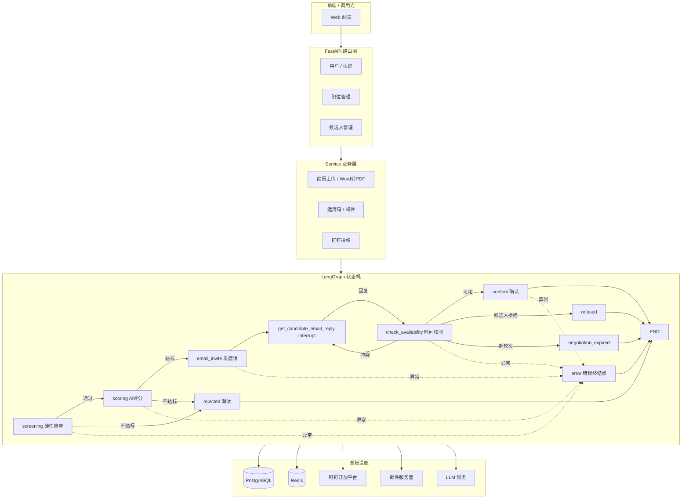

# SimpleJob · AI 智能招聘管理系统

> 基于 **FastAPI + LangGraph** 的全异步招聘后端：把「简历投递 → 硬性筛查 → AI 评分 → 邮件邀约 → 面试时间协商 → 日程确认」全流程自动化，并用状态机 + 检查点保证流程可观测、可恢复、可重试。

---

## ✨ 核心特性

| 特性 | 说明 |
|------|------|
| **LangGraph 状态机工作流** | 招聘流程建模为 `StateGraph`，而非 LLM 黑盒决策；每个阶段是显式节点，流程可见、可调试、可扩展 |
| **人机协作（interrupt / resume）** | `interrupt()` 暂停状态图等待候选人邮件回复，外部调度器拿到回复后 resume 继续执行 |
| **检查点持久化** | `AsyncPostgresSaver` 将状态图检查点写入 PostgreSQL，服务重启后可从断点恢复 |
| **分层异常处理** | 自定义异常层级 + `@node_error_wrapper` 装饰器：业务异常流转到 `error` 节点，基础设施异常穿透到外层统一标记 `PROCESSING_ERROR` |
| **节点元信息保留** | `@wraps` 确保装饰后的节点名、文档字符串不丢失，日志中仍能正确显示 `scoring_node` 而非 `wrapped` |
| **防御性错误终结点** | `error_node` 自身也做 try/catch，即使状态更新失败也保证记录 `critical` 日志，不会二次抛异常 |
| **可配置阈值** | 评分通过阈值、协商轮次上限、面试时间窗口全部通过 `.env` 配置 |
| **AI 多维度评分** | 工作经验 / 技术技能 / 软技能 / 教育背景 / 项目经验五维打分，结构化 JSON 输出并落库 |
| **双模型容错** | 主模型（DeepSeek）+ 备用模型（Qwen），`ModelFallbackMiddleware` 自动降级 |
| **简历解析流水线** | PaddleOCR 识别 + LLM 结构化提取，后台任务 + Redis 状态轮询 |
| **钉钉深度集成** | OAuth2 扫码授权、日历读取空闲时段、自动创建面试日程 |
| **邮件机器人** | 自研异步 IMAP/SMTP 邮件机器人，长连接 + 断线自愈 + 关键词规则监听；收到候选人回复后通过 `Command(resume=...)` 恢复状态图 |
| **JWT 双令牌认证** | Access + Refresh Token，Redis 黑名单吊销，pwdlib Argon2 密码哈希 |
| **结构化日志** | 节点/路由全链路 `candidate_id` 追踪，文件按天轮转 + 错误单独归档 |

---

## 🧱 技术栈

| 层面 | 选型 |
|------|------|
| Web 框架 | FastAPI（异步 OpenAPI 文档自动生成） |
| ORM / 数据库 | SQLAlchemy 2.x AsyncSession + PostgreSQL（连接池 + 预检） |
| 迁移 | Alembic |
| 缓存 | Redis（asyncio 连接池，Token / 任务状态 / 邀请码） |
| AI 框架 | LangGraph（状态图）+ LangChain（Agent / Tool Calling） |
| LLM 接入 | OpenAI 兼容协议（DeepSeek / Qwen） |
| 配置管理 | Pydantic Settings v2（`.env` → 环境变量 → 默认值） |
| 认证 | PyJWT + OAuth2PasswordBearer + pwdlib[argon2] |
| OCR / 文档 | PaddleOCR、PyMuPDF、pywin32（Word→PDF） |
| 邮件 | aiosmtplib、imaplib、APScheduler（轮询调度） |
| 钉钉 | alibabacloud-dingtalk SDK + httpx |
| 日志 | 标准库 logging（文件轮转 + 分级） |

---

## 🏗️ 系统架构



---

## 📂 目录结构

```
simplejob/
├── app/
│   ├── main.py                  # FastAPI 应用入口（生命周期、CORS、全局异常处理器）
│   ├── agents/                  # LangChain Agent 与提示词
│   │   ├── candidate.py         # 候选人流程 Agent（旧模式，保留兼容）
│   │   ├── resume.py            # 简历信息提取 Agent
│   │   ├── prompts.py           # 全部系统提示词
│   │   └── llms.py              # 模型实例
│   ├── core/                    # 基础设施
│   │   ├── config.py            # Pydantic Settings（含招聘阈值）
│   │   ├── db.py                # 异步引擎 / 会话工厂 / BaseModel
│   │   ├── auth.py              # JWT 签发、校验、当前用户依赖
│   │   ├── exceptions.py        # 自定义异常层级
│   │   ├── redis_client.py      # Redis 连接池
│   │   ├── checkpointer.py      # LangGraph 检查点
│   │   ├── logging_config.py    # 日志配置（轮转）
│   │   └── mail.py              # FastMail 事务邮件
│   ├── models/                  # SQLAlchemy ORM 模型
│   ├── schemas/                 # Pydantic 请求/响应模型
│   ├── repository/              # 数据访问层
│   ├── service/                 # 业务逻辑层
│   ├── routers/                 # 路由层
│   ├── tasks/                   # 后台任务（OCR / 邮件 / Agent）
│   └── workflow/                # LangGraph 状态机
│       ├── candidate_graph.py   # 图构建（节点 + 边 + 条件路由）
│       ├── candidate_state.py   # 状态定义（TypedDict）
│       ├── error_handler.py     # @node_error_wrapper + error_node
│       └── candidate_nodes/     # 各阶段节点实现
├── utils/
│   ├── emailbot/                # 自研异步邮件机器人（IMAP/SMTP/解析/规则）
│   ├── available_time.py        # 空闲时段计算算法
│   ├── ORC_ser.py               # PaddleOCR 封装
│   ├── PDFser.py                # Word → PDF 转换
│   └── time_ISO8601_datatime.py # 北京时间工具
├── alembic/                     # 数据库迁移脚本
├── docs/                        # 设计与重构文档
├── upload/                      # 简历文件存储
├── attachments/                 # 邮件附件存储
├── .env                         # 本地配置（已在 .gitignore 中）
├── pyproject.toml
└── README.md
```

---

## 🚀 快速开始

### 环境要求

- Python **≥ 3.13**
- PostgreSQL
- Redis
- [uv](https://docs.astral.sh/uv/)（包管理）

### 1. 安装依赖

```bash
uv sync
```

### 2. 配置环境变量

在项目根目录创建 `.env`（已加入 `.gitignore`，不会提交）：

```env
# 数据库
DB_USERNAME=postgres
DB_PASSWORD=your_password
DB_HOST=127.0.0.1
DB_PORT=5432
DB_NAME=hr_system

# JWT
ACCESS_SECRET=your-access-secret-key-32+
REFRESH_SECRET=your-refresh-secret-key-32+

# Redis
REDIS_HOST=127.0.0.1
REDIS_PORT=6379
REDIS_DB=0

# 邮件（163 邮箱需使用授权码）
MAIL_USERNAME=you@163.com
MAIL_FROM=you@163.com
MAIL_PASSWORD=your_auth_code

# 钉钉
DINGTALK_CLIENT_ID=your_client_id
DINGTALK_CLIENT_SECRET=your_client_secret
BACKEND_BASE_URL=https://your-public-domain

# LLM / OCR
DASHSCOPE_API_KEY=your_api_key
PADDLE_OCR_ACCESS_TOKEN=your_token

# 招聘流程阈值（可选，均有默认值）
SCORE_PASS_THRESHOLD=7
MAX_NEGOTIATION_ROUNDS=3
AM_WINDOW_START_HOUR=9
AM_WINDOW_END_HOUR=12
PM_WINDOW_START_HOUR=14
PM_WINDOW_END_HOUR=18

# 工作流开关：True=LangGraph 状态图，False=旧 Agent 模式
GRAPH_OPEN=True
```

### 3. 初始化数据库

```bash
uv run alembic upgrade head
```

### 4. 初始化种子数据（部门 + 测试账号）

```bash
uv run python init_data.py
```

### 5. 启动服务

```bash
uv run uvicorn app.main:app --reload
```

> Windows 下代码已自动切换 `WindowsSelectorEventLoopPolicy`，解决 psycopg 的 ProactorEventLoop 兼容问题。

访问 `http://127.0.0.1:8000/docs` 查看自动生成的 Swagger 文档。

---

## 🔄 招聘工作流详解

### 节点职责

| 节点 | 类型 | 职责 |
|------|------|------|
| `screening` | 纯规则 | 硬性条件筛查（如最低工作年限），不调用 LLM，零成本过滤 |
| `scoring` | LLM | 五维度评分，结构化 JSON 落库，决定通过/淘汰 |
| `email_invite` | 外部服务 | 读取面试官空闲时段，发送面试邀请邮件 |
| `get_candidate_email_reply` | 中断点 | `interrupt()` 暂停，等待候选人邮件回复后 resume |
| `check_availability` | LLM + 外部服务 | 解析候选人回复的时间意图，对照钉钉日历校验空闲 |
| `confirm` | 外部服务 + DB | 发确认邮件 + 创建钉钉日程 + 创建面试记录 + 更新候选人状态 |
| `rejected` / `refused` | DB | 淘汰 / 候选人拒绝，更新状态 |
| `negotiation_expired` | DB | 超过协商轮次上限，更新状态 |
| `error` | 错误终结点 | 记录错误日志，更新候选人状态为 `PROCESSING_ERROR` |

### 候选人状态机

```
已投递 → AI筛选失败 / AI筛选成功 → 待面试 → 面试通过 / 面试未通过 → 已入职
                                    ↓
                             拒绝面试 / 协商超时 / 处理异常
```

状态只能**单向流转**，在路由层做严格校验。

### 面试时间协商

```
AI 评分通过 → 发邀请邮件（附建议时间）
                    ↓
            候选人回复邮件
          ┌─────────┼─────────┐
       确认原时间  提议新时间   拒绝
          ↓         ↓          ↓
       确认面试   校验面试官空闲  → 结束
                  ┌────┴────┐
                可用       冲突
                 ↓          ↓
              确认面试   通知重选（轮次+1）
                           ↓
                     超轮次上限 → 协商超时
```

---

## 🛡️ 异常处理机制

```
节点函数
  └─ @node_error_wrapper（装饰器）
        ├─ BusinessException（业务异常）
        │     → 返回 error state → 状态图流转到 error 节点
        │     → error_node 更新候选人状态为 PROCESSING_ERROR
        │
        ├─ ExternalServiceError（基础设施异常：LLM / 邮件 / 钉钉）
        │     → 不捕获，向上传播
        │     → run_candidate_agent 外层捕获
        │     → 结构化日志 + 更新候选人状态 + 静默结束（不 re-raise）
        │
        └─ 未知异常
              → 包装为 AppException 后向上传播
```

> **为什么不 re-raise？** `run_candidate_agent` 由 FastAPI `BackgroundTasks` 调用，未捕获异常会被静默丢弃。因此所有异常必须在函数内**完全处理**。

**关键设计：**

| 设计 | 说明 |
|------|------|
| 异常分级 | `BusinessException`（HTTP 400）与 `ExternalServiceError`（HTTP 502）分开处理 |
| 节点安全网 | `@node_error_wrapper` 三层捕获：业务异常→error state，基础设施异常→穿透，未知异常→包装 |
| BackgroundTask 安全 | 外层不 re-raise，改为结构化日志 + 更新状态 + 静默返回 |
| `PROCESSING_ERROR` 状态 | 基础设施故障有明确终态，管理后台可筛选重试 |
| `@wraps` 保留元信息 | 日志中节点名仍为 `scoring_node` 而非 `wrapped` |
| 结构化路由日志 | 每个路由决策记录 `candidate_id` + 上下文 + 目标节点 |
| `error_node` 防御性 | 即使状态更新失败也保证记录 `critical` 日志，不会二次抛异常 |

异常层级详见 [`app/core/exceptions.py`](app/core/exceptions.py)，完整设计文档见 [`docs/error_handling_design.md`](docs/error_handling_design.md)。

---

## ⚙️ 可配置项

| 配置项 | 环境变量 | 默认值 | 说明 |
|--------|----------|--------|------|
| 评分通过阈值 | `SCORE_PASS_THRESHOLD` | 7 | `overall_score > 阈值` 视为通过 |
| 协商轮次上限 | `MAX_NEGOTIATION_ROUNDS` | 3 | 超过则流转到 `negotiation_expired` |
| 上午面试窗口 | `AM_WINDOW_START_HOUR` / `AM_WINDOW_END_HOUR` | 9 / 12 | 用于校验「上午」类模糊时间 |
| 下午面试窗口 | `PM_WINDOW_START_HOUR` / `PM_WINDOW_END_HOUR` | 14 / 18 | 用于校验「下午」类模糊时间 |
| 工作流开关 | `GRAPH_OPEN` | False | `True` 启用 LangGraph 状态图 |
| Access Token 有效期 | `ACCESS_EXPIRE_MINUTES` | 30 | 分钟 |
| Refresh Token 有效期 | `REFRESH_EXPIRE_DAYS` | 7 | 天 |
| 邀请码有效期 | `INVITE_EXPIRE_MINUTES` | 30 | 分钟 |

---

## 🔌 API 概览

| 方法 | 路径 | 说明 |
|------|------|------|
| POST | `/user/token` | 登录（邮箱 + 密码） |
| POST | `/user/refresh` | 刷新 Access Token |
| POST | `/user/logout` | 登出（吊销 Refresh Token） |
| GET | `/user/me` | 当前登录用户 |
| POST | `/user/invite` | 邀请用户（发送邀请码邮件） |
| POST | `/user/register` | 注册（需邀请码） |
| GET | `/user/list` | 员工列表（分页） |
| PATCH | `/user/status/update` | 修改员工状态 |
| GET | `/user/department/list` | 部门列表 |
| GET | `/user/dingtalk/authorize` | 获取钉钉授权 URL |
| GET | `/user/dingtalk/callback` | 钉钉 OAuth 回调 |
| GET | `/user/dingtalk/account` | 获取已绑定的钉钉账号 |
| POST | `/position/create` | 创建职位 |
| GET | `/position/list` | 职位列表 |
| DELETE | `/position/delete/{id}` | 删除职位 |
| POST | `/candidate/resume/upload` | 上传简历（PDF/Word/图片） |
| POST | `/candidate/resume/parse` | 触发简历解析（后台任务） |
| GET | `/candidate/resume/parse/{task_id}` | 查询解析任务状态 |
| POST | `/candidate/create` | 创建候选人（触发招聘流程） |
| GET | `/candidate/list` | 候选人列表（按职位/状态筛选） |
| PATCH | `/candidate/{id}/status` | 更新候选人状态（单向流转校验） |
| GET | `/candidate/ai-score/{id}` | 获取 AI 评分详情 |
| GET | `/candidate/candidate/7d` | 近 7 天新增候选人统计 |

---

## 📧 邮件机器人

`utils/emailbot/` 是一个独立可用的异步邮件机器人，能力包括：

- IMAP 收件 + MIME 解析 + 附件提取
- SMTP 发件（STARTTLS / 隐式 SSL）
- 长连接保活 + 断线自愈 + `asyncio.Lock` 串行化
- UID 游标持久化 + Message-ID 去重（幂等）
- 关键词/附件规则 → 自动回复或提醒

详见 [`utils/emailbot/README.md`](utils/emailbot/README.md)。

---

## 📚 文档

| 文档 | 内容 |
|------|------|
| [`docs/error_handling_design.md`](docs/error_handling_design.md) | 分层异常架构、节点安全网、BackgroundTask 安全、PROCESSING_ERROR、@wraps、结构化日志、error_node 防御性 7 大亮点详解 |
| [`docs/workflow_refactor_plan.md`](docs/workflow_refactor_plan.md) | 从 Agent 重构为 StateGraph 的设计方案（含 Interrupt 审批、批量并行、LangSmith 集成规划） |
| [`docs/workflow_email_integration.md`](docs/workflow_email_integration.md) | 邮件机器人与招聘工作流的集成说明 |
| [`docs/workflow_fixes.md`](docs/workflow_fixes.md) | 工作流历史问题修复记录 |
| [`CHANGES.md`](CHANGES.md) | 阈值配置化 + 异常处理重构的完整改动记录 |
| [`docs/deployment.md`](docs/deployment.md) | 生产部署方案（裸机 / Docker 双版）：环境准备、Nginx/Caddy 配置、systemd、Compose 编排、备份升级、故障排查 |

---

## 🪟 Windows 兼容性

项目对 Windows 开发环境做了专门处理：

- `app/main.py` / `app/core/db.py` 中设置 `WindowsSelectorEventLoopPolicy`，解决 psycopg 在 ProactorEventLoop 下的兼容问题
- 强制 uvicorn 使用 `SelectorEventLoop`
- Word → PDF 转换使用 `pywin32`（仅 Windows 可用）

---


