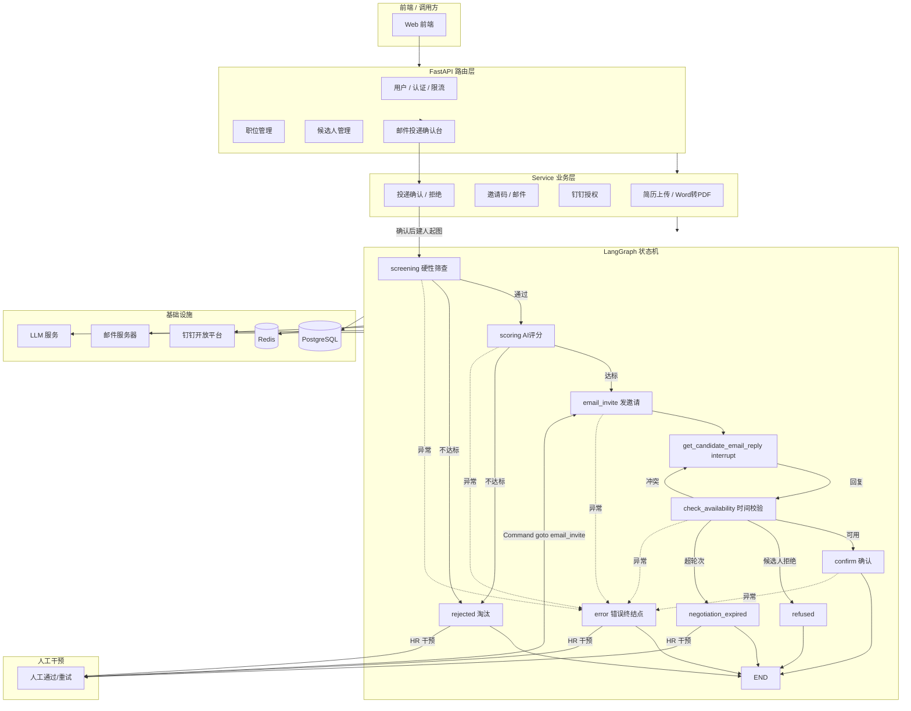

# SimpleJob · AI 智能招聘管理系统

> 基于 **FastAPI + LangGraph** 的全异步招聘后端：把「简历投递 → 硬性筛查 → AI 评分 → 邮件邀约 → 面试时间协商 → 日程确认」全流程自动化，并用状态机 + 检查点保证流程可观测、可恢复、可重试。

---

## ✨ 核心特性

| 特性 | 说明 |
|------|------|
| **LangGraph 状态机工作流** | 招聘流程建模为 `StateGraph`，而非 LLM 黑盒决策；每个阶段是显式节点，流程可见、可调试、可扩展 |
| **人机协作（interrupt / resume）** | `interrupt()` 暂停状态图等待候选人邮件回复，邮件机器人收到回复后 `Command(resume=...)` 继续执行 |
| **检查点持久化** | `AsyncPostgresSaver` 将状态图检查点写入 PostgreSQL，服务重启后可从断点恢复 |
| **分层异常处理** | 自定义异常层级 + `@node_error_wrapper` 装饰器：业务异常流转到 `error` 节点，基础设施异常穿透到外层统一标记 `PROCESSING_ERROR` |
| **人工通过/重试** | HR/管理员可将 `AI筛选失败`/`协商超时`/`处理异常` 的候选人手动触发重试，通过 `Command(goto="email_invite")` 重启协商流程 |
| **超时自动巡检** | 定时扫描「等待候选人回复」超时的流程，自动推进到「协商超时」，无需人工介入 |
| **邮件意图识别** | LLM 识别邮件意图（简历投递 / 面试回复），投递类邮件进入待确认台，避免自动建错人 |
| **人工闸门** | 评分达标后先 `interrupt()` 暂停，由 HR 决定「发送邀请 / 淘汰 / 归档」，避免 AI 自动发信 |
| **状态变更链** | 每次状态变更写入 `candidate_status_history`，用 `next_id` 串成时间链；`archived_at` 表示「图流程走完」，`next_id` 区分归档/结算 |
| **建日程前复核** | 确认面试时间后、创建日程前再查一次该时段是否仍空闲，被占用则轮次归零重新协商 |
| **邮件投递确认台** | HR 在确认台选择职位后，才创建候选人并启动招聘流程 |
| **AI 多维度评分** | 工作经验 / 技术技能 / 软技能 / 教育背景 / 项目经验五维打分，结构化 JSON 输出并落库 |
| **双模型容错** | 主模型（DeepSeek）+ 备用模型（Qwen），`ModelFallbackMiddleware` 自动降级 |
| **简历解析流水线** | PaddleOCR 识别 + LLM 结构化提取，后台任务 + Redis 状态轮询 |
| **钉钉深度集成** | OAuth2 扫码授权、日历读取空闲时段、自动创建面试日程 |
| **邮件机器人** | 自研异步 IMAP/SMTP 邮件机器人，长连接 + 断线自愈 + 关键词规则监听 |
| **JWT 双令牌认证** | Access + Refresh Token，Redis 黑名单吊销，pwdlib Argon2 密码哈希 |
| **登录限流** | 基于 Redis 滑动窗口 + Lua 原子脚本的 IP / 账号双维度限流 |
| **安全审计日志** | 登录、简历下载、删除等敏感操作写入独立 `audit.log`（JSON Lines） |
| **非阻塞结构化日志** | 队列异步落盘，不阻塞业务线程 / 事件循环；节点日志独立归档 |
| **全链路 Request ID** | 每个请求分配 `X-Request-ID`，贯穿日志与审计，便于追踪 |

---

## 🧱 技术栈

| 层面 | 选型 |
|------|------|
| Web 框架 | FastAPI（异步 OpenAPI 文档自动生成） |
| ORM / 数据库 | SQLAlchemy 2.x AsyncSession + PostgreSQL（连接池 + 预检） |
| 迁移 | Alembic |
| 缓存 | Redis（asyncio 连接池，Token / 任务状态 / 邀请码 / 限流） |
| AI 框架 | LangGraph（状态图）+ LangChain（Agent / Tool Calling） |
| LLM 接入 | OpenAI 兼容协议（DeepSeek / Qwen） |
| HTTP 客户端 | httpx（全局复用 `AsyncClient`，连接池 + 超时） |
| 配置管理 | Pydantic Settings v2（`.env` → 环境变量 → 默认值） |
| 认证 | PyJWT + OAuth2PasswordBearer + pwdlib[argon2] |
| OCR / 文档 | PaddleOCR、PyMuPDF、pywin32（Word→PDF） |
| 邮件 | aiosmtplib、imaplib、自研计时循环（`MAIL_POLL_INTERVAL_SECONDS`） |
| 钉钉 | alibabacloud-dingtalk SDK + httpx |
| 日志 | 标准库 logging（QueueHandler 非阻塞 + 文件轮转 + 分级） |
| 测试 | pytest + pytest-asyncio |
| 部署 | uvicorn / gunicorn |

---

## 🏗️ 系统架构



---

## 📂 目录结构

```
simplejob/
├── app/
│   ├── main.py                  # FastAPI 应用入口
│   ├── core/                    # 基础设施
│   │   ├── config.py            # Pydantic Settings（含招聘阈值 / 限流 / 超时）
│   │   ├── db.py                # 异步引擎 / 会话工厂 / BaseModel
│   │   ├── time.py              # 全项目唯一时间出入口（北京时间 / naive 落库 / ISO-8601）
│   │   ├── auth.py              # JWT 签发、校验、权限依赖（HR / 超管）
│   │   ├── exceptions.py        # 自定义异常层级
│   │   ├── exception_handlers.py# 全局异常处理器
│   │   ├── redis_client.py      # Redis 连接池
│   │   ├── checkpointer.py      # LangGraph 检查点（连接池 + 进程级单例）
│   │   ├── http_client.py       # 全局 httpx AsyncClient
│   │   ├── logging_config.py    # 日志配置（非阻塞队列 + 轮转 + 分级）
│   │   ├── audit.py             # 安全审计日志
│   │   ├── rate_limit.py        # Redis 滑动窗口限流
│   │   ├── request_context.py   # 请求上下文（request_id）
│   │   ├── lifespan.py          # 应用生命周期管理
│   │   ├── limiters.py          # 限流键与规则
│   │   └── mail.py              # FastMail 事务邮件
│   ├── middleware/              # 中间件
│   │   ├── cors_middleware.py
│   │   └── request_id_middleware.py
│   ├── agents/                  # LangChain Agent 与提示词
│   │   ├── candidate.py         # 候选人流程 Agent（旧模式，保留兼容）
│   │   ├── resume.py            # 简历信息提取 Agent
│   │   ├── prompts.py           # 全部系统提示词
│   │   └── llms.py              # 模型实例
│   ├── models/                  # SQLAlchemy ORM 模型
│   │   ├── candidate.py         # 候选人 / 简历 / AI 评分
│   │   ├── mail_submission.py   # 邮件投递待确认记录
│   │   ├── mail_review.py       # 意图识别待人工复核
│   │   └── candidate_status_history.py # 候选人状态变更链
│   │   ├── position.py          # 职位
│   │   ├── InterviewModel.py    # 面试记录
│   │   └── user.py              # 用户 / 部门 / 钉钉绑定
│   ├── schemas/                 # Pydantic 请求/响应模型
│   │   ├── intent_schema.py     # 意图/槽位（邮件与图内共用）
│   │   └── ...
│   ├── repository/              # 数据访问层
│   ├── service/                 # 业务逻辑层
│   │   ├── candidate_status_ser.py # 状态流转校验 + 人工重试触发
│   │   ├── mail_submission_ser.py  # 投递确认 / 拒绝
│   │   ├── mail_review_ser.py      # 意图复核：确认意图并执行动作
│   │   └── ...
│   ├── routers/                 # 路由层
│   │   ├── mail_submission_router.py # 邮件投递确认台接口
│   │   ├── mail_review_router.py     # 意图复核接口
│   │   └── ...
│   ├── tasks/                   # 后台任务
│   │   ├── agent_tasks.py       # 招聘流程执行
│   │   ├── ocr_tasks.py         # OCR + LLM 简历解析
│   │   ├── email_tasks.py       # 事务邮件
│   │   ├── timeout_tasks.py     # 邮件回复超时巡检
│   │   ├── mail_submission_tasks.py # 投递超期巡检
│   │   └── periodic_task.py     # 周期任务基类（含分布式锁）
│   └── workflow/                # LangGraph 状态机
│       ├── candidate_graph.py   # 图构建（节点 + 边 + 条件路由）
│       ├── candidate_state.py   # 状态定义（TypedDict）
│       ├── error_handler.py     # @node_error_wrapper + error_node
│       └── candidate_nodes/     # 一个节点一个文件（含 archive/settle 收尾）
├── utils/
│   ├── emailbot/                # 自研异步邮件机器人（IMAP/SMTP/解析/意图/规则）
│   ├── ocr_service.py           # PaddleOCR 云端 API 封装
│   ├── PDFser.py                # Word → PDF 转换
│   └── available_time.py        # 空闲时段计算算法
├── tests/                       # pytest 测试套件（288 个用例）
├── scripts/                     # 运维脚本
│   ├── backup.sh                # 数据库备份
│   ├── deploy.sh                # 部署脚本
│   ├── demo_seed.py             # 演示数据
│   ├── bench_index_compare.py   # 索引性能对比
│   └── ci/smoke.py              # CI 冒烟测试
├── benches/                     # 性能基准数据
├── alembic/                     # 数据库迁移脚本
├── docs/                        # 设计与重构文档
├── hr-frontend/                 # Vue 3 + Element Plus 前端
├── upload/                      # 简历文件存储
├── attachments/                 # 邮件附件存储
├── .env                         # 本地配置（已在 .gitignore 中）
├── gunicorn.conf.py             # gunicorn 部署配置
├── pyproject.toml
└── README.md
```

---

## 🚀 快速开始

### 环境要求

- Python **≥ 3.13**
- PostgreSQL
- Redis
- [uv](https://docs.astral.sh/uv/)（包管理）

### 1. 安装依赖

```bash
uv sync
```

### 2. 配置环境变量

在项目根目录创建 `.env`（已加入 `.gitignore`，不会提交）：

```env
# 数据库
DB_USERNAME=postgres
DB_PASSWORD=your_password
DB_HOST=127.0.0.1
DB_PORT=5432
DB_NAME=hr_system

# JWT
ACCESS_SECRET=your-access-secret-key-32+
REFRESH_SECRET=your-refresh-secret-key-32+

# Redis
REDIS_HOST=127.0.0.1
REDIS_PORT=6379
REDIS_DB=0

# 邮件（163 邮箱需使用授权码）
MAIL_USERNAME=you@163.com
MAIL_FROM=you@163.com
MAIL_PASSWORD=your_auth_code

# 钉钉
DINGTALK_CLIENT_ID=your_client_id
DINGTALK_CLIENT_SECRET=your_client_secret
BACKEND_BASE_URL=https://your-public-domain
FRONTEND_BASE_URL=https://your-domain

# LLM / OCR
DASHSCOPE_API_KEY=your_api_key
PADDLE_OCR_ACCESS_TOKEN=your_token

# 招聘流程阈值（可选，均有默认值）
SCORE_PASS_THRESHOLD=7
MAX_NEGOTIATION_ROUNDS=3
AM_WINDOW_START_HOUR=9
AM_WINDOW_END_HOUR=12
PM_WINDOW_START_HOUR=14
PM_WINDOW_END_HOUR=18

# 邮件回复超时（小时）
EMAIL_REPLY_TIMEOUT_HOURS=48

# 邮件轮询间隔（秒）——独立开关，不跟随 DEBUG
MAIL_POLL_INTERVAL_SECONDS=15

# 登录限流（次/60 秒）
LOGIN_RATE_LIMIT_PER_IP=20
LOGIN_RATE_LIMIT_PER_EMAIL=5

# 工作流开关：True=LangGraph 状态图，False=旧 Agent 模式
GRAPH_OPEN=True

# 节点日志 logger 名（可选，默认 workflow.nodes）
NODE_LOGGER_NAME=workflow.nodes
```

### 3. 初始化数据库

```bash
uv run alembic upgrade head
```

### 4. 初始化种子数据（部门 + 测试账号）

```bash
uv run python init_data.py
```

### 5. 启动服务

```bash
uv run uvicorn app.main:app --reload
```

> Windows 下代码已自动切换 `WindowsSelectorEventLoopPolicy`，解决 psycopg 的 ProactorEventLoop 兼容问题。

访问 `http://127.0.0.1:8000/docs` 查看自动生成的 Swagger 文档。

### 6. 运行测试

```bash
uv run pytest          # 278 个用例，约 8 秒
```

测试不依赖真实数据库 / Redis / 网络：用内存版 Redis 与纯函数覆盖路由、
异常包装、Token 生命周期、意图识别与日志分流。

> **生产部署**（可选）：用 gunicorn，日志由主进程统一接管：
>
> ```bash
> uv run gunicorn app.main:app -c gunicorn.conf.py
> ```

---

## 🔄 招聘工作流详解

### 节点职责

| 节点 | 类型 | 职责 |
|------|------|------|
| `screening` | 纯规则 | 硬性条件筛查（如最低工作年限），不调用 LLM，零成本过滤 |
| `scoring` | LLM | 五维度评分并落库；达标即进入「待人工确认」 |
| `manual_decision` | 人工闸门 | `interrupt()` 暂停，等 HR 选择 发送 / 淘汰 / 归档 |
| `email_invite` | 外部服务 | 读取面试官空闲时段，发送面试邀请邮件 |
| `get_candidate_email_reply` | 中断点 | `interrupt()` 暂停，等待候选人邮件回复后 resume |
| `check_availability` | LLM + 外部服务 | 解析候选人回复的时间意图，对照钉钉日历校验空闲 |
| `confirm` | 外部服务 + DB | 发确认邮件 + 创建钉钉日程 + 创建面试记录 + 更新候选人状态 |
| `recheck_interview_slot` | 外部服务 | 建日程前复核该时段是否仍空闲（并拒绝已过去的时间），被占用则轮次归零重发 |
| `rejected` / `refused` | DB | 淘汰 / 候选人拒绝，更新状态 |
| `negotiation_expired` | DB | 超过协商轮次上限或回复超时，更新状态 |
| `error` | 错误终结点 | 记录错误日志，更新候选人状态为 `PROCESSING_ERROR` |
| `archive` / `settle` | 收尾 | 所有终态强制经过：写 `archived_at` + 链尾 `next_id='-1'`（归档）/ `'-2'`（结算） |
| **人工通过/重试** | HR 干预 | HR 在失败后手动触发，通过 `Command(goto="email_invite")` 重启协商流程 |

### 候选人状态机

```
已投递
  ├─ 筛选/评分未通过 ─→ AI筛选失败 ─┐
  └─ 达标 ─→ 待人工确认（闸门）      │
        ├─ 发送 ─→ 面试时间协商中 ──┤
        │       ├─ 确认时间 ─→ 待面试 → [结算] → END
        │       ├─ 拒绝 ─→ 拒绝面试 ─┤
        │       └─ 轮次耗尽/超时 ─→ 协商超时 ─┤
        ├─ 淘汰 ─→ AI筛选失败 ──────┤
        └─ 归档 ──────────────────┤
     处理异常 ────────────────────┘
              ↓ archive_node（写 archived_at，next_id='-1'）
             END
```

**要点**：
- 评分达标**直接**进入 `待人工确认`（`AI筛选成功` 只作为链上的评分结论保留）；
- 要推进只能走闸门的「发送」；`待人工确认` 不能手动改成「面试时间协商中」——
  那样会绕过闸门且不发邀请（实测导致状态与检查点脱节）；
- 归档与结算**都写 `archived_at`**（语义是「图流程走完」），靠 `next_id` 区分
  `-1`（淘汰/放弃/异常）与 `-2`（正常完成，转人工维护）；
- 重试走 `Command(goto="email_invite")`，并**新建一条链**（旧链保留）。

### 邮件投递确认台

邮件机器人识别到「简历投递」意图后，**不自动建人**，而是落库到待确认台：

```
邮件命中「简历投递」
        ↓
LLM 提取候选人信息 + 推荐职位
        ↓
写入 mail_resume_submissions（PENDING）
        ↓
HR 在确认台选择职位 → 确认
        ↓
创建候选人 + 启动招聘流程
```

### 意图复核台

LLM 判不准（`needs_review` / `AMBIGUOUS`），或**候选人回复了但流程不在等待**时，
邮件落进 `mail_reviews`，由 HR 确认意图并**执行对应动作**：

```
GET  /mail-reviews              列表（待复核/已处理/已忽略）
GET  /mail-reviews/{id}         详情（正文、AI 猜测、判据、证据）
POST /mail-reviews/{id}/resolve {action: execute|ignore, intent?}
```

### 超时自动巡检

```
定时任务（默认每 15 分钟）
        ↓
扫状态变更链：状态=面试时间协商中 + 链上最新（next_id IS NULL）
+ COALESCE(最后来信时间, 变更时间) 超过 48 小时
        ↓
校验中断点身份（必须是「等待候选人回复」）
        ↓
Command(resume=EMAIL_REPLY_TIMEOUT) 恢复状态图
        ↓
negotiation_expired_node → 状态推进到「协商超时」
```

---

## 🛡️ 异常处理机制

```
节点函数
  └─ @node_error_wrapper（装饰器）
        ├─ BusinessException（业务异常）
        │     → 返回 error state → 状态图流转到 error 节点
        │     → error_node 更新候选人状态为 PROCESSING_ERROR
        │
        ├─ ExternalServiceError（基础设施异常：LLM / 邮件 / 钉钉）
        │     → 不捕获，向上传播
        │     → run_candidate_agent 外层捕获
        │     → 结构化日志 + 更新候选人状态 + 静默结束（不 re-raise）
        │
        └─ 未知异常
              → 包装为 AppException 后向上传播
```

> **为什么不 re-raise？** `run_candidate_agent` 由 FastAPI `BackgroundTasks` 调用，未捕获异常会被静默丢弃。因此所有异常必须在函数内**完全处理**。

**关键设计：**

| 设计 | 说明 |
|------|------|
| 异常分级 | `BusinessException`（HTTP 400）与 `ExternalServiceError`（HTTP 502）分开处理 |
| 节点安全网 | `@node_error_wrapper` 三层捕获：业务异常→error state，基础设施异常→穿透，未知异常→包装 |
| BackgroundTask 安全 | 外层不 re-raise，改为结构化日志 + 更新状态 + 静默返回 |
| `PROCESSING_ERROR` 状态 | 基础设施故障有明确终态，管理后台可筛选重试 |
| `@wraps` 保留元信息 | 日志中节点名仍为 `scoring_node` 而非 `wrapped` |
| 结构化路由日志 | 每个路由决策记录 `candidate_id` + 上下文 + 目标节点 |
| `error_node` 防御性 | 即使状态更新失败也保证记录 `critical` 日志，不会二次抛异常 |

异常层级详见 [`app/core/exceptions.py`](app/core/exceptions.py)，完整设计文档见 [`docs/error_handling_design.md`](docs/error_handling_design.md)。

---

## ⚙️ 可配置项

| 配置项 | 环境变量 | 默认值 | 说明 |
|--------|----------|--------|------|
| 评分通过阈值 | `SCORE_PASS_THRESHOLD` | 7 | `overall_score > 阈值` 视为通过 |
| 协商轮次上限 | `MAX_NEGOTIATION_ROUNDS` | 3 | 超过则流转到 `negotiation_expired` |
| 上午面试窗口 | `AM_WINDOW_START_HOUR` / `AM_WINDOW_END_HOUR` | 9 / 12 | 用于校验「上午」类模糊时间 |
| 下午面试窗口 | `PM_WINDOW_START_HOUR` / `PM_WINDOW_END_HOUR` | 14 / 18 | 用于校验「下午」类模糊时间 |
| 邮件回复超时 | `EMAIL_REPLY_TIMEOUT_HOURS` | 48 | 等待候选人回复超过该时长 → 自动流转「协商超时」 |
| 后台巡检调度模式 | 由 `DEBUG` 推导 | — | `DEBUG=True` → 每 15 秒一轮；`False` → 按 `PERIODIC_TASK_DAILY_TIMES` 的每日时刻 |
| 每日执行时刻 | `PERIODIC_TASK_DAILY_TIMES` | `08:00,12:00,17:00,24:00` | 非 debug 环境生效 |
| debug 巡检间隔 | `PERIODIC_TASK_DEV_INTERVAL_SECONDS` | 15 | 秒；仅 `DEBUG=True` 时生效 |
| 邮件轮询间隔 | `MAIL_POLL_INTERVAL_SECONDS` | 15 | 秒；独立开关，不跟随 `DEBUG` |
| 登录限流（IP / 账号） | `LOGIN_RATE_LIMIT_PER_IP` / `LOGIN_RATE_LIMIT_PER_EMAIL` | 20 / 5 | 60 秒滑动窗口内的尝试上限 |
| 工作流开关 | `GRAPH_OPEN` | False | `True` 启用 LangGraph 状态图 |
| 节点日志 logger 名 | `NODE_LOGGER_NAME` | `workflow.nodes` | 决定哪些记录写入 `logs/nodes.log` |
| Access Token 有效期 | `ACCESS_EXPIRE_MINUTES` | 30 | 分钟 |
| Refresh Token 有效期 | `REFRESH_EXPIRE_DAYS` | 7 | 天 |
| 邀请码有效期 | `INVITE_EXPIRE_MINUTES` | 30 | 分钟 |

---

## 📋 日志系统

日志采用「**队列 + 独立监听进程/线程**」架构，业务线程只入队、不直接写盘：

```
logger.info(...) → QueueHandler → 队列 → 监听进程/线程 → 文件
```

- **非阻塞**：调用方只做 `queue.put_nowait`，磁盘 IO 不阻塞业务线程与 asyncio 事件循环
- **分级归档**：`workflow.log`（全量，按天）/ `error.log`（错误，按大小）/ `nodes.log`（节点执行，按天）/ `audit.log`（安全审计，JSON Lines）
- **可追溯**：每个请求分配 `X-Request-ID`，日志里带 `req=<id>`；登录、登出、简历下载、删除等安全操作写入 `audit.log`
- **可配置**：节点 logger 名由 `NODE_LOGGER_NAME` 控制，logger 与分流过滤器同源，改名后路由自动跟随

详见 [`docs/logging_system.md`](docs/logging_system.md)。

---

## 🔌 API 概览

### 用户 / 认证

| 方法 | 路径 | 说明 |
|------|------|------|
| POST | `/user/token` | 登录（邮箱 + 密码，带限流） |
| POST | `/user/refresh` | 刷新 Access Token |
| POST | `/user/logout` | 登出（吊销 Refresh Token） |
| POST | `/user/password` | 修改密码 |
| GET | `/user/me` | 当前登录用户 |
| POST | `/user/invite` | 邀请用户（发送邀请码邮件） |
| POST | `/user/register` | 注册（需邀请码） |
| GET | `/user/list` | 员工列表（分页） |
| PATCH | `/user/status/update` | 修改员工状态 |
| GET | `/user/department/list` | 部门列表 |
| POST | `/user/assign/department` | 给 HR 分配部门 |
| GET | `/user/hr/list` | HR 列表 |
| GET | `/user/dingtalk/authorize` | 获取钉钉授权 URL |
| GET | `/user/dingtalk/callback` | 钉钉 OAuth 回调 |
| GET | `/user/dingtalk/account` | 获取已绑定的钉钉账号 |

### 职位管理

| 方法 | 路径 | 说明 |
|------|------|------|
| POST | `/position/create` | 创建职位 |
| GET | `/position/list` | 职位列表 |
| PATCH | `/position/{id}` | 更新职位 |
| DELETE | `/position/delete/{id}` | 删除职位 |

### 候选人管理

| 方法 | 路径 | 说明 |
|------|------|------|
| POST | `/candidate/resume/upload` | 上传简历（PDF/Word/图片） |
| POST | `/candidate/resume/parse` | 触发简历解析（后台任务） |
| GET | `/candidate/resume/parse/{task_id}` | 查询解析任务状态 |
| POST | `/candidate/create` | 创建候选人（触发招聘流程） |
| GET | `/candidate/list` | 候选人列表（按职位/状态筛选） |
| PATCH | `/candidate/{id}/status` | 更新候选人状态（含人工通过/重试） |
| DELETE | `/candidate/{id}` | 删除候选人（含关联数据） |
| GET | `/candidate/ai-score/{id}` | 获取 AI 评分详情 |
| GET | `/candidate/candidate/7d` | 近 7 天新增候选人统计 |
| GET | `/candidate/{id}/resume` | 下载简历（鉴权） |
| POST | `/candidate/{id}/manual-decision` | 人工决定是否发送面试邀请（唤醒暂停的招聘图） |

### 邮件投递确认台

| 方法 | 路径 | 说明 |
|------|------|------|
| GET | `/mail-submissions` | 投递列表（按状态筛选） |
| GET | `/mail-submissions/{id}` | 投递详情 |
| POST | `/mail-submissions/{id}/confirm` | 确认投递（建人并起图） |
| POST | `/mail-submissions/{id}/reject` | 拒绝投递 |

### 意图复核

| 方法 | 路径 | 说明 |
|------|------|------|
| GET | `/mail-reviews` | 复核列表（按状态筛选，HR/超管） |
| GET | `/mail-reviews/{id}` | 复核详情 |
| POST | `/mail-reviews/{id}/resolve` | 确认意图并执行 / 忽略 |

### 日程

| 方法 | 路径 | 说明 |
|------|------|------|
| GET | `/calendar/events?days=7` | 我的日程（未来 N 天，需绑定钉钉；未绑定返回 400） |

---

## 🧪 测试

```
tests/
├── conftest.py                # 夹具：内存 Redis（含 Lua 语义）/ 临时工作目录
├── test_auth_tokens.py             # Token 生命周期（10）
├── test_bugfixes_1117.py           # 11-17 缺陷修复回归（52）
├── test_cache_control.py           # 接口禁用浏览器缓存（3）
├── test_calendar_events.py         # 日程接口（3）
├── test_candidate_history.py       # 状态变更链 / thread_id / 收尾节点 / 邀请邮件 / 备选时段 / 终态写链 / 权限（21）
├── test_candidate_ownership.py     # 候选人接口归属校验（6）
├── test_change_password.py         # 修改密码（22）
├── test_confirm_branch.py          # 「同意原时间」分支（5）
├── test_email_invite_guard.py      # 邀请节点错误守卫（6）
├── test_email_reply_interrupt.py   # 中断点（3）
├── test_exception_wrapper.py       # 节点异常包装（5）
├── test_graph_routes.py            # 状态图路由（27）
├── test_hardening.py               # 安全加固（6）
├── test_intent.py                  # 意图识别 + evidence 清洗（11）
├── test_llms_lazy.py               # LLM 客户端懒加载 + 构建收敛守卫（5）
├── test_logging_routing.py         # 日志分流（9）
├── test_mail_review.py             # 意图复核（7）
├── test_manual_decision.py         # 人工闸门 / 中断点身份（16）
├── test_negotiation_loop.py        # 协商主链路（8）
├── test_notify_resume_guard.py     # 恢复前校验中断点（3）
├── test_rate_limit.py              # 滑动窗口限流（7）
├── test_recheck_interview_slot.py  # 建日程前复核（6）
├── test_redis_getter.py            # Redis getter 同步化（3）
├── test_scheduler.py               # 后台调度与重试（28）
└── test_time_policy.py             # 时区策略（16）

# 合计 288 个用例
```

## 📧 邮件机器人

`utils/emailbot/` 是一个独立可用的异步邮件机器人，能力包括：

- IMAP 收件 + MIME 解析 + 附件提取
- SMTP 发件（STARTTLS / 隐式 SSL）
- 长连接保活 + 断线自愈 + `asyncio.Lock` 串行化
- UID 游标持久化 + Message-ID 去重（幂等）
- **意图识别**：LLM 区分「简历投递」与「面试回复」
- 关键词/附件规则 → 自动回复或提醒

详见 [`utils/emailbot/README.md`](utils/emailbot/README.md)。

---

## 📚 文档

| 文档 | 内容 |
|------|------|
| [`docs/error_handling_design.md`](docs/error_handling_design.md) | 分层异常架构、节点安全网、BackgroundTask 安全、PROCESSING_ERROR、@wraps、结构化日志、error_node 防御性 |
| [`docs/logging_system.md`](docs/logging_system.md) | 日志系统：非阻塞队列、独立监听、分流与轮转 |
| [`docs/deployment.md`](docs/deployment.md) | 生产部署方案（裸机 / Docker）：Nginx/Caddy、systemd、Compose、备份升级、故障排查 |
| [`docs/technical_highlights.md`](docs/technical_highlights.md) | 技术亮点汇总 |
| [`docs/sql_performance_optimization.md`](docs/sql_performance_optimization.md) | SQL 性能优化与索引设计 |
| [`docs/rate_limiting_plan.md`](docs/rate_limiting_plan.md) | 限流方案设计 |
| [`docs/monitoring-alerting-healthcheck.md`](docs/monitoring-alerting-healthcheck.md) | 监控、告警与健康检查 |
| [`docs/intent_recognition_implementation.md`](docs/intent_recognition_implementation.md) | 邮件意图识别实现 |
| [`docs/periodic_task_refactor.md`](docs/periodic_task_refactor.md) | 周期任务重构（含分布式锁） |
| [`docs/workflow_email_integration.md`](docs/workflow_email_integration.md) | 邮件机器人与招聘工作流的集成说明 |
| [`docs/candidate_status_history_design.md`](docs/candidate_status_history_design.md) | 状态变更链（`candidate_status_history`）设计 |
| [`docs/change2026-11-19.md`](docs/change2026-11-19.md) | 变更记录 11-19（节点拆分、人工闸门、四项事故修复、状态链落地） |
| [`docs/change2026-11-20.md`](docs/change2026-11-20.md) | 变更记录 11-20（流程脱节修复、回复兜底、检查点连接池、四项收尾） |
| [`事故汇总.md`](事故汇总.md) | 21 起事故的现象 / 根因 / 修复 / 教训、5 类共性根因与部署前检查清单 |

---

## 🪟 Windows 兼容性

项目对 Windows 开发环境做了专门处理：

- `app/main.py` / `app/core/db.py` 中设置 `WindowsSelectorEventLoopPolicy`，解决 psycopg 在 ProactorEventLoop 下的兼容问题
- 强制 uvicorn 使用 `SelectorEventLoop`
- Word → PDF 转换使用 `pywin32`（仅 Windows 可用）
