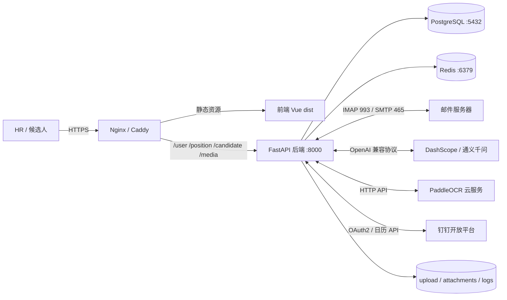

# SimpleJob 部署方案（裸机版 / Docker 版）

> 适用版本：simplejob 0.1.0 ｜ 后端 Python ≥ 3.13 ｜ 前端 Node ≥ 22.18（推荐 24.x）
>
> 本文提供两套可落地方案：
> - **方案一（裸机部署）**：不使用 Docker，直接在 Linux 服务器（或虚拟机）上安装 Python / Node / PostgreSQL / Redis / Nginx，用 systemd 守护进程。
> - **方案二（Docker 部署）**：使用 Docker Compose 编排 后端 + 前端 + PostgreSQL + Redis + Caddy（自动 HTTPS），一条命令完成部署。
>
> 两套方案共用同一份源码与同一份 `.env` 配置，可随时切换。

---

## 目录

- [0. 部署前必读](#0-部署前必读)
- [1. 方案一：裸机部署（不使用 Docker）](#1-方案一裸机部署不使用-docker)
- [2. 方案二：Docker 部署](#2-方案二docker-部署)
- [3. 附录](#3-附录)

---

## 0. 部署前必读

### 0.1 系统架构与端口



| 组件 | 默认端口 | 说明 |
|------|---------|------|
| FastAPI 后端 | `8000` | 裸机建议只监听 `127.0.0.1`，由 Nginx 反代；容器内监听 `0.0.0.0` |
| PostgreSQL | `5432` | 生产环境不要暴露到公网 |
| Redis | `6379` | 存储 Token 黑名单 / 简历解析任务状态 / 邀请码 |
| Nginx / Caddy | `80` / `443` | 前端静态托管 + API 反向代理 + HTTPS |
| 前端 | — | 纯静态站点（`hr-frontend/dist`），由 Nginx/Caddy 托管 |

### 0.2 外部依赖清单（部署前必须已具备）

| 依赖 | 用途 | 配置位置 |
|------|------|---------|
| PostgreSQL | 业务数据 + LangGraph 检查点 | `.env` 中 `DB_*` |
| Redis | 缓存 / 会话 / 任务状态 | `.env` 中 `REDIS_*` |
| 邮件服务器（IMAP+SMTP） | 收发面试邮件、监听候选人回复 | `.env` 中 `MAIL_*` / `IMAP_*` / `SMTP_*` |
| LLM（OpenAI 兼容协议） | AI 简历评分 / 邮件意图解析 | `.env` 中 `DASHSCOPE_API_KEY` |
| PaddleOCR 云服务 | 图片/扫描版简历 OCR | `.env` 中 `PADDLE_OCR_ACCESS_TOKEN` |
| 钉钉开放平台应用 | 扫码授权 / 日历空闲时段 / 创建日程 | `.env` 中 `DINGTALK_*` + `BACKEND_BASE_URL` |
| 公网域名 + HTTPS | 钉钉 OAuth 回调要求公网可达地址 | 域名解析 + 证书 |

### 0.3 六个部署阻塞项（务必先读）

1. **`pywin32` 是 Windows 专属依赖，Linux / Docker 下必须改 `pyproject.toml`**。
   项目 `pyproject.toml` 中 `pywin32>=312` 没有加平台标记，在 Linux 上 `uv sync` / `pip install` 会直接失败（PyPI 上没有 Linux  wheel）。**这是 Linux 部署的第一道硬性修改**，详见 [0.4](#04-部署前代码修改linuxdocker-必需)。

2. **`MAIL_USERNAME` / `MAIL_PASSWORD` / `MAIL_FROM` 是必填项**（`app/core/config.py` 中用 `Field(...)` 声明），缺任意一项服务启动即报 `ValidationError`。163 邮箱的 `MAIL_PASSWORD` 填的是**授权码**，不是登录密码。

3. **前端 API 地址是构建期注入的**。`VITE_API_BASE_URL` 在 `npm run build` 时写死进产物，部署前必须设置。推荐设为**空字符串**（前端与 API 同源，由 Nginx 反代），详见 [1.8](#18-构建前端)。

4. **邮件机器人与多 worker 冲突，生产必须单 worker 运行**。
   邮件机器人（`MailManager`）在 FastAPI `lifespan` 中初始化（`app/main.py:36`），`uvicorn --workers N` 会 fork 出 N 个进程，每个进程都会启动一套独立的 IMAP 长连接 + APScheduler 调度器，造成重复拉取邮件、UID 游标（`mailbot_state.json`）竞争。**裸机用 systemd 启动、Docker 用容器（天然单进程）都默认是单 worker，无需额外配置；但不要手动加 `--workers`。**

5. **Redis 不支持密码认证**（`app/core/redis_client.py` 的连接串中没有密码字段）。生产环境请把 Redis 放在内网 / 容器内网，不要暴露公网；如需密码需自行扩展代码。

6. **LLM 与 OCR 的部分参数硬编码在代码中**，换服务商需要改代码：
   - `app/agents/llms.py:10-28`：`base_url` 硬编码为 `https://maas.qianwenaiapi.com/compatible-mode/v1`，模型名 `deepseek-v4.1-flash` / `qwen3.8-max`，仅 `api_key` 走环境变量 `DASHSCOPE_API_KEY`。
   - `utils/ORC_ser.py:18`：OCR 调用硬编码为 `https://paddleocr.aistudio-app.com/api/v2/ocr/jobs`，仅 `access_token` 走环境变量 `PADDLE_OCR_ACCESS_TOKEN`。

### 0.4 部署前代码修改（Linux/Docker 必需）

修改 `pyproject.toml`，把 `pywin32` 一行改为带平台标记：

```diff
 dependencies = [
     ...
-    "pywin32>=312",
+    "pywin32>=312; sys_platform == 'win32'",
 ]
```

然后重新生成锁文件：

```bash
uv lock
```

> 说明：`utils/PDFser.py` 只在 Windows 分支下才 `import win32com`（懒加载），Linux 下 Word → PDF 走 LibreOffice 后端，因此移除 Linux 的 pywin32 不影响功能。
> **Windows 裸机部署不需要此修改**（保留 pywin32，Word 转 PDF 走 Office COM，需服务器安装 Microsoft Office）。

---

## 1. 方案一：裸机部署（不使用 Docker）

以 **Ubuntu 24.04 LTS** 为例。CentOS / Debian 步骤类似，仅 apt 命令不同。

### 1.1 环境要求

| 软件 | 版本要求 | 备注 |
|------|---------|------|
| Python | ≥ 3.13 | 用 uv 自动安装，无需系统包 |
| Node.js | ^22.18.0 或 ≥ 24.12.0 | 仅构建前端用，运行不需要 |
| PostgreSQL | 14+（推荐 16） | |
| Redis | 6+（推荐 7） | |
| Nginx | 1.18+ | |
| LibreOffice | 任意较新版本 | **仅当需要解析 .doc/.docx 简历时需要**；纯 PDF/图片简历可不装 |
| uv | 最新版 | Python 包管理器 |

### 1.2 安装系统依赖

```bash
# 以 root 或 sudo 执行
sudo apt update && sudo apt upgrade -y

# 基础工具
sudo apt install -y curl git build-essential libpq-dev

# PostgreSQL 16 + Redis
sudo apt install -y postgresql-16 postgresql-client-16 redis-server

# Nginx
sudo apt install -y nginx

# LibreOffice（Word → PDF 转换后端；不需要可跳过）
sudo apt install -y --no-install-recommends libreoffice-writer

# 启动并设置开机自启
sudo systemctl enable --now postgresql redis-server nginx

# 安装 uv（Python 包管理器）
curl -LsSf https://astral.sh/uv/install.sh | sh
# 安装完成后重开终端，或执行：
source $HOME/.local/bin/env

# 用 uv 安装 Python 3.13（不依赖系统源）
uv python install 3.13
```

### 1.3 创建部署用户与目录

```bash
# 创建专用运行用户（不使用 root 跑服务）
sudo useradd -r -m -s /bin/bash simplejob

# 部署目录
sudo mkdir -p /opt/simplejob
sudo chown simplejob:simplejob /opt/simplejob
```

### 1.4 获取源码

```bash
sudo -u simplejob bash
cd /opt/simplejob

# 方式一：git clone（替换为实际仓库地址）
git clone <你的仓库地址> .

# 方式二：从开发机同步（推荐，可排除 .venv / node_modules）
# rsync -avz --exclude .venv --exclude node_modules --exclude .uv-cache \
#   --exclude .uv-python --exclude data --exclude logs \
#   /path/to/simplejob/ simplejob@server:/opt/simplejob/
```

> 同步完成后确认目录属主为 `simplejob:simplejob`。

### 1.5 配置后端环境变量（.env）

在项目根目录创建 `.env`（已加入 `.gitignore`，不会提交）：

```bash
cd /opt/simplejob
sudo -u simplejob vim .env
```

完整内容如下（带注释，可直接修改后使用）：

```env
# ==================== 应用 ====================
DEBUG=False
APP_NAME=SimpleJob
ENVIRONMENT=production

# ==================== 数据库 ====================
DB_USERNAME=simplejob
DB_PASSWORD=your_db_password
DB_HOST=127.0.0.1
DB_PORT=5432
DB_NAME=hr_system

# ==================== JWT（必填，用随机值）====================
# 生成命令：openssl rand -hex 32
ACCESS_SECRET=please-change-me-0123456789abcdef0123456789abcdef
REFRESH_SECRET=please-change-me-fedcba9876543210fedcba9876543210
ALGORITHM=HS256
ACCESS_EXPIRE_MINUTES=30
REFRESH_EXPIRE_DAYS=7

# ==================== Redis ====================
REDIS_HOST=127.0.0.1
REDIS_PORT=6379
REDIS_DB=0

# ==================== 邮件（必填三项）====================
# 163 邮箱：MAIL_PASSWORD 填授权码（设置 → POP3/SMTP/IMAP → 客户端授权密码）
MAIL_USERNAME=you@163.com
MAIL_FROM=you@163.com
MAIL_PASSWORD=your_auth_code

# 集成模式（应用启动时由 MailManager 拉起）只读取以下三项：
# IMAP_HOST 默认 imap.163.com；SMTP_HOST 默认 smtp.163.com；SMTP_PORT 默认 465（隐式 SSL）
# 注意：当前代码未暴露 STARTTLS/QQ邮箱(587) 配置，仅完整支持 163 的 465 隐式 SSL
IMAP_HOST=imap.163.com
SMTP_HOST=smtp.163.com
SMTP_PORT=465

# ==================== 邀请码 ====================
INVITE_EXPIRE_MINUTES=30

# ==================== 钉钉开放平台 ====================
DINGTALK_CLIENT_ID=your_client_id
DINGTALK_CLIENT_SECRET=your_client_secret
# 公网可达的 HTTPS 地址，钉钉 OAuth 回调会打到 {BACKEND_BASE_URL}/user/dingtalk/callback
BACKEND_BASE_URL=https://hr.example.com

# ==================== LLM / OCR ====================
DASHSCOPE_API_KEY=your_dashscope_api_key
PADDLE_OCR_ACCESS_TOKEN=your_paddleocr_token

# ==================== 工作流开关（生产建议 True）====================
GRAPH_OPEN=True

# ==================== 招聘流程阈值（可选）====================
SCORE_PASS_THRESHOLD=7
MAX_NEGOTIATION_ROUNDS=3
AM_WINDOW_START_HOUR=9
AM_WINDOW_END_HOUR=12
PM_WINDOW_START_HOUR=14
PM_WINDOW_END_HOUR=18
```

生成 JWT 密钥：

```bash
openssl rand -hex 32   # 生成 ACCESS_SECRET
openssl rand -hex 32   # 生成 REFRESH_SECRET
```

> **安全提醒**：`.env` 权限设为 600：`sudo -u simplejob chmod 600 /opt/simplejob/.env`

### 1.6 安装 Python 依赖

```bash
cd /opt/simplejob

# 确认已按 0.4 修改 pyproject.toml 并重新 uv lock
uv lock
uv sync                    # 创建 .venv 并安装全部依赖

# 验证（应输出 backend import OK）
uv run python -c "import app.main; print('backend import OK')"
```

### 1.7 初始化数据库

```bash
# 1) 创建数据库与用户（postgres 超级用户下执行）
sudo -u postgres psql <<'SQL'
CREATE USER simplejob WITH PASSWORD 'your_db_password';
CREATE DATABASE hr_system OWNER simplejob;
GRANT ALL PRIVILEGES ON DATABASE hr_system TO simplejob;
SQL

# 2) 执行迁移（项目根目录有 alembic.ini 和 alembic/ 目录）
cd /opt/simplejob
uv run alembic upgrade head
# 正常输出结尾：... Running upgrade  -> ed3f50bb8cea, add error message to candidates.

# 3) 初始化种子数据（8 个部门 + 9 个测试账号）
uv run python init_data.py
# 输出：部门初始化完成 / 用户初始化完成！
```

> ⚠️ `init_data.py` **只能执行一次**：脚本没有做存在性检查，重复执行会插入重复的部门和用户。
> 初始账号：`Boss / 111111`（超管）、`hr / 111111` 等，**上线后请立即修改密码**。

### 1.8 构建前端

```bash
cd /opt/simplejob/hr-frontend

# 安装 Node（NodeSource，Node 24 LTS；也可用 nvm）
# 若构建机与服务器分离，可在任意机器执行构建，把 dist/ 目录传到服务器
curl -fsSL https://deb.nodesource.com/setup_24.x | sudo -E bash -
sudo apt install -y nodejs
node -v   # 应 >= v24.12.0

# 安装依赖（package-lock.json 已随仓库提交，用 npm ci 保证可重复）
npm ci

# 生产环境变量：设为空字符串 = 前端请求与站点同源，由 Nginx 反代到后端
echo 'VITE_API_BASE_URL=' > .env.production

# 构建（type-check + vite build，产物在 dist/）
npm run build
```

构建完成后 `hr-frontend/dist/` 即为前端全部静态文件。

> **为什么设为空字符串**：`src/apis/requests.ts` 中 axios 的 `baseURL` 与该值直接拼接（如 `http.baseURL + '/media/...'`）。留空后所有请求走相对路径，由 Nginx 同源反代，避免跨域与地址硬编码。
> 若前后端不同域名，则填 `https://hr.example.com`，并确保该域名的 `/user`、`/position`、`/candidate`、`/media` 路径反代到后端。

### 1.9 配置 Nginx

创建站点配置：

```bash
sudo vim /etc/nginx/sites-available/simplejob
```

写入以下内容（域名替换为实际域名）：

```nginx
# ========== HTTP：ACME 验证 + 全站跳转 HTTPS ==========
server {
    listen 80;
    server_name hr.example.com;

    # Let's Encrypt 验证目录
    location /.well-known/acme-challenge/ {
        root /var/www/certbot;
    }

    location / {
        return 301 https://$host$request_uri;
    }
}

# ========== HTTPS ==========
server {
    listen 443 ssl;
    server_name hr.example.com;

    # 简历上传大小限制（与后端配合，按需要调整）
    client_max_body_size 50m;

    # ---- SSL 证书（certbot 签发）----
    ssl_certificate     /etc/letsencrypt/live/hr.example.com/fullchain.pem;
    ssl_certificate_key /etc/letsencrypt/live/hr.example.com/privkey.pem;
    include             /etc/letsencrypt/options-ssl-nginx.conf;
    ssl_dhparam         /etc/letsencrypt/ssl-dhparams.pem;

    # ---- 后端 API 反向代理（注意：后端没有 /api 前缀，按路径前缀区分）----
    # 简历文件 /media/*
    location /media/ {
        proxy_pass http://127.0.0.1:8000;
        proxy_set_header Host $host;
        proxy_set_header X-Real-IP $remote_addr;
        proxy_set_header X-Forwarded-For $proxy_add_x_forwarded_for;
        proxy_set_header X-Forwarded-Proto $scheme;
    }

    # 用户 / 认证
    location /user/ {
        proxy_pass http://127.0.0.1:8000;
        proxy_set_header Host $host;
        proxy_set_header X-Real-IP $remote_addr;
        proxy_set_header X-Forwarded-For $proxy_add_x_forwarded_for;
        proxy_set_header X-Forwarded-Proto $scheme;
    }

    # 职位
    location /position/ {
        proxy_pass http://127.0.0.1:8000;
        proxy_set_header Host $host;
        proxy_set_header X-Real-IP $remote_addr;
        proxy_set_header X-Forwarded-For $proxy_add_x_forwarded_for;
        proxy_set_header X-Forwarded-Proto $scheme;
    }

    # 候选人
    location /candidate/ {
        proxy_pass http://127.0.0.1:8000;
        proxy_set_header Host $host;
        proxy_set_header X-Real-IP $remote_addr;
        proxy_set_header X-Forwarded-For $proxy_add_x_forwarded_for;
        proxy_set_header X-Forwarded-Proto $scheme;
    }

    # FastAPI 自动文档（可选，生产可注释掉）
    location /docs {
        proxy_pass http://127.0.0.1:8000;
        proxy_set_header Host $host;
        proxy_set_header X-Real-IP $remote_addr;
        proxy_set_header X-Forwarded-For $proxy_add_x_forwarded_for;
        proxy_set_header X-Forwarded-Proto $scheme;
    }

    location /redoc {
        proxy_pass http://127.0.0.1:8000;
        proxy_set_header Host $host;
        proxy_set_header X-Real-IP $remote_addr;
        proxy_set_header X-Forwarded-For $proxy_add_x_forwarded_for;
        proxy_set_header X-Forwarded-Proto $scheme;
    }

    location = /openapi.json {
        proxy_pass http://127.0.0.1:8000;
        proxy_set_header Host $host;
        proxy_set_header X-Real-IP $remote_addr;
        proxy_set_header X-Forwarded-For $proxy_add_x_forwarded_for;
        proxy_set_header X-Forwarded-Proto $scheme;
    }

    # ---- 前端 SPA（Vue Router history 模式，所有非 API 路径回退 index.html）----
    root /opt/simplejob/hr-frontend/dist;
    index index.html;

    location / {
        try_files $uri $uri/ /index.html;
    }

    # 静态资源长缓存
    location /assets/ {
        expires 30d;
        add_header Cache-Control "public, immutable";
    }
}
```

启用站点并测试配置：

```bash
sudo ln -sf /etc/nginx/sites-available/simplejob /etc/nginx/sites-enabled/simplejob
sudo rm -f /etc/nginx/sites-enabled/default    # 移除默认站点（如有）
sudo nginx -t && sudo systemctl reload nginx
```

申请 Let's Encrypt 证书（先确保域名已解析到本机、80 端口公网可达）：

```bash
sudo apt install -y certbot python3-certbot-nginx
sudo mkdir -p /var/www/certbot
sudo certbot certonly --webroot -w /var/www/certbot -d hr.example.com
# 按提示输入邮箱、同意协议；成功后证书在 /etc/letsencrypt/live/hr.example.com/

# 自动续期（certbot 安装时已带 systemd timer，验证一下）
sudo systemctl list-timers | grep certbot
```

### 1.10 配置 systemd 进程守护

创建服务文件：

```bash
sudo vim /etc/systemd/system/simplejob.service
```

```ini
[Unit]
Description=SimpleJob FastAPI backend
After=network.target postgresql.service redis-server.service
Wants=postgresql.service redis-server.service

[Service]
Type=simple
User=simplejob
Group=simplejob
WorkingDirectory=/opt/simplejob
EnvironmentFile=/opt/simplejob/.env

# 单 worker 运行（重要）：
# MailManager（邮件机器人）在 FastAPI lifespan 中初始化，多 worker 会启动多套
# IMAP 长连接与调度器，造成邮件重复拉取 / 游标竞争。
ExecStart=/opt/simplejob/.venv/bin/uvicorn app.main:app \
    --host 127.0.0.1 \
    --port 8000 \
    --workers 1

Restart=always
RestartSec=3
# 日志同时进 journalctl 与 logs/ 目录
StandardOutput=journal
StandardError=journal

[Install]
WantedBy=multi-user.target
```

启动：

```bash
sudo systemctl daemon-reload
sudo systemctl enable --now simplejob
sudo systemctl status simplejob        # 应显示 active (running)
```

### 1.11 启动与验证

按顺序验证：

```bash
# 1) 后端根路径（应返回 {"message":"Hello World"}）
curl -s http://127.0.0.1:8000/

# 2) FastAPI 文档（应返回 200）
curl -s -o /dev/null -w "%{http_code}\n" http://127.0.0.1:8000/docs

# 3) 登录接口（OAuth2 表单格式，初始账号 Boss / 111111）
curl -s -X POST http://127.0.0.1:8000/user/token \
  -H "Content-Type: application/x-www-form-urlencoded" \
  -d "username=Boss&password=111111"
# 应返回 access_token / refresh_token

# 4) 公网域名（应返回前端 index.html）
curl -s https://hr.example.com/ | head -5

# 5) 公网 API（应返回 200）
curl -s -o /dev/null -w "%{http_code}\n" https://hr.example.com/docs

# 6) 检查邮件机器人是否启动（日志中应有 IMAP 连接/轮询记录）
sudo journalctl -u simplejob -n 100 | grep -iE "imap|mail|mailbot"

# 7) 数据库表是否就绪
sudo -u simplejob psql -h 127.0.0.1 -U simplejob -d hr_system -c "\dt"
```

浏览器访问 `https://hr.example.com`，用 `Boss / 111111` 登录，看到 Dashboard 即部署成功。

### 1.12 日志查看

| 日志 | 位置 | 说明 |
|------|------|------|
| 服务日志（全量） | `logs/workflow.log` | 按天轮转，保留 30 天 |
| 错误日志 | `logs/error.log` | 仅 ERROR，按大小轮转，保留 90 天 |
| 工作流节点日志 | `logs/nodes.json` 同目录 `logs/nodes.log` | 状态图各节点执行记录，按天轮转 |
| systemd 日志 | `journalctl -u simplejob -f` | 控制台输出 |

```bash
# 实时跟踪
sudo tail -f /opt/simplejob/logs/workflow.log
sudo journalctl -u simplejob -f
```

### 1.13 数据备份

```bash
# ==== 数据库备份（每日 cron）====
sudo -u simplejob pg_dump -h 127.0.0.1 -U simplejob -d hr_system -Fc \
  > /backup/hr_system_$(date +%F).dump

# ==== 文件备份（简历 / 邮件附件 / 邮件机器人游标）====
sudo tar -czf /backup/simplejob_files_$(date +%F).tar.gz \
  -C /opt/simplejob upload attachments mailbot_state.json

# ==== 加入 crontab（每天 02:30）====
sudo crontab -e
# 30 2 * * * /opt/simplejob/scripts/backup.sh >> /var/log/simplejob_backup.log 2>&1
```

> Redis 数据（Token 黑名单 / 任务状态 / 邀请码）未纳入备份：丢失后唯一影响是**已登出的 Token 在有效期内可继续使用**，业务数据不受影响。如需备份可定期 `redis-cli BGSAVE` 后备份 `dump.rdb`。

### 1.14 升级流程

```bash
cd /opt/simplejob
sudo -u simplejob git pull

# 1) 依赖与数据库迁移
sudo -u simplejob bash -c 'uv sync && uv run alembic upgrade head'

# 2) 前端有改动时重新构建
cd hr-frontend && npm ci && npm run build && cd ..

# 3) 重启服务
sudo systemctl restart simplejob
sudo systemctl status simplejob
```

### 1.15 Windows Server 差异（简要）

Windows 可以跑，但**生产推荐 Linux 或 Docker**。差异点：

| 步骤 | Windows 做法 |
|------|-------------|
| Python | 官网安装 3.13，或用 `uv python install 3.13` |
| Node | 官网安装 24.x LTS |
| PostgreSQL / Redis | 官方安装包；Redis 官方不支持 Windows，可用 Memurai 或 WSL2 |
| pywin32 | **保留** `pyproject.toml` 原样（不做 0.4 的修改），Word 转 PDF 需安装 Microsoft Office |
| 进程守护 | 用 NSSM 或计划任务，不建议生产使用 |
| 邮件/OCR/LLM | 配置完全相同 |

---

## 2. 方案二：Docker 部署

### 2.1 文件清单与目录规划

在仓库根目录新建以下文件（本文 [2.2](#22-dockerignore) ~ [2.6](#26-docker-composeyml) 给出完整内容，直接创建即可）：

```
simplejob/
├── docker/
│   ├── Dockerfile.backend        # 后端镜像（多阶段）
│   └── Dockerfile.frontend       # 前端构建 + Nginx 镜像
├── docker-compose.yml            # 编排：postgres / redis / app / web / caddy
├── Caddyfile                     # 自动 HTTPS（3 行配置）
├── .dockerignore                  # 排除 .venv / node_modules 等大目录
├── .env                           # 与裸机方案共用同一份配置
└── data/                         # 运行时数据（首次部署前创建）
    ├── upload/
    ├── attachments/
    ├── logs/
    └── mailbot_state.json        # 注意：必须是文件，先 touch
```

前置条件：服务器安装 Docker Engine 24+ 与 Docker Compose v2（`docker compose` 插件形式）。

```bash
# Ubuntu 24.04 安装示例
curl -fsSL https://get.docker.com | sudo sh
sudo systemctl enable --now docker
docker --version        # >= 24
docker compose version  # >= 2.20
```

### 2.2 .dockerignore

```gitignore
# Python
.venv
.uv-cache
.uv-python
**/__pycache__
*.pyc

# 前端
node_modules
dist
**/.vscode
**/.idea

# 运行时数据（由卷挂载提供，不进镜像）
data
logs
upload
attachments
mailbot_state.json

# Git / 编辑器
.git
.gitignore
.idea
.vscode
**/*.md
!README.md
```

> **重要**：不加 `.dockerignore` 会把宿主机 `node_modules`（几百 MB）和 `.venv` 传给构建守护进程，导致构建极慢甚至失败。

### 2.3 Dockerfile.backend

```dockerfile
# ==================== 构建阶段：安装 Python 依赖 ====================
FROM python:3.13-slim AS builder

ENV PYTHONUNBUFFERED=1 \
    PIP_NO_CACHE_DIR=1

RUN pip install --no-cache-dir uv

WORKDIR /app

# 先复制依赖清单，利用 Docker 层缓存（源码变动不触发依赖重装）
COPY pyproject.toml uv.lock ./
RUN uv sync --frozen --no-dev

# 复制源码
COPY . .

# ==================== 运行阶段 ====================
FROM python:3.13-slim AS runtime

# LibreOffice：Word → PDF 转换后端（只接收 PDF/图片简历时可删除以减小镜像体积）
RUN apt-get update \
    && apt-get install -y --no-install-recommends \
        libreoffice-writer-nogui \
        curl \
    && rm -rf /var/lib/apt/lists/*

# 依赖（含全部 wheel，复制即可用）
COPY --from=builder /app/.venv /app/.venv

# 业务代码
COPY app ./app
COPY utils ./utils
COPY alembic ./alembic
COPY alembic.ini ./alembic.ini
COPY templates ./templates
COPY main.py init_data.py check_column.py ./

# 运行时目录（卷挂载点）
RUN mkdir -p /app/upload /app/attachments /app/logs

ENV PATH="/app/.venv/bin:$PATH" \
    PYTHONUNBUFFERED=1 \
    TZ=Asia/Shanghai

WORKDIR /app

EXPOSE 8000

HEALTHCHECK --interval=30s --timeout=5s --start-period=20s --retries=3 \
    CMD curl -fsS http://127.0.0.1:8000/ || exit 1

# 单 worker（原因见 0.3 第 4 条：邮件机器人多进程冲突）
CMD ["uvicorn", "app.main:app", "--host", "0.0.0.0", "--port", "8000", "--workers", "1"]
```

> **说明**：
> - `libreoffice-writer-nogui` 是 Debian 12（bookworm）的无界面精简包；若该包不可用，改为 `libreoffice-writer`。
> - 构建前请确认已按 [0.4](#04-部署前代码修改linuxdocker-必需) 修改 `pyproject.toml` 并重新 `uv lock`，否则 `uv sync --frozen` 会因 pywin32 无 Linux wheel 而失败。

### 2.4 Dockerfile.frontend

```dockerfile
# ==================== 构建阶段 ====================
FROM node:24-alpine AS builder

WORKDIR /web

# 先装依赖（利用层缓存）
COPY hr-frontend/package.json hr-frontend/package-lock.json ./
RUN npm ci

COPY hr-frontend/ ./

# 生产构建：VITE_API_BASE_URL 由构建参数注入（默认空串 = 同源反代）
ARG VITE_API_BASE_URL=""
ENV VITE_API_BASE_URL=${VITE_API_BASE_URL}

RUN npm run build

# ==================== 运行阶段：Nginx 托管静态文件 ====================
FROM nginx:alpine

COPY --from=builder /web/dist /usr/share/nginx/html
COPY docker/nginx.conf /etc/nginx/conf.d/default.conf

EXPOSE 80
```

### 2.5 Nginx 配置（docker/nginx.conf）

```nginx
server {
    listen 80;
    server_name _;

    # 简历上传大小限制
    client_max_body_size 50m;

    # ---- 后端 API 反代 ----
    location /media/ {
        proxy_pass http://app:8000;
        proxy_set_header Host $host;
        proxy_set_header X-Real-IP $remote_addr;
        proxy_set_header X-Forwarded-For $proxy_add_x_forwarded_for;
        proxy_set_header X-Forwarded-Proto $scheme;
    }

    location /user/ {
        proxy_pass http://app:8000;
        proxy_set_header Host $host;
        proxy_set_header X-Real-IP $remote_addr;
        proxy_set_header X-Forwarded-For $proxy_add_x_forwarded_for;
        proxy_set_header X-Forwarded-Proto $scheme;
    }

    location /position/ {
        proxy_pass http://app:8000;
        proxy_set_header Host $host;
        proxy_set_header X-Real-IP $remote_addr;
        proxy_set_header X-Forwarded-For $proxy_add_x_forwarded_for;
        proxy_set_header X-Forwarded-Proto $scheme;
    }

    location /candidate/ {
        proxy_pass http://app:8000;
        proxy_set_header Host $host;
        proxy_set_header X-Real-IP $remote_addr;
        proxy_set_header X-Forwarded-For $proxy_add_x_forwarded_for;
        proxy_set_header X-Forwarded-Proto $scheme;
    }

    location /docs {
        proxy_pass http://app:8000;
        proxy_set_header Host $host;
        proxy_set_header X-Real-IP $remote_addr;
        proxy_set_header X-Forwarded-For $proxy_add_x_forwarded_for;
        proxy_set_header X-Forwarded-Proto $scheme;
    }

    location /redoc {
        proxy_pass http://app:8000;
        proxy_set_header Host $host;
        proxy_set_header X-Real-IP $remote_addr;
        proxy_set_header X-Forwarded-For $proxy_add_x_forwarded_for;
        proxy_set_header X-Forwarded-Proto $scheme;
    }

    location = /openapi.json {
        proxy_pass http://app:8000;
        proxy_set_header Host $host;
        proxy_set_header X-Real-IP $remote_addr;
        proxy_set_header X-Forwarded-For $proxy_add_x_forwarded_for;
        proxy_set_header X-Forwarded-Proto $scheme;
    }

    # ---- 前端 SPA ----
    root /usr/share/nginx/html;
    index index.html;

    location / {
        try_files $uri $uri/ /index.html;
    }

    location /assets/ {
        expires 30d;
        add_header Cache-Control "public, immutable";
    }
}
```

### 2.6 docker-compose.yml

```yaml
name: simplejob

services:
  # ==================== PostgreSQL ====================
  postgres:
    image: postgres:16-alpine
    restart: unless-stopped
    environment:
      POSTGRES_DB: ${DB_NAME:-hr_system}
      POSTGRES_USER: ${DB_USERNAME:-postgres}
      POSTGRES_PASSWORD: ${DB_PASSWORD:?DB_PASSWORD 必须在 .env 中设置}
    volumes:
      - pg_data:/var/lib/postgresql/data
    healthcheck:
      test: ["CMD-SHELL", "pg_isready -U ${DB_USERNAME:-postgres} -d ${DB_NAME:-hr_system}"]
      interval: 5s
      timeout: 3s
      retries: 10
    # 不映射宿主机端口：仅 compose 内网可达，更安全

  # ==================== Redis ====================
  redis:
    image: redis:7-alpine
    restart: unless-stopped
    command: redis-server --appendonly yes   # 开启 AOF 持久化
    volumes:
      - redis_data:/data
    healthcheck:
      test: ["CMD", "redis-cli", "ping"]
      interval: 5s
      timeout: 3s
      retries: 10

  # ==================== FastAPI 后端 ====================
  app:
    build:
      context: .
      dockerfile: docker/Dockerfile.backend
    restart: unless-stopped
    env_file:
      - .env
    environment:
      # compose 内部服务名，优先级高于 env_file 中的 127.0.0.1
      DB_HOST: postgres
      REDIS_HOST: redis
      TZ: Asia/Shanghai
    volumes:
      - ./data/upload:/app/upload
      - ./data/attachments:/app/attachments
      - ./data/logs:/app/logs
      - ./data/mailbot_state.json:/app/mailbot_state.json
    depends_on:
      postgres:
        condition: service_healthy
      redis:
        condition: service_healthy

  # ==================== 前端（Nginx 静态托管 + API 反代）====================
  web:
    build:
      context: .
      dockerfile: docker/Dockerfile.frontend
      args:
        VITE_API_BASE_URL: ${VITE_API_BASE_URL:-}
    restart: unless-stopped
    depends_on:
      - app

  # ==================== Caddy：自动 HTTPS ====================
  caddy:
    image: caddy:2-alpine
    restart: unless-stopped
    ports:
      - "80:80"
      - "443:443"
    volumes:
      - ./Caddyfile:/etc/caddy/Caddyfile:ro
      - caddy_data:/data
      - caddy_config:/config
    depends_on:
      - web

volumes:
  pg_data:
  redis_data:
  caddy_data:
  caddy_config:
```

### 2.7 Caddyfile（自动 HTTPS）

在仓库根目录创建 `Caddyfile`（域名替换为实际域名）：

```
hr.example.com {
    encode zstd
    reverse_proxy web:80
}
```

> Caddy 会自动为 `hr.example.com` 申请并续期 Let's Encrypt 证书，需要：
> 1. 域名已解析到本机公网 IP；
> 2. 本机 80 / 443 端口公网可达（云服务商安全组放行）。
>
> 如果已有证书或不想要 Caddy，可删除 compose 中的 `caddy` 服务，改为把 `web` 的端口映射到宿主机并自行配置 Nginx/证书。

### 2.8 准备 .env 与数据目录

```bash
cd /opt/simplejob   # 或你的部署目录

# 1) 复制裸机方案的 .env 配置（内容相同，见 1.5）
#    注意：DB_HOST / REDIS_HOST 写 127.0.0.1 即可，compose 会用服务名覆盖
vim .env

# 2) 准备数据目录（卷挂载点）
mkdir -p data/upload data/attachments data/logs
touch data/mailbot_state.json      # 必须是文件！否则 Docker 会创建成目录导致启动失败
```

> ⚠️ **卷挂载陷阱**：`./data/mailbot_state.json:/app/mailbot_state.json` 这种文件挂载，若宿主机路径不存在，Docker 会创建一个**同名目录**，容器内应用写文件时报 `Is a directory`。务必先 `touch`。

### 2.9 首次部署步骤

```bash
# 0) 前置：确认已按 0.4 修改 pyproject.toml 并 uv lock（Linux 构建必需）

# 1) 启动基础设施
docker compose up -d postgres redis

# 2) 构建镜像（首次约 3-8 分钟，取决于网络与机器）
docker compose build app web

# 3) 初始化数据库（依赖已 healthy，自动等待）
docker compose run --rm app uv run alembic upgrade head
docker compose run --rm app uv run python init_data.py

# 4) 启动全部服务
docker compose up -d

# 5) 查看状态
docker compose ps
docker compose logs -f app
```

`docker compose run --rm app ...` 会临时启动一个 app 容器执行命令（依赖服务已就绪），执行完自动删除，不影响正在运行的服务。

### 2.10 验证

```bash
# 1) 前端（经 Caddy HTTPS，应返回 index.html）
curl -s https://hr.example.com/ | head -5

# 2) 公网 API 文档（经 web → app 两级反代，应 200）
curl -s -o /dev/null -w "%{http_code}\n" https://hr.example.com/docs

# 3) 登录（初始账号 Boss / 111111）
curl -s -X POST https://hr.example.com/user/token \
  -H "Content-Type: application/x-www-form-urlencoded" \
  -d "username=Boss&password=111111"

# 4) 容器健康状态
docker compose ps
# app / postgres / redis 应显示 (healthy)

# 5) 邮件机器人
docker compose logs app | grep -iE "imap|mailbot|mail_manager"

# 6) 数据库
docker compose exec postgres psql -U simplejob -d hr_system -c "\dt"
```

浏览器访问 `https://hr.example.com`，用 `Boss / 111111` 登录验证。

### 2.11 数据持久化与备份

**持久化清单**（全部在 named volume 或 bind mount 中）：

| 数据 | 位置 | 说明 |
|------|------|------|
| PostgreSQL 数据 | volume `pg_data` | 业务数据 + LangGraph 检查点 |
| Redis 数据 | volume `redis_data`（AOF） | Token 黑名单 / 任务状态 / 邀请码 |
| 简历文件 | `./data/upload` | 简历 PDF/Word/图片 |
| 邮件附件 | `./data/attachments` | 邮件机器人下载的附件 |
| 应用日志 | `./data/logs` | workflow.log / error.log / nodes.log |
| 邮件机器人游标 | `./data/mailbot_state.json` | IMAP UID 游标 + Message-ID 去重 |
| Caddy 证书 | volume `caddy_data` | 自动续期，勿删 |

**备份命令**：

```bash
# 数据库逻辑备份
docker compose exec -T postgres pg_dump -U "${DB_USERNAME:-simplejob}" "${DB_NAME:-hr_system}" \
  | gzip > "backup_db_$(date +%F).sql.gz"

# 文件备份
tar -czf "backup_files_$(date +%F).tar.gz" data/

# 恢复数据库
gunzip -c backup_db_2025-01-01.sql.gz | docker compose exec -T postgres \
  psql -U "${DB_USERNAME:-simplejob}" "${DB_NAME:-hr_system}"
```

### 2.12 日常运维

```bash
# 查看日志
docker compose logs -f app            # 后端
docker compose logs -f web caddy      # 前端 / 证书
docker compose exec app tail -f logs/workflow.log   # 文件日志

# 重启 / 单个服务重启
docker compose restart app
docker compose down && docker compose up -d

# 升级（代码更新后）
git pull
docker compose build                 # 重新构建
docker compose run --rm app uv run alembic upgrade head   # 迁移
docker compose up -d                 # 滚动替换容器

# 回滚（保留旧镜像的前提下）
git checkout <上一版本>
docker compose build && docker compose up -d
# 数据库迁移回滚：uv run alembic downgrade -1（谨慎，先备份）

# 清理（谨慎：会删未使用镜像/卷）
docker compose down -v               # -v 会删除数据卷，生产禁用
```

### 2.13 Docker 版注意事项

| 事项 | 说明 |
|------|------|
| **IMAP 长连接** | 邮件机器人保持 IMAP 长连接，容器网络需能出网访问 `imap.163.com:993` / `smtp.163.com:465`（云服务器注意安全组出站规则） |
| **时区** | 容器已设 `TZ=Asia/Shanghai`；业务时间由代码固定为 UTC+8（`utils/time_ISO8601_datatime.py`），与系统时区无关，日志时间显示为本地时间 |
| **LibreOffice 体积** | 安装 LibreOffice 后镜像约增加 300-500MB；纯 PDF/图片简历场景可删除 Dockerfile.backend 中的 `libreoffice-writer-nogui` |
| **单副本限制** | 如前所述，**不要对 app 服务做水平扩展**（多副本 = 多个邮件机器人）。需要更高并发时，应把邮件机器人拆为独立服务（项目自带 `utils/emailbot/main.py` 独立运行模式） |
| **.env 敏感信息** | `.env` 不进镜像（未 COPY），仅运行时注入；镜像分层中不含密钥 |
| **健康检查** | app 的 HEALTHCHECK 用 `/`（无需认证）；postgres/redis 用各自客户端探测 |
| **首次启动顺序** | `depends_on + condition: service_healthy` 保证 app 等数据库就绪后再启动 |

---

## 3. 附录

### 3.1 环境变量完整参考表

| 变量 | 必填 | 默认值 | 说明 |
|------|:---:|--------|------|
| `DEBUG` | | `False` | 生产必须 False |
| `DB_USERNAME` | ✅ | `postgres` | PostgreSQL 用户名 |
| `DB_PASSWORD` | ✅ | — | PostgreSQL 密码 |
| `DB_HOST` | ✅ | `127.0.0.1` | Docker 中由 compose 覆盖为 `postgres` |
| `DB_PORT` | | `5432` | |
| `DB_NAME` | | `hr_system` | |
| `ACCESS_SECRET` | ✅ | — | JWT Access Token 密钥（≥32 字符随机值） |
| `REFRESH_SECRET` | ✅ | — | JWT Refresh Token 密钥 |
| `ALGORITHM` | | `HS256` | JWT 算法 |
| `ACCESS_EXPIRE_MINUTES` | | `30` | Access Token 有效期（分钟） |
| `REFRESH_EXPIRE_DAYS` | | `7` | Refresh Token 有效期（天） |
| `REDIS_HOST` | ✅ | `localhost` | Docker 中由 compose 覆盖为 `redis` |
| `REDIS_PORT` | | `6379` | |
| `REDIS_DB` | | `0` | |
| `MAIL_USERNAME` | ✅ | — | 发件邮箱账号 |
| `MAIL_PASSWORD` | ✅ | — | 邮箱授权码（非登录密码） |
| `MAIL_FROM` | ✅ | — | 发件人地址（一般与 MAIL_USERNAME 相同） |
| `MAIL_PORT` | | `465` | 事务邮件端口 |
| `MAIL_SERVER` | | `smtp.163.com` | 事务邮件服务器 |
| `IMAP_HOST` | | `imap.163.com` | 邮件机器人收件服务器 |
| `SMTP_HOST` | | `smtp.163.com` | 邮件机器人发件服务器 |
| `SMTP_PORT` | | `465` | 邮件机器人发件端口（465 隐式 SSL） |
| `INVITE_EXPIRE_MINUTES` | | `30` | 邀请码有效期（分钟） |
| `DINGTALK_CLIENT_ID` | | — | 钉钉开放平台应用 Client ID |
| `DINGTALK_CLIENT_SECRET` | | — | 钉钉应用 Client Secret |
| `BACKEND_BASE_URL` | ✅（用钉钉时） | — | 公网 HTTPS 地址，如 `https://hr.example.com` |
| `DASHSCOPE_API_KEY` | ✅ | — | 通义千问 / DashScope API Key（LLM 用） |
| `PADDLE_OCR_ACCESS_TOKEN` | | — | PaddleOCR 云服务 Token |
| `GRAPH_OPEN` | | `False` | **生产建议 `True`**（启用 LangGraph 状态图工作流） |
| `SCORE_PASS_THRESHOLD` | | `7` | AI 评分通过阈值（`overall_score > 阈值` 通过） |
| `MAX_NEGOTIATION_ROUNDS` | | `3` | 面试时间协商轮次上限 |
| `AM_WINDOW_START_HOUR` / `AM_WINDOW_END_HOUR` | | `9` / `12` | 上午面试时间窗口 |
| `PM_WINDOW_START_HOUR` / `PM_WINDOW_END_HOUR` | | `14` / `18` | 下午面试时间窗口 |
| `VITE_API_BASE_URL` | 前端构建时 | — | 生产设为空串（同源反代），见 1.8 |

> 完整字段以 `app/core/config.py` 为准；`.env` 中未声明的字段使用代码默认值。

### 3.2 端口清单

| 端口 | 服务 | 暴露建议 |
|------|------|---------|
| 80 / 443 | Nginx / Caddy | 公网暴露 |
| 8000 | FastAPI | 仅内网 / 127.0.0.1 |
| 5432 | PostgreSQL | 仅内网 / 127.0.0.1 |
| 6379 | Redis | 仅内网 / 127.0.0.1 |
| 993 / 465 | 邮件服务器 | 出站方向（服务器 → 邮件服务商） |

### 3.3 验证命令速查

```bash
# 后端存活
curl -s http://127.0.0.1:8000/                      # {"message":"Hello World"}
curl -s -o /dev/null -w "%{http_code}\n" .../docs    # 200

# 登录（表单格式）
curl -s -X POST .../user/token \
  -H "Content-Type: application/x-www-form-urlencoded" \
  -d "username=Boss&password=111111"

# 带 Token 访问受保护接口
TOKEN=<上一步返回的 access_token>
curl -s .../user/me -H "Authorization: Bearer $TOKEN"

# 数据库
psql -h 127.0.0.1 -U simplejob -d hr_system -c "\dt"
psql -h 127.0.0.1 -U simplejob -d hr_system -c "SELECT count(*) FROM users;"

# Redis
redis-cli -h 127.0.0.1 ping

# 邮件机器人（日志关键字）
grep -iE "imap|mailbot|mail" logs/workflow.log | tail -20
```

### 3.4 故障排查表

| 现象 | 可能原因 | 处理 |
|------|---------|------|
| 启动报 `ValidationError: MAIL_USERNAME/MAIL_PASSWORD/MAIL_FROM` | `.env` 缺必填项 | 按 1.5 补全 |
| `uv sync` / 镜像构建失败：找不到 pywin32 Linux wheel | 未加平台标记 | 按 0.4 修改 `pyproject.toml` 并 `uv lock` |
| 后端启动即退出，日志含 `mailbot` / IMAP 错误 | 邮箱授权码错误 / 端口不通 | 检查 `MAIL_PASSWORD`（授权码）、`IMAP_HOST`、出站 993 端口 |
| 登录接口 401 | 账号密码错误或 Token 过期 | 用初始账号验证；确认 `ACCESS_SECRET` 未在重建后变化（变化会导致已签发 Token 全部失效） |
| 前端页面能开但接口 404 | Nginx 未反代 API 前缀 | 检查 `location /user/`、`/position/`、`/candidate/`、`/media/` 配置 |
| 前端报跨域错误 | `VITE_API_BASE_URL` 指向了不同域名 | 同源部署（空串）；跨域需确认后端 CORS 配置（`app/main.py` 当前为 `allow_origins=["*"]`，允许） |
| 上传 Word 简历后解析失败 | 缺 LibreOffice / Office | Linux 装 LibreOffice；Windows 装 Office + 保留 pywin32 |
| 钉钉授权回调失败 | `BACKEND_BASE_URL` 非公网 HTTPS | 改为公网域名；确认 443 可达、证书有效 |
| 容器内 `mailbot_state.json` 报 `Is a directory` | 宿主机未先 `touch` | 删除错误目录，`touch` 后重新挂载 |
| 时间相关显示差 8 小时 | 系统时区 | 业务时间固定 UTC+8 不受影响；日志时间设置 `TZ=Asia/Shanghai` |
| 上传文件重启后丢失 | 卷未挂载 / 挂载点错误 | 检查 `data/upload` 等卷挂载与目录权限 |
| 收不到候选人邮件回复 | 邮件机器人未启动 / IMAP 断线 | 查看日志；确认容器/服务能出网；`mailbot_state.json` 是否损坏（可备份后清空重试） |

### 3.5 安全加固清单

- [ ] 修改初始账号密码（`Boss` / `hr` 等默认 `111111`）
- [ ] `ACCESS_SECRET` / `REFRESH_SECRET` 使用 `openssl rand -hex 32` 生成，不提交仓库
- [ ] `.env` 权限 600，且不进入 Git（已在 `.gitignore`）
- [ ] `DEBUG=False`
- [ ] PostgreSQL / Redis 不暴露公网（仅监听内网/回环）
- [ ] 全站 HTTPS，HSTS（Caddy 默认开启；Nginx 可加 `add_header Strict-Transport-Security`）
- [ ] 生产关闭 `/docs` `/redoc`（或加 IP 白名单），按需
- [ ] 如前后端分离部署，收紧 CORS（`app/main.py` 中 `allow_origins=["*"]` 改为实际域名）
- [ ] 定期备份数据库与 `data/` 目录（见 1.13 / 2.11）
- [ ] 关注日志 `logs/error.log`，接入告警

### 3.6 常见业务配置

| 需求 | 操作 |
|------|------|
| 启用 LangGraph 状态图工作流 | `.env` 中 `GRAPH_OPEN=True` |
| 调整 AI 评分通过线 | `SCORE_PASS_THRESHOLD`（默认 7，`overall_score > 阈值` 通过） |
| 调整面试协商轮次上限 | `MAX_NEGOTIATION_ROUNDS`（默认 3） |
| 调整面试时间窗口 | `AM_WINDOW_*` / `PM_WINDOW_*`（默认 9-12 点 / 14-18 点） |
| 更换 LLM 服务商 | 修改 `app/agents/llms.py` 中 `base_url` 与 `model`（当前硬编码） |
| 更换 OCR 服务商 | 修改 `utils/ORC_ser.py` 中 `job_url` 与模型名（当前硬编码） |
| 邮件机器人独立部署（多副本场景） | 使用 `utils/emailbot/main.py` 独立运行，避免与 Web 服务同进程 |

---

> 文档对应代码版本：simplejob 0.1.0。如代码更新导致配置项变化，以 `app/core/config.py` 与 `utils/emailbot/config.py` 为准。
