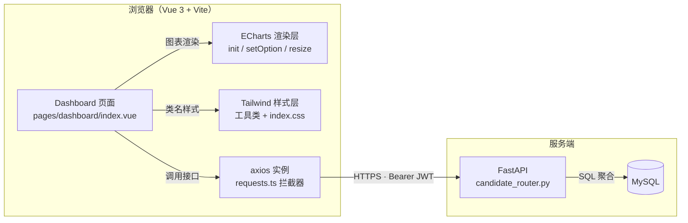
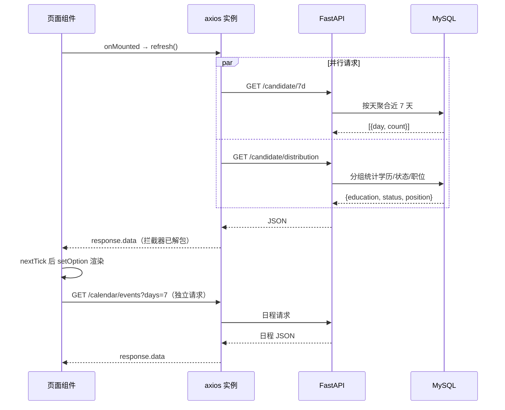
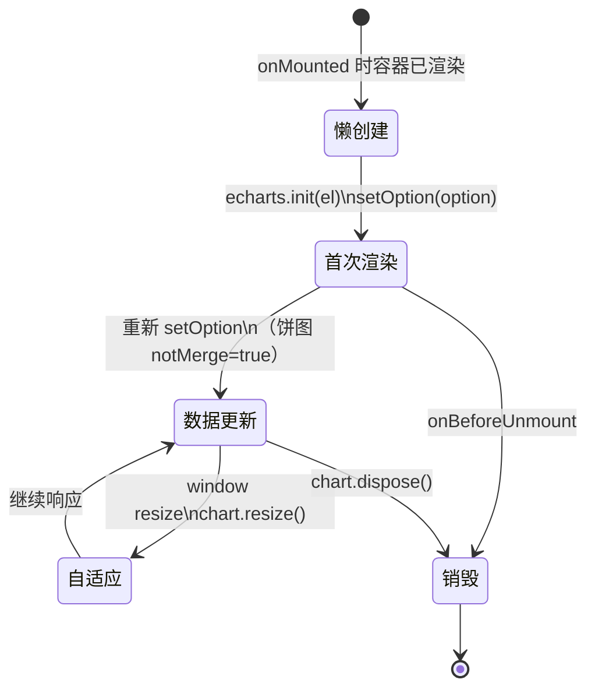

# 前端首页（数据总览）实现教程

> 项目：`hr-frontend`（Vue 3 + Vite + TypeScript）
> 页面：登录后的「首页 / 数据总览」看板（路由 `/dashboard`）
> 技术栈：Vue 3 `<script setup>`、Vue Router、Pinia、axios、**ECharts 6**、**Tailwind CSS 4**、Element Plus

本教程目标：读完你能独立讲清楚这个首页「怎么搭出来的」，并掌握其中 ECharts 与 Tailwind CSS 的用法，能照着改造出一个自己的看板页。

---

## 1. 首页长什么样

页面分为三块（见 `hr-frontend/src/pages/dashboard/index.vue`）：

| 区域 | 内容 | 数据源 |
| --- | --- | --- |
| 上排左侧（2/3 宽） | 近 7 天新增候选人折线图 | `GET /candidate/candidate/7d` |
| 上排右侧（1/3 宽） | 我的日程列表（未来 7 天） | `GET /calendar/events?days=7` |
| 下排（三等分） | 学历分布 / 状态分布 / 职位分布 三个环形饼图 | `GET /candidate/candidate/distribution` |

视觉上是「暗色底 + 光晕/网格背景 + 毛玻璃卡片」，这部分见姊妹篇《毛玻璃与背景特效制作教程》。

---

## 2. 文件地图

| 文件 | 作用 |
| --- | --- |
| `hr-frontend/src/pages/dashboard/index.vue` | **首页本体**：布局、状态、图表渲染、接口调用 |
| `hr-frontend/src/apis/dashboard_api.ts` | 看板两个接口的类型与请求函数 |
| `hr-frontend/src/apis/calendar_api.ts` | 日程接口 |
| `hr-frontend/src/apis/requests.ts` | axios 实例、拦截器（塞 token / 401 刷新） |
| `hr-frontend/src/components/MainLayout.vue` | 登录后外壳：侧边栏 + 顶栏 + `<router-view>` |
| `hr-frontend/src/index.css` | 设计令牌 + 毛玻璃/按钮/面板等组件类 + 暗色覆盖 |
| `hr-frontend/vite.config.ts` | `@tailwindcss/vite` 插件、`@` 别名 |
| `hr-frontend/package.json` | 依赖版本 |
| `app/routers/candidate_router.py` | 后端接口（`/candidate/7d`、`/candidate/distribution`） |
| `app/service/candidate_ser.py` | 分布统计的服务层逻辑 |

---

## 3. 整体架构



要点：

- 页面组件只负责「状态 + 模板 + 把数据喂给 ECharts」，不直接操作 DOM。
- 所有请求走 `requests.ts` 的 axios 实例，请求拦截器自动带 `Authorization: Bearer <accessToken>`。
- 后端接口返回的是**已聚合好的统计数据**，前端不再做二次计算（学历推断在后端 `parse_education` 完成）。

---

## 4. 首屏数据流



对应代码（`dashboard/index.vue` 的 `refresh`）：

```ts
const refresh = async () => {
  loading.value = true
  error.value = null
  try {
    // ① 两个统计接口并行，缩短首屏等待
    const [trend, dist] = await Promise.all([
      getLatest7DaysCandidates(),
      getCandidateDistribution(),
    ])

    // ② 拆成 ECharts 需要的 x / y 数据
    chartDays.value = trend.map((item) => item.day)
    chartCounts.value = trend.map((item) => item.count)

    // ③ 等 DOM 更新后再渲染，保证容器已存在
    await nextTick()
    renderChart()
    renderPies(dist)

    // ④ 日程独立加载：失败只影响右栏，不拖累图表
    await refreshCalendar()
  } catch (err) {
    console.error(err)
    error.value = '获取看板数据失败，请稍后重试。'
  } finally {
    loading.value = false
  }
}
```

> 注意：`requests.ts` 的响应拦截器返回的是 `response.data`，所以业务代码里拿到的直接就是后端 JSON，不用再 `.data` 一层。

---

## 5. Tailwind CSS 使用说明

### 5.1 版本与接入（Tailwind CSS v4）

本项目用的是 **Tailwind CSS v4**，和老版本（v3）最大的区别是「CSS-first」：**不需要 `tailwind.config.js`**，改由 Vite 插件驱动。

`package.json` 关键依赖：

```json
{
  "dependencies": {
    "tailwindcss": "^4.3.4",
    "@tailwindcss/vite": "^4.3.4"
  }
}
```

`vite.config.ts`：

```ts
import tailwindcss from '@tailwindcss/vite'

export default defineConfig({
  plugins: [vue(), vueDevTools(), tailwindcss()], // ← 注册插件
  resolve: {
    alias: { '@': fileURLToPath(new URL('./src', import.meta.url)) },
  },
})
```

`src/index.css` 第一行：

```css
@import 'tailwindcss';
```

这三步就是 v4 的全部接入成本。之后模板里写的 `flex`、`grid`、`gap-4`、`lg:grid-cols-3` 都会被扫描并生成对应 CSS。

### 5.2 设计令牌：一切颜色的唯一来源

`index.css` 顶部用 CSS 变量定义整套暗色视觉（`:root`），模板和组件类都引用它们，改主题只改这一处：

```css
:root {
  --bg-page: #0a0a0a;            /* 页面底色 */
  --brand: #4d6bfe;              /* 品牌蓝（实） */
  --brand-bright: #6799fe;       /* 品牌亮蓝（图表/高亮） */
  --brand-light: #73a3d2;

  --text-primary: #fff;                       /* 主文字 */
  --text-secondary: hsla(0, 0%, 100%, 0.8);   /* 次文字 */
  --text-description: hsla(0, 0%, 100%, 0.55);/* 说明文字 */
  --text-placeholder: hsla(0, 0%, 100%, 0.32);

  --surface-1: hsla(0, 0%, 100%, 0.06);  /* 玻璃表面（强） */
  --surface-2: hsla(0, 0%, 100%, 0.04);  /* 玻璃表面（弱） */
  --border-subtle: hsla(0, 0%, 100%, 0.08);
  --border-default: hsla(0, 0%, 100%, 0.12);

  --radius-card: 24px;
  --radius-panel: 16px;
  --radius-input: 10px;
}
```

首页里那些 `text-desc`、`text-strong`、`text-brand` 就是基于这些变量封装的语义类：

```css
.text-desc   { color: var(--text-description); }
.text-muted  { color: var(--text-placeholder); }
.text-strong { color: var(--text-primary); }
.text-brand  { color: var(--brand-bright); }
```

> 经验：**不要把 `#4d6bfe`、`hsla(0,0%,100%,.55)` 这类字面量散落在模板里**。抽成变量后，换主题/调对比度只需要改 `:root`。

### 5.3 工具类：搭布局骨架

首页的主体结构几乎全靠 Tailwind 工具类表达（`dashboard/index.vue`）：

```html
<!-- 页面容器：内边距 + 纵向间距 -->
<div class="page-panel space-y-4">

  <!-- 标题行：两端对齐 -->
  <div class="flex items-center justify-between">
    <h1 class="page-title">数据总览</h1>
    <button class="btn btn-secondary" :disabled="loading" @click="refresh">刷新</button>
  </div>

  <!-- 上排：移动端 1 列，lg 起 3 列；左图占 2 列 -->
  <div class="grid grid-cols-1 lg:grid-cols-3 gap-4">
    <div class="panel-block lg:col-span-2">
      <div ref="chartEl" class="mt-4 w-full" style="height: 300px"></div>
    </div>
    <div class="panel-block flex flex-col">…日程列表…</div>
  </div>

  <!-- 下排：移动端 1 列，md 起 3 列，三图并列 -->
  <div class="grid grid-cols-1 md:grid-cols-3 gap-4">
    <div class="panel-block">
      <div ref="educationChartEl" class="w-full" style="height: 220px"></div>
    </div>
    …
  </div>
</div>
```

常用类速查（本页出现的）：

| 类 | 含义 |
| --- | --- |
| `grid grid-cols-1 lg:grid-cols-3` | 网格；≥1024px 时 3 列 |
| `md:grid-cols-3` | ≥768px 时 3 列 |
| `gap-4` | 网格/ Flex 间距 1rem |
| `lg:col-span-2` | ≥1024px 时占 2 列 |
| `flex items-center justify-between` | 弹性布局 + 垂直居中 + 两端对齐 |
| `flex flex-col` / `flex-1` | 纵向弹性 / 占满剩余高度 |
| `space-y-4` | 子元素纵向间距 1rem |
| `mt-4` / `mb-2` / `px-3` / `py-2` | 外边距 / 内边距 |
| `w-full` / `truncate` | 宽度撑满 / 文本溢出省略 |
| `rounded-lg` / `border` | 圆角 / 边框 |

响应式思路：**移动端先单列堆叠，再用 `md:` / `lg:` 前缀在宽屏恢复多列**。断点前缀是移动优先的，写起来顺序建议「先想手机，再想桌面」。

### 5.4 自定义组件类：工具类之外的部分

Tailwind 负责「原子」样式，而毛玻璃卡片、按钮这类**复用组件**用普通 CSS 类更合适（项目就是这么分的）：

```css
/* 毛玻璃卡片 */
.glass {
  position: relative;
  background: var(--surface-1);
  border: 1px solid var(--border-subtle);
  backdrop-filter: blur(22px) saturate(150%);
  -webkit-backdrop-filter: blur(22px) saturate(150%);
  box-shadow:
    inset 0 1px 0 hsla(0, 0%, 100%, 0.12),   /* 顶部内高光，玻璃厚度感 */
    0 24px 60px rgba(0, 0, 0, 0.45);
}

/* 页面内的次级面板 */
.panel-block {
  padding: 20px;
  border-radius: var(--radius-panel);
  background: var(--surface-2);
  border: 1px solid var(--border-subtle);
}

/* 按钮（三种语义） */
.btn { display: inline-flex; align-items: center; gap: 8px; padding: 10px 18px;
       border-radius: var(--radius-input); font-size: 14px; font-weight: 500;
       border: 1px solid transparent; transition: background .18s ease; }
.btn-secondary { background: var(--surface-1); color: #fff;
                 border-color: hsla(0, 0%, 100%, 0.15); }
```

> 为什么不用 `@apply`？v4 里可以用 `@utility` 定义带变体能力的自定义类，但本项目选择「普通 CSS 类 + Tailwind 工具类」混用：工具类负责布局，组件类负责视觉。简单直接，调试时元素类名也更可读。

### 5.5 和 Element Plus 的暗色主题配合

Element Plus 自带暗色变量表，但需要**在项目 CSS 之前**导入，并且根节点要有 `dark` 类：

```ts
// main.ts
import 'element-plus/dist/index.css'
import 'element-plus/theme-chalk/dark/css-vars.css' // ← 必须在 index.css 之前
import './index.css'
```

```html
<!-- index.html -->
<html lang="zh-CN" class="dark">
```

`index.css` 里再用 `html.dark …` 选择器把 Element 的主色、表格、弹窗、下拉等统一成玻璃暗色（约 200 行覆盖），首页的 `刷新` 按钮、下拉、分页都依赖这套覆盖。

---

## 6. ECharts 使用说明

### 6.1 引入方式

项目用「完整引入」：

```ts
import * as echarts from 'echarts'
```

包体积更大但省事，适合内部系统。若在意体积，可改为按需引入：

```ts
import * as echarts from 'echarts/core'
import { LineChart, PieChart } from 'echarts/charts'
import { GridComponent, TooltipComponent, LegendComponent } from 'echarts/components'
import { CanvasRenderer } from 'echarts/renderers'
echarts.use([LineChart, PieChart, GridComponent, TooltipComponent, LegendComponent, CanvasRenderer])
```

### 6.2 容器要求（最容易踩的坑）

ECharts 初始化时容器**必须已经有确定尺寸**：

- 用 `ref` 拿到真实 DOM；
- 容器要有高度（本项目用内联 `style="height: 300px"`，因为图表高度是视觉定值）；
- 容器不存在或为 `display:none` 时 `init` 会得到 0 宽高，图就是空白。

```html
<div ref="chartEl" class="mt-4 w-full" style="height: 300px"></div>
```

### 6.3 生命周期



对应代码骨架：

```ts
const chartEl = ref<HTMLDivElement | null>(null)
let chart: echarts.ECharts | null = null

const renderChart = () => {
  if (!chartEl.value) return
  if (!chart) chart = echarts.init(chartEl.value) // 懒创建，复用实例
  chart.setOption({ /* option */ })
}

const handleResize = () => { chart?.resize() }

onMounted(async () => {
  await refresh()
  window.addEventListener('resize', handleResize)
})

onBeforeUnmount(() => {
  window.removeEventListener('resize', handleResize)
  chart?.dispose()   // 释放实例，防内存泄漏
  chart = null
})
```

三条铁律：

1. **实例复用**：`init` 一次，后续只 `setOption`，不要每次刷新都新建。
2. **尺寸变化要 `resize()`**：窗口缩放、侧栏折叠后必须调用。
3. **卸载要 `dispose()`**：Vue 组件销毁时一定要 dispose，否则定时器/监听残留。

### 6.4 折线图 option 逐段注解

`renderChart()` 的 option 拆开看：

```ts
chart.setOption({
  backgroundColor: 'transparent',          // 透明，透出毛玻璃卡片

  // —— 提示框：鼠标悬浮时显示当天数值 ——
  tooltip: {
    trigger: 'axis',                        // 按 x 轴触发（而不是单个点）
    backgroundColor: 'rgba(15, 23, 42, 0.88)',
    borderWidth: 0,
    textStyle: { color: '#F8FAFC' },
    axisPointer: { type: 'line', lineStyle: { color: '#94A3B8', width: 1 } },
  },

  // —— 绘图区边距；containLabel 让坐标轴文字不被裁掉 ——
  grid: { left: 16, right: 16, top: 22, bottom: 18, containLabel: true },

  // —— x 轴：类目轴，隐藏轴线/刻度，只留灰色文字 ——
  xAxis: {
    type: 'category',
    boundaryGap: false,                     // 折线贴边，趋势图更「满」
    data: chartDays.value,                  // ['05-12', '05-13', ...]
    axisLine: { show: false },
    axisTick: { show: false },
    axisLabel: { color: '#8b93a7' },
  },

  // —— y 轴：数值轴，最小刻度为 1（人数不能是 0.5）——
  yAxis: {
    type: 'value',
    minInterval: 1,
    axisLine: { show: false },
    axisTick: { show: false },
    splitLine: { lineStyle: { color: 'rgba(255,255,255,0.07)', type: 'dashed' } },
    axisLabel: { color: '#8b93a7' },
  },

  series: [{
    name: '候选人人数',
    type: 'line',
    smooth: true,                           // 平滑曲线
    data: chartCounts.value,
    showSymbol: false,                      // 不画数据点圆点（更干净）
    lineStyle: {
      width: 3,
      color: '#6799fe',
      shadowColor: 'rgba(103, 153, 254, 0.35)',  // 线条辉光
      shadowBlur: 8,
    },
    itemStyle: { color: '#6799fe' },
    emphasis: { focus: 'series', itemStyle: { borderColor: '#d3dffe', borderWidth: 2 } },
    areaStyle: {
      // 面积渐变：顶部半透明蓝 → 底部几乎透明
      color: new echarts.graphic.LinearGradient(0, 0, 0, 1, [
        { offset: 0, color: 'rgba(103, 153, 254, 0.32)' },
        { offset: 1, color: 'rgba(103, 153, 254, 0.02)' },
      ]),
    },
  }],
})
```

### 6.5 饼图：工厂函数 + `notMerge`

三个饼图结构完全一样，只是数据不同，所以抽成一个**option 工厂**：

```ts
const PIE_COLORS = ['#6799fe', '#4d6bfe', '#6be2a2', '#ffc46b', '#ff8080', '#73a3d2', '#a78bfa', '#f472b6']

const pieOption = (data: DistributionItem[]): echarts.EChartsOption => {
  const option: echarts.EChartsOption = {
    backgroundColor: 'transparent',
    color: PIE_COLORS,                       // 全局调色板，按数据顺序取色
    tooltip: {
      trigger: 'item',
      backgroundColor: 'rgba(15, 23, 42, 0.92)',
      borderWidth: 0,
      textStyle: { color: '#F8FAFC' },
      formatter: '{b}: {c} ({d}%)',         // 名称: 数量 (百分比)
    },
    legend: {                                // 底部图例，可滚动
      bottom: 0, type: 'scroll',
      itemWidth: 10, itemHeight: 10,
      textStyle: { color: '#8b93a7', fontSize: 11 },
    },
    series: [{
      type: 'pie',
      radius: ['42%', '66%'],               // 环形：内半径 42%，外半径 66%
      center: ['50%', '42%'],               // 圆心上移，给底部图例让位
      avoidLabelOverlap: true,
      itemStyle: {
        borderColor: 'rgba(16, 18, 24, 1)', // 扇形之间的「描边」= 卡片底色，形成缝隙
        borderWidth: 2,
        borderRadius: 4,                      // 扇形圆角
      },
      label: { show: false },               // 不画标签，信息交给 tooltip + 图例
      emphasis: { scale: true, scaleSize: 4 }, // 悬浮放大
      data,                                 // [{name, value}, ...]
    }],
  }
  // 空数据兜底：显示「暂无数据」
  if (!data.length) {
    option.title = { text: '暂无数据', left: 'center', top: 'center',
                     textStyle: { color: '#8b93a7', fontSize: 13, fontWeight: 'normal' } }
  }
  return option
}
```

渲染时注意第二个参数 `true`：

```ts
const renderPies = (dist: CandidateDistributionResponse) => {
  if (educationChartEl.value) {
    educationChart = educationChart || echarts.init(educationChartEl.value)
    educationChart.setOption(pieOption(dist.education), true) // ← notMerge
  }
  // status / position 同理
}
```

- `setOption(option)` 默认是**合并（merge）**：旧 series 里已不存在的项会残留，刷新后可能出现「幽灵数据」。
- `setOption(option, true)` 是 **notMerge**：先清空再整体替换，适合数据整体变化的看板。
- 折线图默认合并即可（结构不变、只换 `data`）。

### 6.6 暗色配色约定

图表是画在毛玻璃卡片上的，所以配色跟随设计令牌：

| 元素 | 取值 | 对应变量/常量 |
| --- | --- | --- |
| 折线/主色 | `#6799fe` | `--brand-bright` |
| 面积渐变 | `rgba(103,153,254,.32) → .02` | 同上，透明化 |
| 坐标轴文字 | `#8b93a7` | 固定灰 |
| 分割线 | `rgba(255,255,255,.07)` dashed | `--border-subtle` 思路 |
| tooltip 底 | `rgba(15,23,42,.88)` | 深蓝玻璃 |
| 饼图调色板 | `PIE_COLORS` | 与品牌色同色系 |

> 提示：ECharts 6 默认主题仍是浅色，暗色页面里务必显式设置 `backgroundColor: 'transparent'` 和 `textStyle.color`，否则会出现白底白字。

---

## 7. 几个关键实现细节

### 7.1 北京时间换算（后端发 `+08:00`，前端要显式对齐）

后端统一返回带 `+08:00` 的 ISO 字符串，但 `new Date().getHours()` 按**浏览器本地时区**解释。非 UTC+8 的浏览器上时间会整体偏移，所以显式换算：

```ts
const toBeijingParts = (iso: string) => {
  const d = new Date(iso)
  if (Number.isNaN(d.getTime())) return null
  // 先拿到 UTC 时刻，整体加 8 小时，再用 UTC getter 读出「北京时间」的各字段
  const bj = new Date(d.getTime() + 8 * 3600_000)
  return {
    month: bj.getUTCMonth() + 1,
    day: bj.getUTCDate(),
    weekday: bj.getUTCDay(),
    hours: bj.getUTCHours(),
    minutes: bj.getUTCMinutes(),
  }
}

/** "2026-11-20T10:30:00+08:00" → "11-20 周五" */
const formatDay = (iso: string) => {
  const p = toBeijingParts(iso)
  return p ? `${pad2(p.month)}-${pad2(p.day)} ${WEEKDAYS[p.weekday]}` : iso
}
```

### 7.2 错误隔离

看板的统计图表和日程是**两组独立请求**：

- 统计失败 → 顶部 `error-banner`，整体不可用；
- 日程失败 → 只在右栏显示「获取日程失败：可能未绑定钉钉账号」，图表照常渲染。

```ts
const refreshCalendar = async () => {
  calendarLoading.value = true
  calendarError.value = null
  try {
    const res = await getCalendarEvents(CALENDAR_DAYS)
    events.value = res.items
  } catch (err) {
    console.error(err)
    calendarError.value = '获取日程失败：可能未绑定钉钉账号'
    events.value = []
  } finally {
    calendarLoading.value = false
  }
}
```

### 7.3 状态与加载

- `loading` / `error` 控制统计区；
- `calendarLoading` / `calendarError` 独立控制日程区；
- 空列表有专门的空态文案（`未来 7 天暂无日程`）；
- 饼图空数据用 `title` 显示「暂无数据」。

---

## 8. 接口对照表

| 前端函数 | 方法 & 路径 | 返回 | 用途 |
| --- | --- | --- | --- |
| `getLatest7DaysCandidates()` | `GET /candidate/candidate/7d` | `[{day, count}]` | 折线图 |
| `getCandidateDistribution()` | `GET /candidate/candidate/distribution` | `{education[], status[], position[]}` | 三个饼图 |
| `getCalendarEvents(days)` | `GET /calendar/events` | `{items: CalendarEvent[]}` | 日程列表 |

后端聚合逻辑（供理解数据形态）：

- `candidate_count(start, end)`：库中 `created_at` 是 naive 北京时间，查询窗口用 `db_now()`，起点取 6 天前 00:00，终点取当前时间（**不要用「今天 00:00」**，否则当天桶永远是 0）。
- `candidate_distribution_ser`：逐行读 `status / education_experience / position_title`，学历用 `parse_education` 关键词推断，最后转成 `{name, value}` 列表。

---

## 9. 排查清单

| 现象 | 可能原因 |
| --- | --- |
| 图表空白 | 容器高度为 0 / `init` 时 DOM 未挂载 / `setOption` 在 `nextTick` 之前 |
| 刷新后饼图出现旧数据 | 用了默认 merge，应 `setOption(option, true)` |
| 窗口缩放后图表变形 | 没监听 `resize` 或没调 `chart.resize()` |
| 切换页面后内存增长 | 没在 `onBeforeUnmount` 里 `dispose()` |
| 时间差 8 小时 | 直接用了 `getHours()`，没做北京时间换算 |
| 请求 401 后没自动恢复 | `requests.ts` 刷新令牌逻辑被绕过（如直接用原生 `axios`） |
| 图表白底白字 | 忘了设 `backgroundColor: 'transparent'` 和文字颜色 |

---

## 10. 动手练习

1. 给首页加一个「本月新增」卡片：复用 `panel-block`，新增一个接口，用 ECharts 仪表盘或纯数字展示。
2. 把折线图改造成「可切换近 7 天 / 近 30 天」：加一个 `ref` 控制天数，重新请求后 `setOption`。
3. 把三个饼图的 `pieOption` 再抽一层，支持传入 `center` / `radius`，做一个横向「玫瑰图」（`roseType: 'area'`）。
4. 为图表加 `loading`：`chart.showLoading()` / `chart.hideLoading()`，把 `loading` 状态接到图表上。

---

## 附：相关文件

- 页面：`hr-frontend/src/pages/dashboard/index.vue`
- 接口：`hr-frontend/src/apis/dashboard_api.ts`、`hr-frontend/src/apis/requests.ts`
- 样式：`hr-frontend/src/index.css`、`hr-frontend/vite.config.ts`
- 布局：`hr-frontend/src/components/MainLayout.vue`
- 后端：`app/routers/candidate_router.py`、`app/service/candidate_ser.py`
