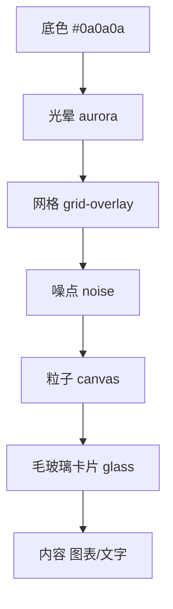

# 毛玻璃与背景特效制作教程（从 0 到 1）

> 项目：`hr-frontend`
> 参考视觉：SimpleYun 登录页 —— 暗色底 + 光晕/网格/噪点背景 + 毛玻璃卡片 + 粒子文字
> 涉及文件：`hr-frontend/src/index.css`、`hr-frontend/src/components/ParticleField.vue`、`hr-frontend/src/components/AuthLayout.vue`、`hr-frontend/src/components/MainLayout.vue`

这篇文档解决两个问题：

1. **毛玻璃效果**怎么做（原理 + 可复制代码 + 坑）。
2. 首页/登录页那套「**粒子 + 光晕 + 网格 + 噪点**」背景特效怎么从 0 搭出来。

所有代码都能直接抄进一个 Vue 3 项目。

---

## 1. 效果分层总览

整套视觉是**多层叠加**，每一层各管一件事，互不干扰：

| 层级（z-index） | 元素 | 作用 | 实现 |
| --- | --- | --- | --- |
| 0 | `.bg` / `.app-bg` | 页面底色 `#0a0a0a` | 纯色 `position: fixed` |
| 0 | `.aurora` | 蓝紫色环境光晕 | `radial-gradient` + `blur` |
| 0 | `.grid-overlay` | 细网格，中间明显四周淡出 | 双线 `linear-gradient` + `mask` |
| 0 | `.noise` | 极淡噪点，增加质感 | SVG `feTurbulence` data URI |
| 1 | `.particle-field` | Canvas 粒子 + 文字粒子 | Canvas 2D + 弹簧物理 |
| 2 | `.glass` / `.page-panel` / `.panel-block` | 毛玻璃卡片 | `backdrop-filter` + 半透明底 |
| 2 | 内容 | 标题/图表/文字 | 正常文档流 |



关键思想：**背景层 `pointer-events: none` 且 `position: fixed`**，永远不参与布局、不挡鼠标；内容层用 `position: relative; z-index: 2` 浮在上面。

---

## 2. 设计令牌（先定变量，再写效果）

所有颜色/圆角/字号集中在 `:root`，后续效果全部引用变量：

```css
:root {
  --bg-page: #0a0a0a;
  --brand: #4d6bfe;
  --brand-bright: #6799fe;
  --brand-deep: #3a65c2;
  --brand-light: #73a3d2;

  --text-primary: #fff;
  --text-secondary: hsla(0, 0%, 100%, 0.8);
  --text-description: hsla(0, 0%, 100%, 0.55);
  --text-placeholder: hsla(0, 0%, 100%, 0.32);

  --surface-1: hsla(0, 0%, 100%, 0.06);   /* 玻璃表面（强） */
  --surface-2: hsla(0, 0%, 100%, 0.04);   /* 玻璃表面（弱） */
  --surface-3: hsla(0, 0%, 100%, 0.02);

  --border-subtle: hsla(0, 0%, 100%, 0.08);
  --border-default: hsla(0, 0%, 100%, 0.12);
  --border-strong: hsla(0, 0%, 100%, 0.2);

  --radius-card: 24px;
  --radius-panel: 16px;
  --radius-input: 10px;

  --font-display: 'Host Grotesk', 'SF Pro Display', 'PingFang SC', 'Microsoft YaHei', system-ui, sans-serif;
  --font-body: 'DM Sans', 'PingFang SC', 'Microsoft YaHei', system-ui, sans-serif;
}
```

> 玻璃的半透明白色（`hsla(0,0%,100%,.04~.06)`）是核心：它透出背景的光晕与粒子，同时保证文字可读。

---

## 3. 毛玻璃卡片（核心）

### 3.1 原理：四个要素缺一不可

`backdrop-filter` 只是「模糊它背后的东西」，要看起来像玻璃，还需要：

1. **半透明背景**：让背景的颜色/光晕透上来（`background: hsla(0,0%,100%,.06)`）。
2. **背景模糊 + 饱和**：`backdrop-filter: blur(22px) saturate(150%)`，模糊负责「毛」，饱和负责「通透」。
3. **一圈极淡描边**：`border: 1px solid hsla(0,0%,100%,.08)`，勾出边缘。
4. **顶部内高光 + 外部投影**：内高光模拟玻璃上沿反光，外投影把卡片从背景里「托」起来。

### 3.2 从 0 写一个最简版

```css
.glass {
  position: relative;
  background: hsla(0, 0%, 100%, 0.06);              /* ① 半透明白 */
  border: 1px solid hsla(0, 0%, 100%, 0.08);       /* ③ 淡描边 */
  border-radius: 24px;
  backdrop-filter: blur(22px) saturate(150%);      /* ② 背景模糊 */
  -webkit-backdrop-filter: blur(22px) saturate(150%); /* Safari 前缀，别省 */
  box-shadow:
    inset 0 1px 0 hsla(0, 0%, 100%, 0.12),         /* ④ 顶部内高光 */
    0 24px 60px rgba(0, 0, 0, 0.45);               /* ④ 外部投影 */
}
```

放到页面里验证：给它背后放一张有颜色的背景（比如渐变），能看到颜色透上来并被模糊，就说明生效了。

### 3.3 进阶：顶部斜向高光层

真实玻璃的高光不是均匀的一条线，而是**从左上到右下渐隐**。用 `::before` 叠一层：

```css
.glass {
  position: relative;   /* 让 ::before 的绝对定位有参照 */
  overflow: hidden;     /* 可选：防止高光溢出圆角 */
}

/* 伪元素在卡片表面铺一层极淡的白色斜向渐变 */
.glass::before {
  content: '';
  position: absolute;
  inset: 0;
  border-radius: inherit;                          /* 跟随卡片圆角 */
  background: linear-gradient(
    135deg,
    hsla(0, 0%, 100%, 0.07),
    hsla(0, 0%, 100%, 0.015) 42%,
    transparent 70%
  );
  pointer-events: none;                            /* 不挡鼠标 */
  z-index: 0;
}

/* 让真实内容压在高光层之上 */
.glass > * {
  position: relative;
  z-index: 1;
}
```

### 3.4 项目里的完整实现

`index.css` 里 `.glass` 的完整版本（登录卡片、侧边栏用）：

```css
.glass {
  position: relative;
  background: var(--surface-1);
  border: 1px solid var(--border-subtle);
  backdrop-filter: blur(22px) saturate(150%);
  -webkit-backdrop-filter: blur(22px) saturate(150%);
  box-shadow:
    inset 0 1px 0 hsla(0, 0%, 100%, 0.12),
    0 24px 60px rgba(0, 0, 0, 0.45);
}

.glass::before {
  content: '';
  position: absolute;
  inset: 0;
  border-radius: inherit;
  background: linear-gradient(135deg, hsla(0, 0%, 100%, 0.07), hsla(0, 0%, 100%, 0.015) 42%, transparent 70%);
  pointer-events: none;
  z-index: 0;
}

.glass > * { position: relative; z-index: 1; }
```

页面容器 `.page-panel`（首页外框）和次级面板 `.panel-block`（图表卡）是同一思路，只是更弱：

```css
.page-panel {
  position: relative;
  z-index: 2;
  padding: 22px 24px;
  border-radius: var(--radius-card);
  background: var(--surface-1);
  border: 1px solid var(--border-subtle);
  backdrop-filter: blur(22px) saturate(150%);
  box-shadow: inset 0 1px 0 hsla(0, 0%, 100%, 0.1), 0 24px 60px rgba(0, 0, 0, 0.45);
}

.panel-block {
  padding: 20px;
  border-radius: var(--radius-panel);
  background: var(--surface-2);
  border: 1px solid var(--border-subtle);
}
```

### 3.5 常见坑

| 坑 | 原因 / 解法 |
| --- | --- |
| 毛玻璃没效果，背景全透 | 背后必须是**有内容**的图层（光晕/粒子/图片），纯色底模糊了也看不出来 |
| 文字发虚 | 半透明底太透，提高 `--surface-1` 不透明度，或给文字层单独加一层更实的底 |
| Safari 无效 | 必须写 `-webkit-backdrop-filter` |
| 卡片边缘出现白边/锯齿 | 给 `::before` 加 `border-radius: inherit`；必要时 `overflow: hidden` |
| 高光层挡住点击 | `pointer-events: none` |
| 性能卡顿（滚动掉帧） | 大面积 `blur(22px)` 很贵。减少同时存在的毛玻璃块数量；静态卡片可用更小的 `blur(12px)`；避免在动画元素上用 |
| 元素看不到 | `.glass > *` 的 `z-index` 需要父级建立层叠上下文（`position: relative`） |

---

## 4. 光晕（aurora）

光晕 = **大尺寸 radial-gradient 圆 + 强模糊 + 定位到视口外**，营造「环境光」。

最简原理：

```css
.aurora {
  position: absolute;
  border-radius: 50%;
  filter: blur(90px);      /* 关键：把渐变边缘糊开 */
}
```

项目里登录页用了三团（`.aurora-a/b/c`），工作台用一团更克制的（`.aurora-d`）：

```css
/* 登录页主光晕：顶部居中，蓝紫 */
.aurora-a {
  width: 900px; height: 560px;
  top: -160px; left: 50%;
  transform: translateX(-50%);
  background: radial-gradient(circle, rgba(77, 107, 254, 0.42), rgba(77, 107, 254, 0) 65%);
}

/* 右侧辅光 */
.aurora-b {
  width: 620px; height: 420px;
  top: 4%; right: -140px;
  background: radial-gradient(circle, rgba(103, 153, 254, 0.24), rgba(103, 153, 254, 0) 70%);
}

/* 左侧冷蓝光 */
.aurora-c {
  width: 560px; height: 420px;
  top: 22%; left: -160px;
  background: radial-gradient(circle, rgba(58, 101, 194, 0.28), rgba(58, 101, 194, 0) 70%);
}

/* 工作台：更克制的顶光 */
.aurora-d {
  position: absolute;
  width: 760px; height: 520px;
  top: -200px; left: 30%;
  background: radial-gradient(circle, rgba(77, 107, 254, 0.16), rgba(77, 107, 254, 0) 65%);
  filter: blur(80px);
}
```

要点：

- **渐变色标**：中心给品牌色 + 透明度，末尾同色但 `0` 透明，形成柔和衰减。
- **`blur` 的半径** ≥ 光晕尺寸的 1/10，边缘才够糊。
- 用**负偏移**（`top:-160px`、`right:-140px`）把光晕中心挪到视口外，避免看到圆形边界。
- 光晕容器本身 `position: fixed; inset: 0; overflow: hidden`，防止大盒子产生滚动条。

---

## 5. 网格（grid-overlay）

网格用**两组互相垂直的 1px 渐变线**拼成，再用 `mask` 让中间清楚、四周淡出：

```css
.grid-overlay {
  position: absolute;
  inset: 0;
  background-image:
    linear-gradient(rgba(255, 255, 255, 0.032) 1px, transparent 1px),   /* 横线 */
    linear-gradient(90deg, rgba(255, 255, 255, 0.032) 1px, transparent 1px); /* 竖线 */
  background-size: 60px 60px;   /* 格子边长 */
  /* 中间明显、四周淡出：椭圆 radial 遮罩 */
  -webkit-mask-image: radial-gradient(ellipse 70% 55% at 50% 8%, #000, transparent 72%);
  mask-image: radial-gradient(ellipse 70% 55% at 50% 8%, #000, transparent 72%);
}
```

要点：

- `1px` 的线 + `background-size` 控制密度；颜色用极低透明度的白（`0.03` 左右），亮色模式下可换黑。
- `mask-image` 的椭圆决定了网格的可见范围，想让网格铺满就改成 `ellipse 120% 120%`。
- 网格透明度一定**低于**内容，否则会干扰阅读。

---

## 6. 噪点（noise）

噪点用内联 SVG 的 `feTurbulence` 生成，转成 data URI 当背景，几乎不增加请求：

```css
.noise {
  position: absolute;
  inset: 0;
  opacity: 0.035;             /* 极淡，只增加质感 */
  background-image: url("data:image/svg+xml,%3Csvg xmlns='http://www.w3.org/2000/svg' width='120' height='120'%3E%3Cfilter id='n'%3E%3CfeTurbulence type='fractalNoise' baseFrequency='0.9' numOctaves='2'/%3E%3C/filter%3E%3Crect width='120' height='120' filter='url(%23n)'/%3E%3C/svg%3E");
}
```

要点：

- URL 里的 `#` 要写成 `%23`，`<` `>` 可保留也可转义（现代浏览器宽容，规范写法是全转义）。
- `opacity` 别超过 `0.06`，否则页面显得脏。
- 想更明显就把 `baseFrequency` 调大（颗粒更细）。

---

## 7. 粒子背景（Canvas）

项目用 `ParticleField.vue` 实现：背景粒子场 + 文字粒子 + 鼠标交互。下面从 0 拆解。

### 7.1 第一步：最简粒子场（约 40 行）

```js
// 伪代码，可直接改成 Vue 组件
const canvas = document.querySelector('canvas')
const ctx = canvas.getContext('2d')
let particles = []

function resize() {
  const dpr = Math.min(window.devicePixelRatio || 1, 2)
  canvas.width = innerWidth * dpr
  canvas.height = innerHeight * dpr
  ctx.setTransform(dpr, 0, 0, dpr, 0, 0) // 用 CSS 像素坐标绘制
  particles = Array.from({ length: 120 }, () => ({
    x: Math.random() * innerWidth,
    y: Math.random() * innerHeight,
    r: Math.random() * 1.5 + 0.5,
    a: Math.random() * 0.25 + 0.1,
  }))
}

function loop() {
  ctx.clearRect(0, 0, innerWidth, innerHeight)
  for (const p of particles) {
    ctx.fillStyle = `rgba(122,152,255,${p.a})`
    ctx.beginPath()
    ctx.arc(p.x, p.y, p.r, 0, Math.PI * 2)
    ctx.fill()
  }
  requestAnimationFrame(loop)
}
resize()
loop()
```

几个立刻能用的工程细节：

- **DPR 上限 2**：高 DPI 屏不无限增加绘制量。
- **`ctx.setTransform(dpr,...)`**：之后统一用 CSS 像素坐标，不用手动乘 DPR。
- **固定粒子数**（或用面积换算），避免 4K 屏粒子爆炸。

### 7.2 第二步：文字粒子（把文字拆成点）

思路：**先把文字画到离屏 canvas，再按像素读 alpha，字形内的像素就是目标点**。

```js
function sampleTextPoints(text, w, h, step = 5) {
  const off = document.createElement('canvas')
  off.width = w; off.height = h
  const octx = off.getContext('2d')

  octx.font = `700 148px 'Inter', system-ui, sans-serif`
  octx.textAlign = 'center'
  octx.textBaseline = 'middle'
  octx.fillStyle = '#fff'
  octx.fillText(text, w / 2, h * 0.46)

  const data = octx.getImageData(0, 0, w, h).data
  const points = []
  for (let y = 0; y < h; y += step) {
    for (let x = 0; x < w; x += step) {
      // alpha 通道 > 128 说明该像素在字形内
      if (data[(y * w + x) * 4 + 3] > 128) points.push([x, y])
    }
  }
  return points
}
```

要点：

- **采样步长 `step`** 控制粒子数量；项目会先「探针采样」估算覆盖率，再反解步长，把粒子数稳定在目标区间（约 1100~2600），避免小字号过疏、大字号过密。
- 采样点要**打乱（Fisher-Yates）**，这样超量截断时是均匀抽稀，而不是只保留左半边。
- 等 `document.fonts.ready` 再采样，否则用回退字体取点，字体加载完字形会跳。

### 7.3 第三步：弹簧物理 + 鼠标斥力

每个粒子有「当前位置」和「目标位置 `home`」，用弹簧力回位；鼠标靠近时加斥力把它推开，松开后弹簧把它拉回来 —— 就有了「打散再聚合」的效果。

```js
// 每帧更新
for (const p of particles) {
  // ① 鼠标斥力（越近推得越狠，平方衰减）
  if (mouse.active) {
    const dx = p.x - mouse.x, dy = p.y - mouse.y
    const d2 = dx * dx + dy * dy
    if (d2 < mouseRadius * mouseRadius && d2 > 0.01) {
      const d = Math.sqrt(d2)
      const force = (1 - d / mouseRadius) ** 2 * 3.2
      p.vx += (dx / d) * force
      p.vy += (dy / d) * force
    }
  }

  // ② 弹簧回归 + 阻尼
  p.vx += (p.hx - p.x) * p.stiffness
  p.vy += (p.hy - p.y) * p.stiffness
  p.vx *= p.damping
  p.vy *= p.damping
  p.x += p.vx
  p.y += p.vy
}
```

调参经验：

| 参数 | 作用 | 建议 |
| --- | --- | --- |
| `stiffness` | 弹簧硬度 | `0.004~0.04`，文字粒子硬一点（回得快） |
| `damping` | 阻尼 | `0.86~0.9`，越小停得越快 |
| `mouseRadius` | 影响半径 | `min(w,h) * 0.145`，夹在 `90~210` |
| 斥力系数 | 推力 | `3.2` 左右，太大粒子会飞出屏幕 |

再叠一个「**亮度随位移变化**」：粒子离目标越远越暗，被搅动处就形成「涟漪」。项目对位移做了 EMA 时间缓动，避免弹簧过冲导致逐帧明暗跳变。

### 7.4 绘制优化

项目用了一个很实用技巧：**单路径批量绘制**。每个粒子不用 `beginPath()`，而是拼成一个 `Path2D`，`fill()` 一次画完，大幅减少状态切换：

```js
// 每个粒子一个 Path2D + 自己的 fillStyle，最后一次性 fill
const path = new Path2D()
for (const p of particles) path.rect(p.x - p.size, p.y - p.size, p.size * 2, p.size * 2)
// 分组填色（见项目 draw()：两遍绘制，先铺文字粒子辉光，再画实心点）
```

> 项目实际用的是 `ctx.fillRect` + 逐粒子 `fillStyle`，并在第一遍先给文字粒子铺一层低透明度**辉光方块**（`GLOW_RADIUS = 2.2`），让字样在标题文案之上依然醒目。辉光用方块而非径向渐变，是为了省性能。

### 7.5 性能与体验清单

- `devicePixelRatio` 上限 2；
- 粒子总量设上限（背景 900 / 文字 2600）；
- 页面不可见时 `cancelAnimationFrame`（`visibilitychange`）；
- `ResizeObserver` 防抖重建（160ms），避免拖动窗口时疯狂重建；
- 尊重 `prefers-reduced-motion`：只静态画一帧，不启动动画循环；
- `pointer-events: none`，不拦截页面交互。

项目 `ParticleField.vue` 的核心参数（可直接抄）：

```ts
const MAX_DPR = 2
const BASE_PARTICLES_PER_MEGAPIXEL = 5600   // 背景粒子密度（每百万 CSS 像素）
const MAX_BASE_PARTICLES = 900
const MAX_TEXT_PARTICLES = 2600
const MOUSE_RADIUS_FACTOR = 0.145           // 鼠标半径 = min(w,h) * 系数
const MIN_MOUSE_RADIUS = 90
const MAX_MOUSE_RADIUS = 210
const GLOW_RADIUS = 2.2                     // 文字粒子辉光半径（× 粒子尺寸）
```

---

## 8. 层级与组合

把上面所有层组合起来，就是登录页/工作台背景。完整结构（`AuthLayout.vue`）：

```html
<div class="auth-view">
  <!-- 背景层：光晕 + 网格 + 噪点（z-index: 0） -->
  <div class="bg" aria-hidden="true">
    <div class="aurora aurora-a"></div>
    <div class="aurora aurora-b"></div>
    <div class="aurora aurora-c"></div>
    <div class="grid-overlay"></div>
    <div class="noise"></div>
  </div>

  <!-- 粒子层（z-index: 1） -->
  <ParticleField text="SimpleHR" variant="center" />

  <!-- 内容层（z-index: 2） -->
  <nav class="topbar">…</nav>
  <main class="auth-hero">
    <div class="auth-copy">…文案…</div>
    <div class="auth-card glass">…表单…</div>
  </main>
</div>
```

层级规则：

```css
.bg, .app-bg { position: fixed; inset: 0; z-index: 0; pointer-events: none; overflow: hidden; }
.particle-field { position: fixed; inset: 0; z-index: 1; pointer-events: none; }
.topbar, .shell, .auth-hero, .auth-view { position: relative; z-index: 2; }
```

---

## 9. 响应式与可访问性

- **响应式**：光晕尺寸用 `vw` 或媒体查询收缩；粒子密度按面积换算，小屏自动减少；`fontSize` 在窄屏（`<640px`）等比缩小，避免文字被裁。
- **可访问性**：
  - 纯装饰层加 `aria-hidden="true"`；
  - 尊重 `prefers-reduced-motion: reduce`（粒子停掉，只画一帧）；
  - 保证文字与背景对比度（玻璃卡上的正文用 `--text-secondary` 以上）。

---

## 10. 坑清单（速查）

| 现象 | 原因 / 解法 |
| --- | --- |
| 毛玻璃无效 | 背后没内容；漏了 `-webkit-` 前缀 |
| 卡片文字发虚 | 提高表面不透明度，或给文字层加实底 |
| 光晕能看到圆边 | `blur` 太小或光晕没挪出视口 |
| 网格太抢眼 | 透明度调低（≤0.04） |
| 噪点让页面变脏 | `opacity` 降到 0.03 |
| 粒子卡顿 | DPR 没设上限、粒子数没封顶、没做批量绘制 |
| 粒子页切走后仍在跑 | 监听 `visibilitychange` 暂停 |
| 鼠标穿过卡片时粒子不动 | canvas 没 `pointer-events: none`，或事件绑在 window 上却没更新坐标 |
| 文字粒子字形抖动 | 没等 `document.fonts.ready` |
| 粒子只聚集在左侧 | 截断前没打乱采样点 |

---

## 11. 改造建议

- **换主题**：只改 `:root` 变量（品牌色、表面透明度、文字色），光晕/粒子/玻璃会自动跟随。
- **换文案**：`ParticleField` 的 `text` prop 换成你的品牌名，`variant="center"`（登录页）或 `"upper"`（工作台）。
- **减配**：如果不需要粒子，保留「光晕 + 网格 + 噪点」三层，视觉已经成立，性能更好。
- **加层**：想更有层次可以在光晕之上加一层「星点」（随机固定小点），注意控制透明度。

---

## 附：相关文件

- 样式：`hr-frontend/src/index.css`（`.glass` / `.aurora` / `.grid-overlay` / `.noise` / `.page-panel`）
- 粒子：`hr-frontend/src/components/ParticleField.vue`
- 登录布局：`hr-frontend/src/components/AuthLayout.vue`
- 工作台布局：`hr-frontend/src/components/MainLayout.vue`
- 入口：`hr-frontend/src/main.ts`、`hr-frontend/index.html`（`<html class="dark">`）
