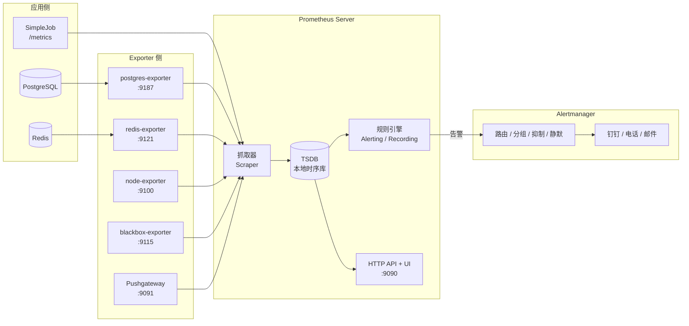
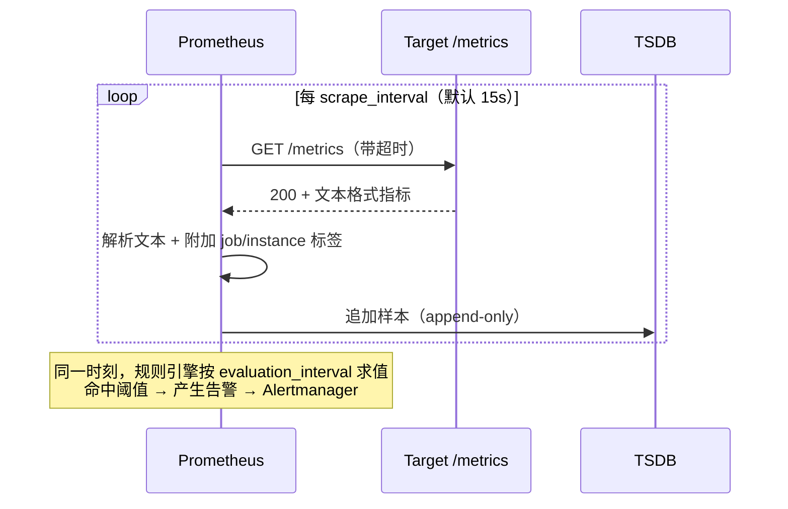
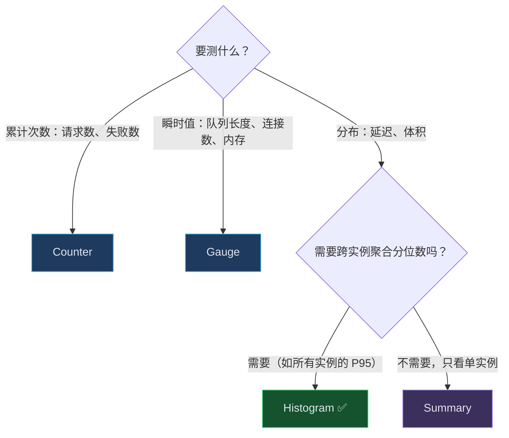
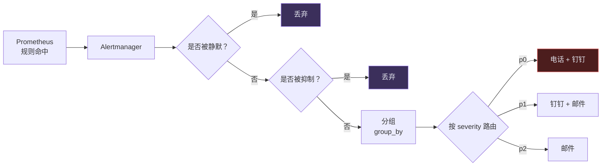

# Prometheus 零基础入门教程

> 适用项目：**simplejob**（FastAPI + gunicorn 单 worker + PostgreSQL + Redis + 邮件机器人 + OCR/AI 外部调用）
>
> 配套文档：[总览篇](./00-监控告警健康检查-总览.md)（监控 / 告警 / 健康检查全景）、[monitoring-alerting-healthcheck.md](../monitoring-alerting-healthcheck.md)（落地配置）
>
> 前置知识：看得懂 YAML 和 JSON，知道 HTTP 是什么。**不需要**运维背景，不需要用过任何时序数据库。
>
> 阅读方式：第 0～2 章建立概念，第 3 章跑起来，第 4～5 章写指标，第 6～9 章是 **PromQL 核心**（重点），第 10～13 章是配置与告警，第 14 章往后是进阶与排障。只想要结论直接跳 [18. 一页纸速查](#18-一页纸速查)。

---

## 目录

- [0. Prometheus 是什么](#0-prometheus-是什么)
- [1. 六个核心概念](#1-六个核心概念)
- [2. 架构全景](#2-架构全景)
- [3. 五分钟跑起来](#3-五分钟跑起来)
- [4. 四种指标类型](#4-四种指标类型)
- [5. 标签与命名](#5-标签与命名)
- [6. PromQL 基础](#6-promql-基础)
- [7. 时间范围与速率](#7-时间范围与速率)
- [8. 聚合与分组](#8-聚合与分组)
- [9. 实战模板](#9-实战模板)
- [10. 抓取配置 prometheusyml](#10-抓取配置-prometheusyml)
- [11. 服务发现与 Exporter](#11-服务发现与-exporter)
- [12. 告警规则](#12-告警规则)
- [13. Alertmanager 简述](#13-alertmanager-简述)
- [14. 存储与性能](#14-存储与性能)
- [15. 进阶](#15-进阶)
- [16. 排障](#16-排障)
- [17. 最佳实践清单](#17-最佳实践清单)
- [18. 一页纸速查](#18-一页纸速查)

---

## 0. Prometheus 是什么

一句话：

> **Prometheus 是一个「定时去问别人要数字、把数字存起来、数字不对就喊人」的系统。**

拆成三件事：

| 动作 | 对应组件 |
|---|---|
| **定时去要数字** | Prometheus Server 按 `scrape_interval` 拉取目标的 `/metrics` |
| **把数字存起来** | 内置 TSDB（时序数据库） |
| **数字不对就喊人** | Alerting Rules 求值 → 发给 Alertmanager → 通知 |

它的四个标志性特征：

1. **拉取模型（Pull）**：Prometheus 主动去拉，而不是等应用推。
2. **多维数据模型**：每条时间序列由「指标名 + 一组标签」唯一确定。
3. **PromQL**：专门为「按维度切片 + 算速率」设计的查询语言。
4. **告警与查询同一套数据**：告警表达式就是 PromQL，不用另建一套。

### 0.1 它**不**做什么（避免误解）

初学者最容易对 Prometheus 产生不切实际的期待：

| 常见误解 | 实际 |
|---|---|
| 「Prometheus 能看日志」 | ❌ 日志是 Loki / ELK 的事 |
| 「Prometheus 能看链路」 | ❌ 链路是 Tempo / Jaeger / Zipkin 的事 |
| 「Prometheus 是通用数据库」 | ❌ TSDB 为「指标 + 标签」优化，不适合高频写入或事务 |
| 「数据一定不丢」 | ❌ 抓取失败就是缺样本，Prometheus 不会重试补数 |
| 「天然支持多机集群」 | ❌ 单节点为主；水平扩展要上 Thanos / Mimir / VictoriaMetrics |
| 「能存几年数据」 | ❌ 默认保留 15 天，长期存储要靠远端写入（remote_write） |

> **一句话定位**：Prometheus 是**指标（metrics）**这个领域的标准答案。日志和链路有各自的答案。

### 0.2 拉取 vs 推送 一次讲清楚

```text
拉取（Pull）                      推送（Push）
─────────────                    ─────────────
Prometheus ──HTTP──► /metrics     应用 ──► Pushgateway / 远端存储
   「你现在多少？」                    「我刚才干了什么」

优点：                            优点：
- 能判断目标死没死（拉不到就是有问题）  - 适合短命任务（跑完就退出的 Cron Job）
- 目标不用知道监控地址                - 适合批量作业、防火墙内网
- 天然有「抓取时刻」这个统一时间点
```

**判断标准**：

- 常驻服务 → **拉取**（Prometheus 直接抓 `/metrics`）。
- 短命任务（Cron Job、批处理）→ **推送**到 Pushgateway，再由 Prometheus 抓 Pushgateway。
- 应用运行日志、调用链 → 不是 Prometheus 的活。

> 本项目的合成监控（`scripts/ci/synthetics.py`）就是典型的短命任务，所以走 Pushgateway。

---

## 1. 六个核心概念

### 1.1 概念表

| 概念 | 一句话 | 例子 |
|---|---|---|
| **目标 Target** | Prometheus 要去抓的那个地址 | `app:8000` |
| **指标 Metric** | 一个可测量的量 | `http_requests_total` |
| **标签 Label** | 指标的维度 | `method="GET"`、`route="/candidate/list"` |
| **样本 Sample** | 某一时刻的一个值 | `http_requests_total{method="GET",code="200"} 1027` |
| **抓取 Scrape** | 一次拉取动作 | 每 15 秒抓一次 `/metrics` |
| **规则 Rule** | 周期性求值的 PromQL | 「5xx 比例 > 1% 就告警」 |

### 1.2 指标在 HTTP 上长什么样

目标暴露的是一个纯文本接口，这叫 **exposition format**：

```text
# HELP http_requests_total Total number of HTTP requests.
# TYPE http_requests_total counter
http_requests_total{method="post",code="200",route="/user/token"} 1027
http_requests_total{method="post",code="400",route="/user/token"} 3
http_requests_total{method="get",code="200",route="/candidate/list"} 8421
```

逐行拆解：

| 部分 | 含义 |
|---|---|
| `# HELP ...` | 给人看的说明（可选但强烈建议） |
| `# TYPE ...` | 指标类型：`counter` / `gauge` / `histogram` / `summary` |
| 指标名 | 匹配 `[a-zA-Z_:][a-zA-Z0-9_:]*` |
| `{...}` | 标签集合，逗号分隔的 `key="value"` |
| 最后的数字 | 该时刻的值 |

### 1.3 关键认知 标签决定「序列」

**同一条指标，标签不同就是不同的时间序列。**

```text
http_requests_total{route="/a"}   →  一条序列
http_requests_total{route="/b"}   →  另一条序列
http_requests_total{route="/a", code="200"}  → 又一条
```

所以「10 个路由 × 5 个状态码 = 50 条序列」。这就是为什么**标签选错会让 Prometheus 内存爆炸**（见 [第 5 章](#5-标签与命名)）。

### 1.4 一个容易忽略的细节 样本是「不带时间戳」的

默认情况下，Prometheus 抓到的样本**不带**时间戳——**抓取时刻就是样本时间**。

这带来两个推论：

1. 抓慢了 / 抓漏了，数据就永久缺失（没有补数机制）。
2. 如果目标自己打了时间戳（`honor_timestamps: true`），要小心时钟漂移。

---

## 2. 架构全景



### 2.1 组件职责

| 组件 | 职责 | 本项目是否需要 |
|---|---|---|
| **Prometheus Server** | 抓取、存储、查询、规则求值 | ✅ 核心 |
| **Exporter** | 把第三方系统（PG/Redis/节点/黑盒）转成 Prometheus 格式 | ✅ 4 个 |
| **Alertmanager** | 告警去重、分组、路由、抑制、静默 | ✅ |
| **Pushgateway** | 短命任务的推送中转 | ✅（合成监控） |
| **Client Library** | 在应用里埋点（`prometheus-client`） | ✅ |
| **Grafana** | 可视化（不是 Prometheus 的一部分） | ✅ |

### 2.2 一次抓取的旅程



**三个关键时间参数**：

| 参数 | 默认 | 含义 |
|---|---|---|
| `scrape_interval` | 1m | 多久抓一次 |
| `scrape_timeout` | 10s | 单次抓取超时（**必须小于 interval**） |
| `evaluation_interval` | 1m | 多久求值一次规则 |

---

## 3. 五分钟跑起来

最快的上手方式：让 Prometheus 抓自己。

```yaml
# prometheus-minimal.yml
global:
  scrape_interval: 15s

scrape_configs:
  - job_name: prometheus
    static_configs:
      - targets: ["localhost:9090"]
```

```bash
docker run -d --name prom \
  -p 9090:9090 \
  -v "$(pwd)/prometheus-minimal.yml:/etc/prometheus/prometheus.yml:ro" \
  prom/prometheus:v2.54.0
```

打开 `http://localhost:9090/graph`，在查询框输入：

```promql
prometheus_http_requests_total
```

能看到数据，就说明「抓取 → 存储 → 查询」整条链路通了。

### 3.1 三个必看的界面

| 页面 | 路径 | 看什么 |
|---|---|---|
| **Graph** | `/graph` | 手写 PromQL 看曲线 |
| **Targets** | `/targets` | 每个目标 UP 还是 DOWN（**排障第一站**） |
| **Alerts** | `/alerts` | 哪些规则在 Pending / Firing |

API 方式（脚本化时用）：

```bash
# 即时查询
curl -s 'http://localhost:9090/api/v1/query?query=up' | python -m json.tool

# 范围查询（画曲线用）
curl -s 'http://localhost:9090/api/v1/query_range?query=up&start=..&end=..&step=15s'
```

---

## 4. 四种指标类型

### 4.1 总览

| 类型 | 一句话 | 能算 | 典型用途 | 项目例子 |
|---|---|---|---|---|
| **Counter** | 只增不减的累计值 | `rate()`、`increase()` | 请求数、错误数、失败次数 | `http_requests_total` |
| **Gauge** | 可增可减的瞬时值 | 直接比较、`_over_time` | 队列长度、连接数、内存 | `simplejob_log_queue_size` |
| **Histogram** | 分桶计数 + 总和 + 总数 | `histogram_quantile()` | 延迟分布、响应大小分布 | `http_request_duration_seconds` |
| **Summary** | 客户端预先算好分位数 | 直接读分位 | 单实例延迟分位（**不能跨实例聚合**） | 较少用 |

### 4.2 Counter 只增不减的「里程表」

```promql
# 不能这样用（值本身无意义，进程重启会归零）
simplejob_login_failed_total

# 正确：看增速
rate(simplejob_login_failed_total[5m])
```

**要点**：

- 命名约定加 `_total` 后缀（Prometheus 2.x 起推荐）。
- 进程重启归零 → `rate()` 内部能识别重置（`resets()` 可查）。
- 告警用 `increase(...[5m]) > N` 或 `rate(...) > 阈值`。

### 4.3 Gauge 可上可下的「时速表」

```promql
# 直接比大小
simplejob_log_queue_size > 10000

# 看趋势
avg_over_time(simplejob_log_queue_size[1h])
```

**要点**：直接读值就有意义；`rate()` 对 Gauge 无意义（用 `delta()` 表示变化量）。

### 4.4 Histogram 分桶统计（最重要也最容易用错）

一个 Histogram 实际暴露**三类**时间序列：

```text
http_request_duration_seconds_bucket{le="0.005"}  3
http_request_duration_seconds_bucket{le="0.01"}   10
http_request_duration_seconds_bucket{le="0.025"}  28
http_request_duration_seconds_bucket{le="0.05"}   45
http_request_duration_seconds_bucket{le="0.1"}    52
http_request_duration_seconds_bucket{le="0.25"}   60
http_request_duration_seconds_bucket{le="0.5"}    65
http_request_duration_seconds_bucket{le="1"}      68
http_request_duration_seconds_bucket{le="+Inf"}   70
http_request_duration_seconds_sum                  123.4      ← 总耗时
http_request_duration_seconds_count                70        ← 总次数
```

三个关键点：

1. **`le` 是累积的**：`le="0.1"` 表示「≤ 0.1 秒的有 52 个」，不是「0.05~0.1 之间的」。
2. **必须显式定义桶边界**（`buckets=[...]`）。桶太少算不准分位，桶太多费内存。
3. **平均值** = `_sum / _count`；**分位数** = `histogram_quantile(0.95, ...)`。

```promql
# 平均值
rate(http_request_duration_seconds_sum[5m])
  / rate(http_request_duration_seconds_count[5m])

# P95
histogram_quantile(0.95,
  sum(rate(http_request_duration_seconds_bucket[5m])) by (le, route))
```

### 4.5 选型决策



> **90% 的场景只需要 Counter / Gauge / Histogram 三种。** Summary 因为不可聚合，微服务场景基本不用。

---

## 5. 标签与命名

### 5.1 标签是「维度」，也是「成本」

每多一个标签取值，序列数就乘一倍。粗算：

```text
1 个指标 × 10 个 route × 5 个 code × 2 个 instance = 100 条序列
```

而下面这样就是灾难：

```text
http_requests_total{request_id="a3f9..."}     ← 每个请求一条序列，无限增长
```

**高基数（high cardinality）** = 标签取值几乎不重复。常见元凶：

| ❌ 不要做 | ✅ 应该做 |
|---|---|
| `candidate_id="12345"` | 把 ID 写进**日志**，不进指标 |
| `email="a@b.com"` | 同上 |
| `user_id="u_8899"` | 同上 |
| `request_id="a3f9..."` | 同上 |
| `path="/candidate/detail?id=8899"` | 用 `route="/candidate/detail/:id"` 这种**路由模板** |

> **核心原则**：**日志/链路存「个体」，指标存「聚合」。** 想知道某个候选人怎样，去日志查；想知道「候选人功能整体慢不慢」，用指标。

### 5.2 命名规范

Prometheus 官方约定：

```text
<namespace>_<subsystem>_<name>_<unit>

例：
simplejob_login_failed_total
└─命名空间 └─名称   └─单位（counter 用 _total）

http_request_duration_seconds   ← 单位用秒，不用毫秒
```

| 规则 | 说明 |
|---|---|
| 单位进名字 | `duration_seconds`，不要 `duration_ms` |
| counter 加 `_total` | `xxx_total`，且 `rate()` 时不用手动加 |
| 不要用 `_seconds_total` 双重单位 | 选一个 |
| 标签值用 snake_case | `result="ok"`、`service="ocr"` |

### 5.3 标签白名单（本项目做法）

`app/core/metrics.py` 开头直接写死规矩：

```python
"""Prometheus 指标定义。

命名规范：simplejob_<域>_<指标>_[单位]
标签规范：只允许低基数标签（status/node/service/result/reason），
          **禁止** candidate_id / email / user_id 等高基数值。
"""
```

CI 里可以用 `promtool check metrics` 做静态检查（见 [16.3](#163-promtool-常用命令)）。

---

## 6. PromQL 基础

PromQL 的查询结果分四种，先建立地图：

| 类型 | 怎么产生 | 例子 |
|---|---|---|
| **即时向量（instant vector）** | `指标{标签}` | `http_requests_total` → 每个序列的**最新**值 |
| **范围向量（range vector）** | `指标{标签}[5m]` | 最近 5 分钟的**一串**样本 |
| **标量（scalar）** | `1`、`0.01` | 单个数字 |
| **字符串** | `"ok"` | 用得少 |

### 6.1 选择器

```promql
# 1) 按指标名
http_requests_total

# 2) 精确匹配
http_requests_total{job="simplejob"}

# 3) 不等匹配
http_requests_total{status!="200"}

# 4) 正则匹配（=~）与排除（!~）
http_requests_total{status=~"5.."}      # 所有 5xx
http_requests_total{status!~"2..|3.."}  # 排除 2xx 和 3xx

# 5) 多条件（AND 关系）
http_requests_total{job="simplejob", status=~"5..", route="/user/token"}
```

匹配符只有四种：`=`、`!=`、`=~`、`!~`。正则默认是**完全锚定**的（`=~"5.."` 等价于 `^(?:5..)$`）。

### 6.2 算术与比较运算符

```promql
# 算术：+ - * / % ^
100 - http_requests_total          # 标量运算
a / b                             # 向量逐元素相除

# 比较：== != > < >= <=
# 不带 bool → 过滤掉不满足的序列
sum(rate(http_requests_total[5m])) > 0.1

# 带 bool → 不满足的返回 0，满足的返回 1
sum(rate(http_requests_total[5m])) > bool 0.1
```

> **告警表达式里不加 `bool`**：加上之后值恒为 1，`{{ $value }}` 就永远是 1，看不出超了多少。

### 6.3 逻辑运算符

```promql
a and b      # 两边都有的序列（取 a 的值）
a or b       # 两边的并集
a unless b   # a 中去掉 b 有的
```

典型用法是**组合多个信号**：

```promql
# 有流量 且 错误率高（避免「没流量的实例」误报）
sum(rate(http_requests_total[5m])) > 1
  and
(sum(rate(http_requests_total{status=~"5.."}[5m]))
  / sum(rate(http_requests_total[5m]))) > 0.01
```

---

## 7. 时间范围与速率

**这是 PromQL 最重要的一章。** 90% 的 PromQL 都是围绕「时间窗口」展开的。

### 7.1 范围选择器

```promql
http_requests_total[5m]        # 最近 5 分钟的所有样本
http_requests_total[1h] offset 1d   # 1 天前的那个 1 小时
http_requests_total[5m] @ 1700000000 # 指定时刻（较新版本支持）
```

`[5m]` 的结果是**范围向量**，不能直接显示，必须配合函数使用。

### 7.2 rate 与 irate 的区别（面试级知识点）

```promql
rate(http_requests_total[5m])    # 平均每秒增长率，抗毛刺 ✅
irate(http_requests_total[5m])   # 最后两个点的瞬时增长率，灵敏但抖
```

图解（假设区间内有一次重启归零）：

```text
值  │                    ╱
    │              ╱────╱
    │        ╱────╱          ← rate 会正确处理这次重置，给出平滑斜率
    │  ╱────╱
    │╱
    └──────────────────────► 时间
         └─5m─┘
                              irate 只看最后两点，可能突然飙高
```

| | `rate()` | `irate()` |
|---|---|---|
| 用几个点 | 整个区间首尾（外推） | 最后两个点 |
| 抗毛刺 | ✅ 好 | ❌ 差 |
| 适合 | **告警、看板（默认选它）** | 快速定位瞬时突变 |
| 前提 | 计数器单调递增 | 同上 |

### 7.3 increase 与 rate 的关系

```promql
increase(x[5m]) ≈ rate(x[5m]) * 300
```

`increase` 是「这段时间内涨了多少」，**告警计数场景更直观**：

```promql
sum(increase(simplejob_login_failed_total[5m])) > 50
```

> ⚠️ `increase` 会**外推到区间边界**，所以结果可能比真实值略大（小数），这是正常的。

### 7.4 `_over_time` 家族

对 Gauge 或任意序列，看一段时间的统计：

| 函数 | 含义 |
|---|---|
| `avg_over_time(x[5m])` | 平均值 |
| `max_over_time(x[5m])` | 最大值（**告警常用**） |
| `min_over_time(x[5m])` | 最小值 |
| `sum_over_time(x[5m])` | 累加 |
| `count_over_time(x[5m])` | 样本个数 |
| `last_over_time(x[5m])` | 最后一个值 |
| `quantile_over_time(0.95, x[5m])` | 分位数 |
| `stddev_over_time(x[5m])` | 标准差（抖动检测） |

例子：

```promql
# 队列积压的峰值
max_over_time(simplejob_log_queue_size[10m]) > 10000

# CPU 持续高位
avg_over_time(node_cpu_seconds_total[15m]) > 0.9
```

### 7.5 histogram_quantile 的正确姿势

```promql
histogram_quantile(0.95,
  sum(rate(http_request_duration_seconds_bucket[5m])) by (le, route))
```

三个要点：

1. **必须按 `le` 分组**（`by (le, route)`），否则桶会混在一起，算出来是错的。
2. **分位参数是 0~1 的小数**（`0.95`），不是 95。
3. 结果是**估算值**，依赖桶的粒度；桶越粗误差越大。

> **常见错误**：忘了 `by (le)`。表现是 P95 数值离谱（比如比平均值还小），而且不报错。

### 7.6 偏移 offset 与 @

```promql
# 环比：今天的错误率 vs 1 小时前
rate(http_requests_total{status=~"5.."}[5m])
  - rate(http_requests_total{status=~"5.."}[5m] offset 1h)

# 同比：今天 vs 昨天
rate(http_requests_total[5m]) / rate(http_requests_total[5m] offset 1d)
```

---

## 8. 聚合与分组

### 8.1 聚合运算符

| 运算符 | 作用 |
|---|---|
| `sum` | 求和 |
| `avg` | 平均 |
| `min` / `max` | 最小 / 最大 |
| `count` | 计数（序列个数） |
| `stddev` / `stdvar` | 标准差 / 方差 |
| `topk(k, v)` | 最大的 k 个 |
| `bottomk(k, v)` | 最小的 k 个 |
| `quantile(q, v)` | 分位数 |
| `count_values(label, v)` | 按值分桶计数 |
| `group` | 全部置 1 |

### 8.2 by 与 without

```promql
# by：保留列出的标签，其余合并
sum(rate(http_requests_total[5m])) by (status)

# without：去掉列出的标签，保留其余
sum(rate(http_requests_total[5m])) without (instance)
```

> **经典坑**：`sum()` 不加 `by` 会把**所有标签都扔掉**，只剩一个总数。想按状态分组就必须写 `by (status)`。

### 8.3 慢接口 Top 10

```promql
topk(10, histogram_quantile(0.95,
  sum(rate(http_request_duration_seconds_bucket[5m])) by (le, route)))
```

注意 `topk` 的参数顺序是 `(k, 向量)`，**k 在前**。

### 8.4 向量匹配（二元运算的进阶）

`a / b` 时，Prometheus 要决定「谁和谁配对」。默认按**完全相同的标签集**配对。

```promql
# 错误率：分子分母的标签集不同，直接除会得到空结果
rate(http_requests_total{status=~"5.."}[5m])
  / rate(http_requests_total[5m])     # ← 可能查不到数据

# 正确：用 ignoring 忽略多余标签
sum(rate(http_requests_total{status=~"5.."}[5m])) ignoring (status)
  / sum(rate(http_requests_total[5m])) ignoring (status)
```

三种匹配修饰符：

| 修饰符 | 含义 |
|---|---|
| `on(label1, label2)` | 只按指定标签配对 |
| `ignoring(label1)` | 忽略指定标签配对 |
| `group_left` / `group_right` | 一对多匹配（如「每个路由的每实例」） |

> **排障经验**：二元运算结果为空，**先怀疑标签集不匹配**，而不是没数据。

---

## 9. 实战模板

以下是可直接改用的模板，都基于本项目的指标命名。

### 9.1 错误率（RED 之 E）

```promql
# 5xx 比例
sum(rate(http_requests_total{status=~"5.."}[5m]))
  / sum(rate(http_requests_total[5m]))

# 4xx 比例（可能是接口变更 / 前端异常）
sum(rate(http_requests_total{status=~"4.."}[5m]))
  / sum(rate(http_requests_total[5m]))
```

### 9.2 延迟分位（RED 之 D）

```promql
# 全服务 P95
histogram_quantile(0.95,
  sum(rate(http_request_duration_seconds_bucket[5m])) by (le))

# 按路由看 P95（看板用）
histogram_quantile(0.95,
  sum(rate(http_request_duration_seconds_bucket[5m])) by (le, route))

# 慢接口 Top 10
topk(10, histogram_quantile(0.95,
  sum(rate(http_request_duration_seconds_bucket[5m])) by (le, route)))
```

### 9.3 流量（RED 之 R）

```promql
sum(rate(http_requests_total[5m]))              # 总 QPS
sum(rate(http_requests_total[5m])) by (status)  # 按状态
```

### 9.4 可用性（SLO 风格）

```promql
# 错误预算燃烧率：过去 1 小时错误率
sum(rate(http_requests_total{status=~"5.."}[1h]))
  / sum(rate(http_requests_total[1h]))
```

### 9.5 外部依赖失败率

```promql
sum(rate(simplejob_external_request_total{service=~"dashscope|paddleocr", result="error"}[10m]))
  / sum(rate(simplejob_external_request_total{service=~"dashscope|paddleocr"}[10m]))
```

### 9.6 平均耗时（OCR / AI）

```promql
rate(simplejob_external_request_duration_seconds_sum{service=~"dashscope|paddleocr"}[5m])
  / rate(simplejob_external_request_duration_seconds_count{service=~"dashscope|paddleocr"}[5m])
```

### 9.7 容量预测（磁盘还能撑多久）

```promql
predict_linear(node_filesystem_avail_bytes{mountpoint="/"}[6h], 4 * 3600) < 0
# 读法：按最近 6 小时趋势外推 4 小时，若结果 < 0 说明 4 小时内写满
```

### 9.8 异常检测（同比突变）

```promql
# 登录失败量 比 1 小时前 增长超过 5 倍
sum(increase(simplejob_login_failed_total[5m]))
  / sum(increase(simplejob_login_failed_total[5m] offset 1h)) > 5
```

### 9.9 数据缺失检测

```promql
# 某个 job 完全没有指标了（连 up 都没有）
absent(up{job="simplejob"})
```

---

## 10. 抓取配置 prometheusyml

### 10.1 逐段讲解

```yaml
global:
  scrape_interval: 15s          # 全局抓取间隔
  scrape_timeout: 10s           # 全局抓取超时（必须 < interval）
  evaluation_interval: 15s      # 规则求值间隔
  external_labels:              # 附加到所有 outgoing 数据（联邦/远端写入时标识来源）
    cluster: simplejob
    env: prod

rule_files:                     # 告警规则文件
  - /etc/prometheus/alerts.yml

alerting:                       # Alertmanager 地址
  alertmanagers:
    - static_configs:
        - targets: ["alertmanager:9093"]

scrape_configs:                 # 抓取目标列表
  - job_name: simplejob
    metrics_path: /metrics      # 默认 /metrics
    scheme: http                # 默认 http
    scrape_interval: 15s        # 可覆盖 global
    scrape_timeout: 10s
    static_configs:
      - targets: ["app:8000"]
        labels:                 # 给该目标的所有指标附加标签
          service: simplejob
          env: prod
```

**字段速查**：

| 字段 | 默认 | 说明 |
|---|---|---|
| `job_name` | 必填 | 会作为 `job` 标签自动附加 |
| `metrics_path` | `/metrics` | 目标暴露路径 |
| `scrape_interval` | `global` | 本项目 15s |
| `scrape_timeout` | 10s | **必须小于 interval** |
| `static_configs.targets` | 必填 | 地址列表，可带 `labels` |
| `relabel_configs` | – | 抓取前改写/过滤目标（见 11.3） |
| `metric_relabel_configs` | – | 抓取后改写/过滤指标 |
| `honor_labels` | false | 目标已带 `job`/`instance` 时是否保留 |
| `honor_timestamps` | false | 是否采用目标提供的时间戳 |
| `params` | – | 附加查询参数 |

### 10.2 本项目的完整配置

```yaml
global:
  scrape_interval: 15s
  evaluation_interval: 15s
  external_labels:
    cluster: simplejob
    env: prod

rule_files:
  - /etc/prometheus/alerts.yml

alerting:
  alertmanagers:
    - static_configs:
        - targets: ["alertmanager:9093"]

scrape_configs:
  - job_name: simplejob
    metrics_path: /metrics
    static_configs:
      - targets: ["app:8000"]
        labels: { service: simplejob, env: prod }

  - job_name: postgres
    static_configs:
      - targets: ["postgres-exporter:9187"]
        labels: { service: postgres }

  - job_name: redis
    static_configs:
      - targets: ["redis-exporter:9121"]
        labels: { service: redis }

  - job_name: node
    static_configs:
      - targets: ["node-exporter:9100"]
        labels: { service: node }

  - job_name: pushgateway
    honor_labels: true          # 保留推送方自己带的标签
    static_configs:
      - targets: ["pushgateway:9091"]

  # 外部拨测（证书、可达性）
  - job_name: blackbox
    metrics_path: /probe
    params:
      module: [http_2xx]
    static_configs:
      - targets:
          - https://hr.example.com/healthz
          - https://hr.example.com/readyz
    relabel_configs:
      - source_labels: [__address__]
        target_label: __param_target
      - source_labels: [__param_target]
        target_label: instance
      - target_label: __address__
        replacement: blackbox-exporter:9115
```

> **Blackbox 这段是重定向（relabeling）的经典例子**：把「要探测的地址」塞进 `__param_target`，再把真正的抓取地址改成 blackbox-exporter 本身。

---

## 11. 服务发现与 Exporter

### 11.1 服务发现方式

| 方式 | 配置 | 适用 |
|---|---|---|
| **静态** | `static_configs.targets` | 目标少、变动小（本项目） |
| **DNS** | `dns_configs` | 有 SRV/A 记录 |
| **Consul** | `consul_sd_configs` | 微服务 |
| **Kubernetes** | `kubernetes_sd_configs` | K8s |
| **文件** | `file_sd_configs` | 最灵活的「自己写文件」方案 |

文件服务发现示例（动态增删目标不用重启 Prometheus）：

```yaml
  - job_name: simplejob
    file_sd_configs:
      - files: ["/etc/prometheus/targets/simplejob.json"]
        refresh_interval: 30s
```

```json
// targets/simplejob.json
[
  { "targets": ["app-1:8000", "app-2:8000"], "labels": { "service": "simplejob" } }
]
```

### 11.2 Exporter 清单

Exporter 是「把第三方系统翻译成 Prometheus 格式」的适配器。

| Exporter | 端口 | 提供什么 | 关键指标 |
|---|---|---|---|
| **node-exporter** | 9100 | 机器/系统层 | `node_cpu_*`、`node_filesystem_*`、`node_memory_*` |
| **postgres-exporter** | 9187 | 数据库 | `pg_up`、`pg_stat_activity_count`、`pg_database_size_bytes` |
| **redis-exporter** | 9121 | 缓存 | `redis_up`、`redis_connected_clients`、`redis_memory_used_bytes` |
| **blackbox-exporter** | 9115 | 外部拨测 | `probe_success`、`probe_duration_seconds`、`probe_ssl_earliest_cert_expiry` |
| **Pushgateway** | 9091 | 短死任务中转 | 任务自身推来的指标 |

> **重要**：Exporter 抓不到 ≠ Prometheus 坏了。**先看 `/targets`**：`up=0` 是目标的问题，`up=1` 但没指标才是 Prometheus 的问题。

### 11.3 relabeling 入门

`relabel_configs` 在**抓取前**处理目标的标签（`__address__`、`__meta_*` 等以 `__` 开头的内部标签）。

```yaml
relabel_configs:
  # 1) 只保留带 monitor=yes 标签的目标
  - source_labels: [__meta_consul_tags]
    regex: '.*,monitor=yes,.*'
    action: keep

  # 2) 改写字段
  - source_labels: [__meta_consul_node]
    target_label: instance       # 用 consul node 名当 instance

  # 3) 丢弃某些指标序列（metric_relabel_configs）
  - source_labels: [__name__]
    regex: 'go_.*'               # 丢掉 Go runtime 指标，省内存
    action: drop
```

常见 `action`：`replace`、`keep`、`drop`、`labeldrop`、`labelkeep`、`hashmod`、`labelmap`。

---

## 12. 告警规则

### 12.1 规则文件结构

```yaml
groups:
  - name: simplejob-availability       # 组名（UI 里分组显示）
    interval: 30s                      # 本组求值间隔（可覆盖全局）
    rules:
      - alert: SimpleJobDown           # 告警名（必须唯一、语义化）
        expr: up{job="simplejob"} == 0 # PromQL 表达式
        for: 1m                        # 持续多久才真告警
        labels:                        # 附加标签（severity 决定路由）
          severity: p0
          team: hr
        annotations:                   # 给人看的说明
          summary: "SimpleJob 服务不可达"
          description: "实例 {{ $labels.instance }} 已 1 分钟无指标"
          runbook: "https://git.example.com/simplejob/docs/runbook.md#simplejobdown"
```

### 12.2 逐字段说明

| 字段 | 必填 | 说明 |
|---|---|---|
| `alert` | ✅ | 告警名，也是 `alertname` 标签 |
| `expr` | ✅ | PromQL，**结果非空 = 触发条件满足** |
| `for` | ❌ | 持续满足多久才进入 Firing（防抖） |
| `keep_firing_for` | ❌ | 恢复后继续 Firing 多久（新版，防抖恢复） |
| `labels` | ❌ | 附加标签，`severity` 最常用 |
| `annotations` | ❌ | 说明文字，支持模板 |

**关于 `expr` 的判定逻辑**：Prometheus 只看「表达式是否有返回值」。

```promql
up{job="simplejob"} == 0     # 有返回 → 触发；无返回 → 不触发
```

所以 `absent()`、`== 0`、`> 阈值` 都是「有返回即异常」。

### 12.3 模板语法

```yaml
annotations:
  summary: "{{ $labels.instance }} 服务不可达"
  description: "当前值 {{ $value }}，已持续 {{ $duration }}"
  runbook: "https://.../{{ $labels.alertname }}"
```

| 变量 | 含义 |
|---|---|
| `{{ $labels.<name> }}` | 告警序列的标签值 |
| `{{ $value }}` | 表达式的返回值 |
| `{{ $externalURL }}` | Prometheus 外部地址 |
| `{{ $duration }}` | 已持续时长（较新版本） |

> **模板里不要写高基数值**（如 instance 之外的 route），否则通知会爆炸。

### 12.4 本项目的规则逐条讲

#### （1）服务可用性

```yaml
- alert: SimpleJobDown
  expr: up{job="simplejob"} == 0
  for: 1m
  labels: { severity: p0, team: hr }
  annotations:
    summary: "SimpleJob 服务不可达"
    description: "实例 {{ $labels.instance }} 已 1 分钟无指标"
    runbook: "https://git.example.com/simplejob/docs/runbook.md#simplejobdown"
```

**读法**：`up` 是 Prometheus 自动生成的指标，抓取成功 = 1，失败 = 0。所以「服务不可达」不用自己写表达式。

```yaml
- alert: SimpleJobReadyFailing
  expr: probe_success{job="blackbox", module="http_2xx", instance=~".*readyz.*"} == 0
  for: 2m
  labels: { severity: p0 }
```

**读法**：用正则匹配「探测 readyz 的那条 probe」，连续 2 分钟失败就 P0。

#### （2）性能

```yaml
- alert: HighErrorRate5xx
  expr: |
    sum(rate(http_requests_total{status=~"5.."}[5m]))
    / sum(rate(http_requests_total[5m])) > 0.01
  for: 5m
  labels: { severity: p0 }
```

**要点**：分子分母都套 `sum(rate(...))`，保证标签集一致。

```yaml
- alert: P95LatencyHigh
  expr: |
    histogram_quantile(0.95,
      sum(rate(http_request_duration_seconds_bucket[5m])) by (le, route)) > 2
  for: 5m
  labels: { severity: p1 }
```

**要点**：**告警粒度是「每个 route」**——只要有一个路由超 2 秒就告警。想只看全局，去掉 `by (route)`。

#### （3）外部依赖与业务

```yaml
- alert: AiOcrFailureRate
  expr: |
    sum(rate(simplejob_external_request_total{service=~"dashscope|paddleocr", result="error"}[10m]))
    / sum(rate(simplejob_external_request_total{service=~"dashscope|paddleocr"}[10m])) > 0.05
  for: 10m
  labels: { severity: p1 }

- alert: LoginBruteForce
  expr: sum(increase(simplejob_login_failed_total[5m])) > 50
  for: 0m
  labels: { severity: p1 }
```

> **`for: 0m` 的用法**：登录爆破是「次数型」事件，50 次失败本身已经足够确定，不需要再等。

#### （4）日志链路

```yaml
- alert: LogListenerDead
  expr: simplejob_log_listener_alive == 0
  for: 2m
  labels: { severity: p1 }

- alert: LogQueueBacklog
  expr: simplejob_log_queue_size > 10000
  for: 5m
  labels: { severity: p1 }
```

#### （5）资源

```yaml
- alert: DiskUsageHigh
  expr: |
    (1 - node_filesystem_avail_bytes{mountpoint="/"}
    / node_filesystem_size_bytes{mountpoint="/"}) > 0.85
  for: 10m
  labels: { severity: p2 }

- alert: CertExpiringSoon
  expr: (probe_ssl_earliest_cert_expiry{job="blackbox"} - time()) / 86400 < 7
  for: 1h
  labels: { severity: p2 }
```

> `time()` 返回当前 Unix 时间戳，和证书到期时间戳相减再除以 86400 得到「还剩几天」。

### 12.5 怎么写才好：五条经验

1. **表达式要有返回值才叫触发** —— 写完后到 `/graph` 里跑一下，确认异常时真有输出。
2. **`for` 是防抖，不是延迟** —— 它是「确认期」，不是「等一会儿再报警」。
3. **标签集对齐** —— 二元运算结果为空，八成是标签不匹配。
4. **阈值留缓冲** —— 阈值定在「真的出事」的位置，不是「稍微不正常」的位置。
5. **每条告警配 Runbook** —— 没有处置手册的告警，三天后就会被静默。

### 12.6 规则单元测试

Prometheus 官方推荐用测试文件验证规则：

```yaml
# alerts_test.yml
rule_files:
  - alerts.yml

evaluation_interval: 1m

tests:
  - interval: 1m
    input_series:
      # 造 5 分钟数据：up 从 1 变 0
      - series: 'up{job="simplejob",instance="app:8000"}'
        values: '1 1 1 1 0 0 0 0'

    alert_rule_test:
      - eval_time: 5m
        alertname: SimpleJobDown
        exp_alerts:
          - exp_labels:
              severity: p0
              team: hr
              job: simplejob
              instance: app:8000
            exp_annotations:
              summary: "SimpleJob 服务不可达"
```

```bash
promtool test rules alerts_test.yml
```

---

## 13. Alertmanager 简述

Prometheus 只负责「判断该不该报警」，**发出去**是 Alertmanager 的事。



核心配置片段：

```yaml
route:
  receiver: dingtalk-p1
  group_by: ['alertname', 'severity', 'instance']
  group_wait: 30s        # 攒 30 秒再发（合并同组告警）
  group_interval: 5m     # 同组新增告警，5 分钟内不重发
  repeat_interval: 4h    # 未恢复的告警，4 小时后才重复提醒
  routes:
    - matchers: [ severity = p0 ]
      receiver: dingtalk-p0
      continue: true
    - matchers: [ severity = p1 ]
      receiver: dingtalk-p1
    - matchers: [ severity =~ "p2|p3" ]
      receiver: email

inhibit_rules:
  - source_matchers: [ alertname = PostgresDown ]
    target_matchers: [ alertname =~ "SimpleJobReadyFailing|HighErrorRate5xx|SlowQueries" ]
    equal: [ instance ]
```

> 告警分级、抑制、静默、Runbook 的完整讲解在 [总览篇 第 6 章](./00-监控告警健康检查-总览.md#6-告警-从发现问题到有人处理)。

---

## 14. 存储与性能

### 14.1 TSDB 是怎么存的

```text
Prometheus 本地磁盘
├── data/
│   ├── wal/                      ← 预写日志（防崩溃丢数据）
│   └── tsdb/
│       ├── 01J.../               ← 2 小时一个 block
│       │   ├── chunks/           ← 压缩后的样本
│       │   ├── index             ← 标签索引
│       │   └── meta.json         ← 时间范围、样本数
│       ├── 01K.../
│       └── ...
└── snapshots/                    ← 备份快照
```

- **写入**：先进 WAL，再进内存 head block，满 2 小时切成一个 block。
- **压缩**：小 block 合并成大 block（2h → 4h → 10% 递增）。
- **保留**：超过 retention 的 block 整体删除。

### 14.2 关键启动参数

```bash
prometheus \
  --config.file=/etc/prometheus/prometheus.yml \
  --storage.tsdb.path=/prometheus \
  --storage.tsdb.retention.time=30d \      # 时间保留（默认 15d）
  --storage.tsdb.retention.size=50GB \     # 大小保留（先到先得）
  --query.lookback-delta=5m \              # 多久没样本就算「不存在」
  --query.max-samples=50000000
```

| 参数 | 默认 | 说明 |
|---|---|---|
| `retention.time` | 15d | 超过就删 block |
| `retention.size` | 0（不限） | 生产建议设上限，防止磁盘爆 |
| `query.lookback-delta` | 5m | 影响「最后一个样本能往前看多久」 |

> **`lookback-delta` 的坑**：如果抓取间隔是 1 分钟，而 `lookback-delta=5m`，那没问题；但若某序列 6 分钟没数据，查询会认为它「不存在」——这会让 `absent()` 之类的判断产生错觉。

### 14.3 容量粗估

经验公式（单条序列）：

```text
内存 ≈ 序列数 × 2～4 KB
磁盘 ≈ 样本数 × 1.5 字节（压缩后）
```

例：1 万个序列 × 15s 抓取 = 每 24 小时 576 万样本/序列 → 总计约 **8.6 GB/天**（未压缩估算，实际压缩后小很多）。

**真正的成本大头是序列数（基数），不是采样频率。**

### 14.4 高基数治理

| 手段 | 说明 |
|---|---|
| `metric_relabel_configs` 丢指标 | 抓完直接丢弃 `go_*`、`process_*` 等无用序列 |
| 少建标签 | 加标签前先问「这个维度真的需要按它切片吗」 |
| 用 recording rules 降维 | 预先聚合成粗粒度指标 |
| 分片（shard） | 多组 Prometheus 各抓一部分目标 |

---

## 15. 进阶

### 15.1 Recording Rules 预计算

把常用表达式预先算好存成新指标，加速查询：

```yaml
groups:
  - name: recording
    interval: 30s
    rules:
      - record: job:http_requests_rate5m     # 新指标名
        expr: sum(rate(http_requests_total[5m])) by (job)

      - record: route:http_request_p95_5m
        expr: histogram_quantile(0.95,
          sum(rate(http_request_duration_seconds_bucket[5m])) by (le, route))
```

好处：看板加载快、表达式统一、避免每次查询重算。

> **注意**：recording rule 的输出**不是**原始数据，不要对它再做 `rate()`。

### 15.2 多副本与长期存储

Prometheus 单机的天花板到了怎么办：

| 方案 | 定位 |
|---|---|
| **Thanos** |  Sidecar + Store Gateway + Compactor，跨实例全局查询 |
| **Cortex / Mimir** | 多租户、水平扩展的「Prometheus 即服务」 |
| **VictoriaMetrics** | 高性能单栈，兼容 PromQL |
| **remote_write** | 把数据写到远端（Loki 之外的时序库） |

对 simplejob 这种体量，**单实例 + 30 天保留完全够用**，不必上这些。

### 15.3 联邦（Federation）

从下级 Prometheus 拉取聚合数据，用于跨集群汇总：

```yaml
  - job_name: federate
    honor_labels: true
    metrics_path: /federate
    params:
      match[]:
        - '{job="simplejob"}'
    static_configs:
      - targets: ["prometheus-a:9090"]
```

---

## 16. 排障

### 16.1 第一站永远是 /targets

| 状态 | 含义 |
|---|---|
| **UP** | 抓取成功 |
| **DOWN** | 抓取失败，`up=0` |
| **unknown** | 还没抓过 |

DOWN 时点开该目标，能看到具体错误：

| 错误信息 | 原因 |
|---|---|
| `connection refused` | 目标没起 / 端口错 |
| `context deadline exceeded` | 目标太慢（`scrape_timeout` 不够） |
| `server returned HTTP status 401` | 需要认证 |
| `x509: certificate signed by unknown authority` | 证书问题 |
| `no such host` | DNS 解析失败 |
| `unable to uncompress` | 目标不支持 gzip 但返回了压缩内容 |

### 16.2 up 指标的用法

```promql
up                          # 每个目标一个 0/1
count(up == 0)              # 当前挂了几个目标
avg(up)                     # 整体可用比例
```

> **本项目的 `SimpleJobDown` 用的就是 `up{job="simplejob"} == 0`**，一行搞定，不用自己算。

### 16.3 promtool 常用命令

```bash
# 检查配置文件语法
promtool check config prometheus.yml

# 检查规则文件语法
promtool check rules alerts.yml

# 规则单元测试
promtool test rules alerts_test.yml

# 命令行即时查询（不用开浏览器）
promtool query instant http://localhost:9090 'up == 0'

# 检查指标命名规范 / 高基数（喂给它的文本可以是 /metrics 的输出）
promtool check metrics < app_metrics.txt

# 调试抓取（看 Prometheus 实际拿到什么）
promtool debug metrics < job_name>
```

> **CI 里建议加两条**：`promtool check config` + `promtool check rules`，改配置改规则时自动拦截语法错误。

### 16.4 查询返回空的排查顺序

```text
1. 指标名拼写对吗？              → /graph 里用自动补全确认
2. 有时间范围吗？                  → 选「Instant」还是「Range」
3. 标签过滤太严？                  → 先只写指标名，再逐个加标签
4. 序列已经过期？                  → lookback-delta 只有 5m
5. 二元运算标签集不匹配？          → 加 ignoring/on
6. 抓取本身失败？                  → 看 /targets
```

### 16.5 告警不响的排查顺序

```text
1. /alerts 里规则是 Inactive 还是 Pending/Firing？
   - Inactive  → 表达式没命中，去 /graph 验证
   - Pending   → 还没到 for 的时长
   - Firing    → 问题在 Alertmanager 或通知渠道
2. Prometheus → Alertmanager 配置对吗？  → 看 Prometheus 日志
3. Alertmanager 里是 Silenced / Inhibited？ → 看 Alertmanager UI
4. 通知渠道（钉钉机器人/邮件）通吗？        → 发一条测试告警
```

---

## 17. 最佳实践清单

**指标设计**

- [ ] Counter 加 `_total`，单位进名字（`_seconds` 而非 `_ms`）
- [ ] 标签只用低基数维度，**禁止 ID / 邮箱 / request_id**
- [ ] Histogram 桶覆盖真实范围，别只给两三个桶
- [ ] 指标名能自解释，配 `# HELP`

**PromQL**

- [ ] 用 `rate()` 而不是 `irate()` 做告警
- [ ] `histogram_quantile` 一定 `by (le)`
- [ ] 二元运算注意标签集对齐（`ignoring` / `on`）
- [ ] 聚合想保留维度就写 `by (...)`

**告警**

- [ ] 告警名语义化、唯一
- [ ] 阈值定在「真的出事」的位置
- [ ] 用 `for` 防抖，但 P0 别设太长
- [ ] 每条告警有 `summary` / `description` / `runbook`
- [ ] 高优先级告警做「防抖 + 分组 + 抑制」
- [ ] 规则写单元测试，CI 跑 `promtool check`

**运维**

- [ ] `scrape_timeout < scrape_interval`
- [ ] 设 `retention.size` 上限
- [ ] 每月演练：手动停依赖，确认告警真能到
- [ ] 监控监控本身（Dead man's switch）

---

## 18. 一页纸速查

### 18.1 四种类型怎么选

```text
累计次数 → Counter   (rate / increase)
瞬时值   → Gauge     (直接比大小)
分布     → Histogram (histogram_quantile)
单实例分位 → Summary (不能跨实例聚合，少用)
```

### 18.2 PromQL 常用函数

| 场景 | 写法 |
|---|---|
| 速率（首选） | `rate(x_total[5m])` |
| 瞬时速率 | `irate(x_total[5m])` |
| 区间增量 | `increase(x_total[5m])` |
| 区间平均 | `avg_over_time(x[5m])` |
| 区间峰值 | `max_over_time(x[5m])` |
| P95 | `histogram_quantile(0.95, sum(rate(x_bucket[5m])) by (le))` |
| 平均值 | `rate(x_sum[5m]) / rate(x_count[5m])` |
| Top N | `topk(10, <向量>)` |
| 缺失检测 | `absent(up{job="x"})` |
| 容量预测 | `predict_linear(x[6h], 4*3600) < 0` |
| 时间偏移 | `x offset 1h` |

### 18.3 告警规则骨架

```yaml
- alert: SomethingWrong
  expr: <PromQL，异常时有返回值>
  for: 1m
  labels: { severity: p1 }
  annotations:
    summary: "一句话说清是什么"
    description: "实例 {{ $labels.instance }}，当前值 {{ $value }}"
    runbook: "https://..."
```

### 18.4 五个易错点

```text
① Counter 直接看值      → 用 rate() / increase()
② histogram_quantile 忘了 by (le)
③ sum() 忘了 by (status) → 只剩一个总数
④ 二元运算标签不匹配     → ignoring / on
⑤ 阈值定得太敏感         → 告警风暴
```

### 18.5 常用命令

```bash
promtool check config prometheus.yml
promtool check rules alerts.yml
promtool test rules alerts_test.yml
promtool query instant http://localhost:9090 'up == 0'

curl 'http://localhost:9090/api/v1/query?query=up'
curl 'http://localhost:9090/api/v1/targets'
```

### 18.6 相关文档

- [总览篇](./00-监控告警健康检查-总览.md) —— 监控 / 告警 / 健康检查全景（含日志、链路、看板）
- [monitoring-alerting-healthcheck.md](../monitoring-alerting-healthcheck.md) —— 完整 `prometheus.yml` / `alerts.yml` / 看板 JSON
- [deployment.md](../deployment.md) —— 部署架构与端口
