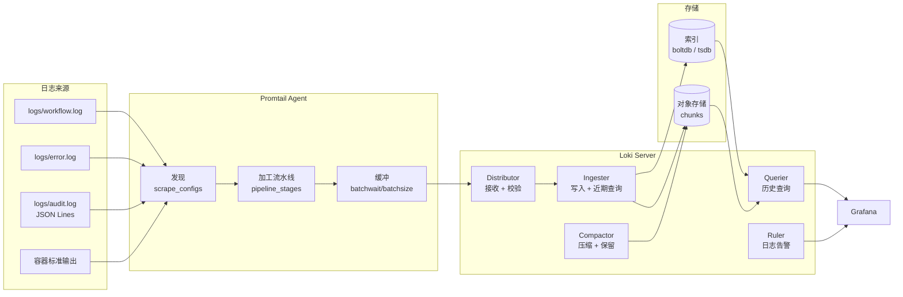
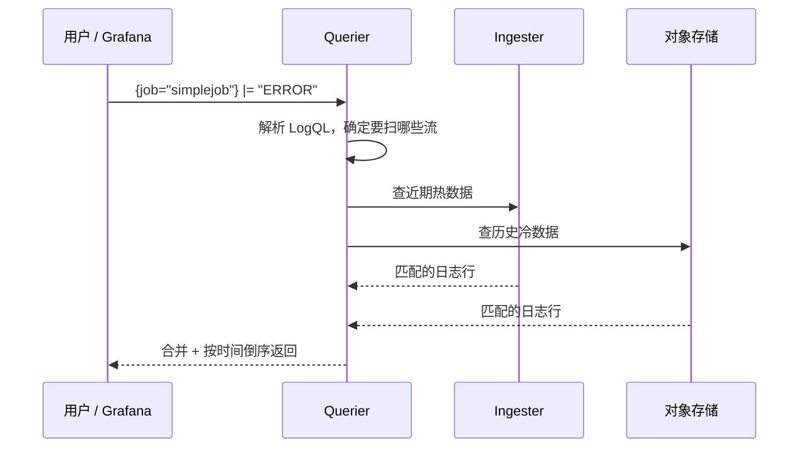
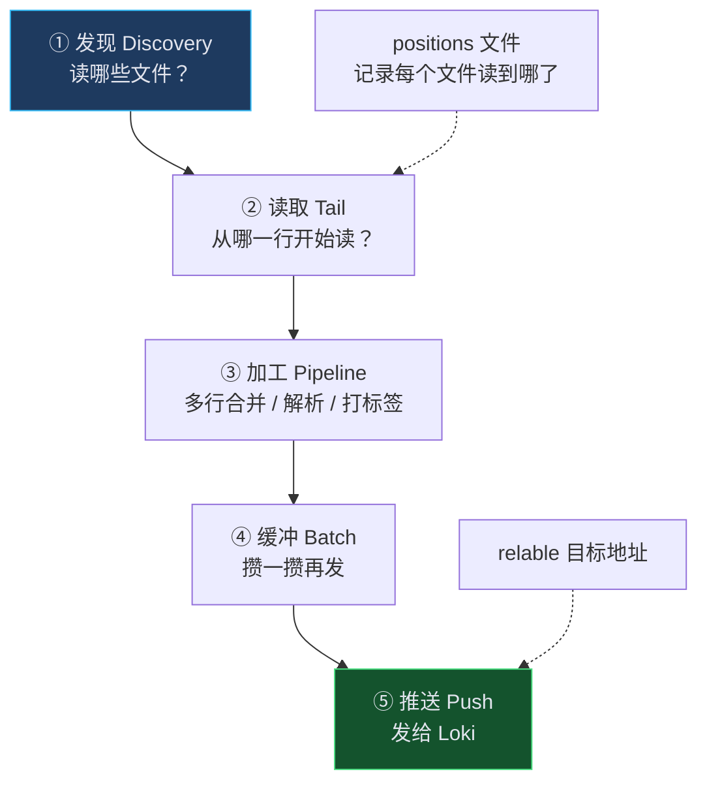

# Loki + Promtail 零基础入门教程

> 适用项目：**simplejob**（FastAPI + gunicorn + LangGraph + PostgreSQL + Redis + 邮件机器人，日志在 `logs/workflow.log`、`error.log`、`nodes.log`、`audit.log`）
>
> 配套文档：[总览篇](./00-监控告警健康检查-总览.md)（监控全景）、[指标篇](./01-Prometheus-指标监控.md)（指标篇）、[monitoring-alerting-healthcheck.md](../monitoring-alerting-healthcheck.md)（落地配置）
>
> 前置知识：看得懂 YAML，知道「日志文件」是什么。**不需要**运维背景，不需要用过 ELK。
>
> 阅读方式：第 0～2 章建立概念，第 3～4 章跑通链路，**第 5 章标签设计是全局重点**，第 6～8 章是配置与 LogQL，第 9～12 章是进阶与排障。只想要结论直接跳 [15. 一页纸速查](#15-一页纸速查)。

---

## 目录

- [0. Loki 是什么](#0-loki-是什么)
- [1. 六个核心概念](#1-六个核心概念)
- [2. 架构全景](#2-架构全景)
- [3. Promtail 是怎么干活的](#3-promtail-是怎么干活的)
- [4. 五分钟跑起来](#4-五分钟跑起来)
- [5. 标签设计 最重要的一章](#5-标签设计-最重要的一章)
- [6. promtail 配置逐段讲](#6-promtail-配置逐段讲)
- [7. LogQL 零基础](#7-logql-零基础)
- [8. LogQL 实战模板](#8-logql-实战模板)
- [9. 多行合并与 pipeline stages](#9-多行合并与-pipeline-stages)
- [10. 日志告警](#10-日志告警)
- [11. 与 Prometheus / Grafana 联动](#11-与-prometheus--grafana-联动)
- [12. 存储与保留](#12-存储与保留)
- [13. 排障](#13-排障)
- [14. 最佳实践清单](#14-最佳实践清单)
- [15. 一页纸速查](#15-一页纸速查)

---

## 0. Loki 是什么

一句话：

> **Loki 是一个「把日志按标签归类、能像查指标一样查日志」的聚合系统。**

它的设计目标和 Elasticsearch 完全不同：

| | **Elasticsearch** | **Loki** |
|---|---|---|
| 索引什么 | **全文**（所有分词都建索引） | **只索引标签** |
| 查询方式 | 全文检索 | 标签筛选 + 管道过滤 |
| 成本 | 高（索引膨胀） | 低（日志压缩存对象存储） |
| 擅长 | 复杂全文搜索、聚合分析 | **和 Prometheus 配合的运维日志** |
| 存储 | 本地盘为主 | 对象存储（S3/OSS/MinIO/文件系统） |

**Loki 的核心哲学**：

> 日志的**元数据**（谁、在哪个环境、哪个服务、什么级别）用标签索引；日志的**正文**只存原文，查询时再扫描过滤。

这带来一个直接推论——**标签选对了查询才快，标签选错了要么查不动要么查不出**。这也是第 5 章是全文最重要一章的原因。

### 0.1 它**不**做什么

| 常见误解 | 实际 |
|---|---|
| 「Loki 能替代 Prometheus」 | ❌ 日志和指标是两套数据，互补而非替代 |
| 「Loki 查询像数据库一样精确」 | ❌ 它是「扫描 + 过滤」，不是索引检索 |
| 「标签越多越好」 | ❌ 标签是高基数杀手，索引会爆 |
| 「日志一定不丢」 | ❌ Promtail 没跑起来 / Loki 挂了，日志就堆在本地或丢掉 |
| 「日志格式随便写」 | ❌ 没有结构化格式就要靠正则解析，成本和脆弱度都高 |

### 0.2 三个角色的分工

```text
应用 / 文件          →  产生日志（logs/*.log）
Promtail / Alloy     →  发现、读取、加工、推送（采集侧）
Loki                 →  存储、索引、查询（服务端）
Grafana              →  查询界面（消费侧）
```

> **Promtail 是 Loki 官方的原生采集器**（Go 写的，单机 agent）。
> 也可以用 **Grafana Alloy**、**Fluent Bit**、**Vector** 等替代；本教程用 Promtail。

---

## 1. 六个核心概念

| 概念 | 一句话 | 例子 |
|---|---|---|
| **日志流 Stream** | 一组唯一标签组合下的日志集合 | `{job="simplejob", level="error"}` |
| **标签 Label** | 日志流的索引维度（**只索引这个**） | `job`、`env`、`level` |
| **日志行 Entry** | 一条日志 = 时间戳 + 正文 | `2026-11-14 10:23:01 \| ERROR \| ...` |
| **Chunk** | 存储单位（一批压缩后的日志） | 默认按时间切 |
| **Pipeline** | Promtail 的加工流水线 | 多行合并 → 正则 → 打标签 |
| **租户 Tenant** | 多租户隔离（HTTP 头 `X-Scope-OrgID`） | 单租户项目一般不用 |

### 1.1 关键认知 标签决定「流」

和 Prometheus 一样：**标签组合不同 = 不同的流**。

```text
{job="simplejob", level="info"}   → 一个流
{job="simplejob", level="error"}  → 另一个流
{job="audit"}                     → 又一个流
```

所以 10 个 level × 5 个服务 = 50 个流。而下面这样就是灾难：

```text
{job="simplejob", request_id="a3f9..."}   ← 每个请求一个流，无限增长
```

> **这是 Loki 和 Prometheus 共同的第一原则**：
> **日志/链路存「个体」，指标和标签存「聚合」。**

### 1.2 日志行的两个部分

```text
┌──────────────────────────────────────────────────┐
│ 时间戳 2026-11-14T10:23:01Z │ 正文（一行文本）    │
└──────────────────────────────────────────────────┘
```

- **时间戳**：Loki 排序的依据。可以来自日志内容（用 `timestamp` stage 提取），也可以来自抓取时刻。
- **正文**：**不索引**，查询时才扫描。

> 推论：**正文写得越结构化，查询越省事**。本项目的 `audit.log` 是 JSON Lines，就能直接用 `| json` 解析；而 `workflow.log` 是竖线分隔文本，需要正则。

---

## 2. 架构全景



### 2.1 组件职责

| 组件 | 职责 | 单二进制模式下 |
|---|---|---|
| **Distributor** | 接收 push，校验标签/顺序，转发给 Ingester | ✅ 内置 |
| **Ingester** | 把日志写成 chunk，**热数据**在内存+本地 | ✅ 内置 |
| **Querier** | 执行查询：热数据问 Ingester，冷数据读对象存储 | ✅ 内置 |
| **Compactor** | 压缩索引、执行保留策略删除旧数据 | ✅ 内置 |
| **Ruler** | 周期性执行日志告警规则，发给 Alertmanager | ✅ 内置 |
| **Query Frontend** | 大查询拆分 + 结果缓存（可选） | 一般不用 |
| **Index Gateway** | 索引查询缓存（大规模才需要） | 不用 |

> **单二进制模式（monolithic）**：一个进程跑全部组件，配 `filesystem` 存储即可，中小项目完全够用。本教程用这种。

### 2.2 一次日志查询的旅程



**关键点**：Querier 是「扫描」而不是「检索」——它按标签定位到流，然后扫描 chunk 内容做过滤。所以：

- 标签越精确 → 要扫的流越少 → 越快
- 正文过滤（`|= "xxx"`）越靠前越好，能提前减少扫描量

---

## 3. Promtail 是怎么干活的

Promtail 的工作可以拆成五步，**这是看懂配置的关键**：



### 3.1 五个步骤详解

| 步骤 | 做什么 | 关键配置 |
|---|---|---|
| **① 发现** | 按 `__path__` 找到日志文件，支持 glob | `static_configs`、`__path__` |
| **② 读取** | 从文件尾部开始读，记录偏移量到 `positions.yml` | `positions.filename` |
| **③ 加工** | 多行合并、正则提取、打标签、改时间戳 | `pipeline_stages` |
| **④ 缓冲** | 攒够时间或条数再发，减少请求数 | `batchwait`、`batchsize` |
| **⑤ 推送** | 按标签分批发给 Loki | `clients.url` |

### 3.2 两个必须理解的文件

**`positions.yml`** —— Promtail 的「书签」：

```yaml
positions:
  /var/log/simplejob/workflow.log: 12345678    # 文件指纹 + 已读偏移
```

- 重启 Promtail 后从这里续读，**不会重复采集**。
- 但注意：它记录的是**读取位置**，不是「已发送成功」。如果 Loki 没收到，Promtail 会重发（靠 WAL，新版本）或丢弃（旧版本）。

**日志文件本身** —— 应用写的。本项目的日志由 `app/core/logging_config.py` 的**日志监听进程**统一落盘（多进程部署下 worker 不直接写文件），所以 Promtail 只需要读文件，不用管进程。

### 3.3 抓不到日志的常见原因

| 现象 | 原因 |
|---|---|
| Loki 里完全没有这个文件的数据 | `__path__` 写错 / 文件权限不足 / Promtail 没跑 |
| 只读到一部分 | `positions.yml` 里的旧位置 / 文件被轮转后换了名字 |
| 日志时间乱 | 没配 `timestamp` stage，用了抓取时刻 |
| 日志重复 | 文件轮转 + positions 没跟上 |
| 延迟很大 | `batchwait` 太长 / Loki 压力大 |

---

## 4. 五分钟跑起来

### 4.1 最小可用栈

```yaml
# docker-compose.loki.yml
services:
  loki:
    image: grafana/loki:3.2.0
    command: -config.file=/etc/loki/loki-config.yml
    volumes:
      - ./deploy/loki/loki-config.yml:/etc/loki/loki-config.yml:ro
      - loki_data:/loki
    ports: ["3100:3100"]

  promtail:
    image: grafana/promtail:3.2.0
    volumes:
      - ./deploy/loki/promtail-config.yml:/etc/promtail/config.yml:ro
      - ./logs:/var/log/simplejob:ro
      - promtail_positions:/var/lib/promtail
    depends_on: [loki]

  grafana:
    image: grafana/grafana:11.2.0
    environment:
      GF_SECURITY_ADMIN_PASSWORD: ${GRAFANA_ADMIN_PASSWORD:?must set}
    volumes:
      - ./deploy/grafana/provisioning:/etc/grafana/provisioning:ro
    ports: ["3000:3000"]
    depends_on: [loki]

volumes:
  loki_data:
  promtail_positions:
```

### 4.2 Promtail 最小配置

```yaml
server:
  http_listen_port: 3101
  grpc_listen_port: 0        # 单 agent 不需要 grpc

positions:
  filename: /var/lib/promtail/positions.yml

clients:
  - url: http://loki:3100/loki/api/v1/push
    batchwait: 1s
    batchsize: 1048576

scrape_configs:
  - job_name: simplejob
    static_configs:
      - targets: [localhost]
        labels:
          job: simplejob
          __path__: /var/log/simplejob/*.log
```

### 4.3 验证

```bash
# 1. 确认 Promtail 读到了文件
curl -s http://localhost:3101/metrics | grep loki_promtail

# 2. 确认 Loki 收到了流（返回的是标签，不是日志）
curl -s http://localhost:3100/loki/api/v1/labels | python -m json.tool
curl -s 'http://localhost:3100/loki/api/v1/label/job/values' | python -m json.tool

# 3. 查日志（最近 5 分钟）
curl -sG http://localhost:3100/loki/api/v1/query_range \
  --data-urlencode 'query={job="simplejob"}' \
  --data-urlencode 'limit=20' | python -m json.tool
```

看到 `job` 标签和日志行，链路就通了。然后去 Grafana 把 Loki 加成数据源（UID `loki`，URL `http://loki:3100`）。

---

## 5. 标签设计 最重要的一章

**标签决定成本，也决定查询体验。** 这一章是 Loki 用得好不好的分水岭。

### 5.1 标签的三个原则

1. **低基数**：标签取值数量要少。
2. **稳定**：标签值不随日志内容变化。
3. **可枚举**：能用一张表列出来。

| ✅ 好的标签 | ❌ 坏的标签 |
|---|---|
| `job="simplejob"` | `request_id="a3f9..."` |
| `env="prod"` | `user_id="u8899"` |
| `level="error"` | `email="a@b.com"` |
| `service="ocr"` | `filename="/var/log/simplejob/workflow.log.2026-11-10"` |
| `route="/candidate/list"` | `trace_id="0af765..."` |

> **`filename` 要小心**：如果日志按天轮转（`workflow.log.2026-11-10`），`filename` 的取值会无限增长。
> 要么**别用**，要么用 `regex` stage 归一化成 `workflow.log`。

### 5.2 静态标签 vs 管道标签

| 类型 | 来源 | 例子 |
|---|---|---|
| **静态标签** | 采集配置里写死 | `job`、`env`、`service` |
| **管道标签** | 从日志正文提取 | `level`、`request_id`（**慎用**） |

本项目的做法（推荐）：

```yaml
labels:
  job: simplejob        # 静态
  env: prod             # 静态
```

```yaml
pipeline_stages:
  - regex:              # 从正文提取，但只提取低基数的
      expression: '^(?P<ts>\S+ \S+)\s+\|\s+(?P<level>\w+)\s+\|...'
  - labels:
      level: level      # level 是低基数 ✅
```

### 5.3 本项目日志的标签方案

| 日志文件 | job | 额外标签 | 说明 |
|---|---|---|---|
| `workflow.log` | `simplejob` | `level` | 主业务日志 |
| `error.log` | `simplejob` | `level` | 同上，但内容更关键 |
| `nodes.log` | `simplejob` | `level` | LangGraph 节点日志 |
| `audit.log` | `simplejob-audit` | `action`、`request_id` | JSON Lines，**单独 job** |
| `access.log` | `simplejob` | `status` | 如有 |

> **为什么 `audit.log` 要单独一个 job？**
>
> 1. 它是**结构化 JSON**，解析方式不同（`| json` 即可，不用正则）。
> 2. 审计日志需要**独立的告警规则**（谁下载了简历、谁删了数据）。
> 3. 主日志量可能很大，分开后可以单独设保留期。

### 5.4 一句话记住

```text
标签 = 「我想怎么把日志分组看」
正文 = 「这一条具体说了什么」
```

想按 `level=error` 分组看 → `level` 做成标签。
想搜某个 `request_id` 的具体日志 → 放正文里用 `|=` 搜。

---

## 6. promtail 配置逐段讲

### 6.1 完整配置（本项目）

```yaml
server:
  http_listen_port: 3101

positions:
  filename: /var/lib/promtail/positions.yml

clients:
  - url: http://loki:3100/loki/api/v1/push
    batchwait: 1s
    batchsize: 1048576
    #  Loki 挂了不要无限重试，避免 Promtail 内存堆积
    tenant_id: ""

scrape_configs:
  # ── 业务日志（workflow.log / error.log / nodes.log）──
  - job_name: simplejob
    static_configs:
      - targets: [localhost]
        labels:
          job: simplejob
          env: prod
          __path__: /var/log/simplejob
    pipeline_stages:
      # 1) 多行合并：日志以 "YYYY-MM-DD HH:MM:SS |" 开头
      - multiline:
          firstline: '^\d{4}-\d{2}-\d{2} \d{2}:\d{2}:\d{2}'
          max_wait_time: 3s
          max_lines: 200

      # 2) 用正则拆出字段
      - regex:
          expression: >-
            ^(?P<ts>\S+ \S+)\s+\|\s+(?P<level>\w+)\s+\|\s+(?P<logger>[^|]+)\s+\|
            \s+(?P<thread>[^|]+)\s+\|\s+req=(?P<request_id>\S+)\s+\|\s+(?P<msg>.*)$

      # 3) 只把低基数字段提升为标签
      - labels:
          level: level

      # 4) 用日志里的时间当时间戳
      - timestamp:
          source: ts
          format: "2006-01-02 15:04:05"
          action_on_failure: skip

      # 5) 丢弃高基数字段（request_id 只留在正文里）
      - labeldrop:
          - request_id

  # ── 审计日志（JSON Lines，单独标签便于告警）──
  - job_name: simplejob-audit
    static_configs:
      - targets: [localhost]
        labels:
          job: simplejob-audit
          __path__: /var/log/simplejob/audit.log
    pipeline_stages:
      - json:
          expressions:
            ts: ts
            action: action
            request_id: request_id
      - labels:
          action: action
      - timestamp:
          source: ts
          format: RFC3339
```

### 6.2 配置项速查

| 段 | 关键字段 | 说明 |
|---|---|---|
| `server` | `http_listen_port` | 自身指标/metrics 端口 |
| `positions` | `filename` | 「书签」位置 |
| `clients` | `url`、`batchwait`、`batchsize` | 推送目标与缓冲 |
| `scrape_configs` | `job_name`、`__path__` | 抓什么 |
| `pipeline_stages` | 见第 9 章 | 怎么加工 |

### 6.3 日志轮转的处理

本项目日志按天轮转（`workflow.log.2026-11-10`）。Promtail 靠**文件指纹**识别文件，轮转时：

- 旧文件被改名 → Promtail 继续读完剩余内容（读满 18 小时无写入后标记完成）
- 新文件出现 → 新建一条流

> 如果轮转后旧文件**不再匹配 glob**（比如 `__path__` 只写 `workflow.log`），那旧文件就读不到了。
> 所以要么 `__path__` 指向**目录**（本项目的写法），要么 glob 覆盖轮转文件。

---

## 7. LogQL 零基础

LogQL = 日志选择器 + 管道。和 PromQL 完全不同的思路。

### 7.1 三个部分

```logql
{job="simplejob"} |= "ERROR" | json | level="error" | line_format "{{.msg}}"
└── 流选择器 ──┘ └─过滤─┘ └解析┘ └标签过滤─┘ └─格式化────┘
```

### 7.2 流选择器

```logql
{job="simplejob"}                       # 精确
{job="simplejob", level="error"}        # 多条件（AND）
{job=~"simplejob.*"}                    # 正则
{job="simplejob", level!="info"}        # 排除
```

> **注意**：Loki 的标签匹配符和 Prometheus 一样是 `= != =~ !~`，但**流选择器里不能用 `>`、`<`**（那是数值比较，不是标签）。

### 7.3 行过滤（过滤运算符）

```logql
{job="simplejob"} |= "ERROR"                    # 包含
{job="simplejob"} != "DEBUG"                    # 不包含
{job="simplejob"} |~ "(?i)error|exception"      # 正则（(?i) 忽略大小写）
{job="simplejob"} !~ "healthz"                  # 正则排除
```

**性能要点**：**过滤越靠前越好**。先过滤再解析，能少解析很多行。

### 7.4 解析器

```logql
# JSON（本项目 audit.log 首选）
{job="simplejob-audit"} | json

# logfmt（key=value 格式）
{job="simplejob"} | logfmt

# 正则（自定义命名分组）
{job="simplejob"} | regexp "(?P<level>\w+) (?P<msg>.*)"

# pattern（按占位符拆分）
{job="simplejob"} | pattern "<_> <level> <msg>"

# 不做解析，直接拆字段
{job="simplejob"} | unpack
```

解析后字段变成可查询的标签：

```logql
{job="simplejob-audit"} | json | action="resume.download"
```

### 7.5 管道后的标签过滤与格式化

```logql
# 解析后按字段过滤（比正则过滤更准更快）
{job="simplejob-audit"} | json | action = "resume.download" and result = "denied"

# 重写展示内容
{job="simplejob"} |= "ERROR" | line_format "{{.level}} | {{.msg}}"

# 增删标签（Loki 3.x）
{job="simplejob"} | line_format "" | drop level
{job="simplejob"} | label_format severity=level
```

### 7.6 日志度量（把日志变成数字）

这是 LogQL 最有用的能力——**不用改应用埋点，直接从日志算指标**：

```logql
count_over_time({job="simplejob"} [5m])              # 5 分钟行数
rate({job="simplejob"} |= "ERROR" [1m])              # ERROR 每秒条数
bytes_over_time({job="simplejob"} [1h])              # 日志体积
bytes_rate({job="simplejob"} [1h])                   # 每秒字节
sum(count_over_time({job="simplejob"}[5m])) by (level)   # 按级别聚合
```

### 7.7 聚合与分组

```logql
sum by (level) (count_over_time({job="simplejob"}[5m]))
sum without (instance) (count_over_time({job="simplejob"}[5m]))
topk(10, sum by (route) (count_over_time({job="simplejob"}[5m])))
avg by (service) (rate({job="simplejob"}[5m]))
```

### 7.8 时间范围与偏移

```logql
count_over_time({job="simplejob"}[5m])
count_over_time({job="simplejob"}[5m] offset 1h)     # 1 小时前
count_over_time({job="simplejob"}[1d] offset 1d)     # 昨天整天
```

### 7.9 和 PromQL 的思维差异

| | PromQL | LogQL |
|---|---|---|
| 选择什么 | 指标名 + 标签 | 日志流 + 标签 |
| 过滤什么 | 标签 | **日志正文** |
| 核心函数 | `rate` / `histogram_quantile` | `count_over_time` / 解析器 |
| 产出 | 数字（曲线） | 日志行 **或** 数字（聚合后） |
| 索引 | 标签（+ 指标名） | **只有标签** |

---

## 8. LogQL 实战模板

以下都基于本项目的日志内容。

### 8.1 按 request_id 串联一次请求

```logql
{job="simplejob"} |= "a3f9c2d8"
```

这是**排障第一招**。拿到 trace_id / request_id 后一搜，全链路日志都在。

### 8.2 关键字搜索

```logql
{job="simplejob"} |= "简历文件不存在"
{job="simplejob"} |= "[timeout_sweep] 推进失败"
{job="simplejob"} |= "node_error"
{job="simplejob"} |= "Redis 未初始化"
{job="simplejob"} |= "Token expired"
{job="simplejob"} |~ "(?i)connection\s+(refused|reset|timeout)"
```

### 8.3 ERROR 突增

```logql
sum(count_over_time({job="simplejob"} |~ "ERROR|Exception" [5m]))
```

### 8.4 按级别分组看分布

```logql
sum by (level) (count_over_time({job="simplejob"}[1h]))
```

### 8.5 审计日志：谁下载了简历

```logql
{job="simplejob-audit"} | json | action="resume.download"
```

### 8.6 审计日志：被拒绝的下载（越权尝试）

```logql
{job="simplejob-audit"} | json | action="resume.download" | result="denied"
```

统计被拒次数：

```logql
sum(count_over_time({job="simplejob-audit"} | json | action="resume.download" | result="denied" [1h]))
```

### 8.7 登录失败（爆破检测）

```logql
{job="simplejob"} |= "登录失败"
```

```logql
sum(count_over_time({job="simplejob"} |= "登录失败" [5m])) > 50
```

### 8.8 日志体积异常（磁盘要爆）

```logql
sum(bytes_rate({job="simplejob"}[1h])) by (level)
```

### 8.9 按节点看工作流耗时

```logql
{job="simplejob"} |~ "node.*(scoring|ocr)" | logfmt
```

### 8.10 模式聚合（pattern 解析器，直接出表格）

```logql
topk(10, sum by (route) (count_over_time({job="simplejob"} | pattern "<_> <_> <route> <_>" [5m])))
```

### 8.11 同比突变

```logql
sum(count_over_time({job="simplejob"} |= "登录失败" [5m]))
  / sum(count_over_time({job="simplejob"} |= "登录失败" [5m] offset 1h)) > 5
```

---

## 9. 多行合并与 pipeline stages

### 9.1 为什么必须多行合并

Python 异常堆栈是多行的：

```text
2026-11-14 10:23:01 | ERROR    | app.workflow.error_handler:wrapped:68 | ... | [error_wrap] scoring_node
Traceback (most recent call last):
  File "/app/app/workflow/candidate_nodes/scoring_node.py", line 42, in run
    score = await ai_client.score(resume)
  File "/app/app/core/http_client.py", line 24, in request
    return await _client.request(method, url, **kwargs)
httpx.ConnectTimeout: timed out
```

不合并的后果：

- 一条异常被拆成 6 条日志，`level` 只对第一行有效
- 按 `request_id` 串联时断掉
- ERROR 计数偏少（堆栈行没有 ERROR 标记）

**`multiline` stage 就是干这个的**：把「不以时间戳开头」的行，合并到上一条日志里。

```yaml
- multiline:
    firstline: '^\d{4}-\d{2}-\d{2} \d{2}:\d{2}:\d{2}'
    max_wait_time: 3s      # 等待后续行的最长时间
    max_lines: 200         # 单条最多合并多少行
```

### 9.2 常用 stage 速查

| stage | 作用 | 典型用途 |
|---|---|---|
| `multiline` | 合并多行 | 异常堆栈 |
| `regex` | 正则提取命名分组 | 拆 `ts`/`level`/`logger` |
| `json` | 解析 JSON | `audit.log` |
| `logfmt` | 解析 `key=value` | 结构化文本 |
| `labels` | 把分组提升为标签 | `level`、`action` |
| `timestamp` | 设置日志时间戳 | 用日志内时间 |
| `match` | 按选择器走不同分支 | 不同级别不同处理 |
| `replace` | 替换字段值 | 脱敏 |
| `template` | 用模板改写字段 | 拼字段 |
| `labeldrop` / `labelkeep` | 增删标签 | 丢高基数标签 |
| `drop` | 丢弃日志行 | 过滤噪音 |
| `limits` | 限流 / 截断 | 防超大行 |
| `decolorize` | 去掉 ANSI 颜色 | 容器日志 |

### 9.3 处理顺序的坑

```yaml
# ❌ 错误：先打标签再合并，堆栈行会单独成条
pipeline_stages:
  - regex: { expression: '...' }
  - labels: { level: level }
  - multiline: { firstline: '...' }

# ✅ 正确：先合并，再解析
pipeline_stages:
  - multiline: { firstline: '...' }
  - regex: { expression: '...' }
  - labels: { level: level }
  - timestamp: { source: ts, format: '...' }
```

> **经验顺序**：`multiline` → `docker`/`cri`（容器格式）→ `regex`/`json`/`logfmt` → `labels` → `timestamp` → `drop`/`labeldrop`。

---

## 10. 日志告警

用 **Loki Ruler**：周期性执行 LogQL，把结果发给 Alertmanager。

### 10.1 启用 ruler

```yaml
# loki-config.yml
ruler:
  storage:
    type: local
    local:
      directory: /loki/rules
  rule_path: /loki/rules
  alertmanager_url: http://alertmanager:9093
  enable_alertmanager_v2: true
```

### 10.2 规则示例

```yaml
# /loki/rules/simplejob.yaml
groups:
  - name: simplejob-logs
    rules:
      - alert: ResumeFileMissingSpike
        expr: |
          sum(count_over_time({job="simplejob"} |= "简历文件不存在" [10m])) > 20
        for: 10m
        labels: { severity: p2 }
        annotations:
          summary: "简历文件缺失日志激增（可能上传/存储链路异常）"

      - alert: WorkflowErrorSpike
        expr: |
          sum(count_over_time({job="simplejob"} |~ "ERROR|Exception" [5m])) > 30
        for: 5m
        labels: { severity: p1 }
```

### 10.3 日志告警 vs 指标告警 怎么选

| | 日志告警 | 指标告警 |
|---|---|---|
| 数据 | 日志正文 | 已埋点的指标 |
| 优点 | **不用改代码**，能覆盖未埋点的场景 | 快、准、省 |
| 缺点 | 扫描成本、依赖日志格式 | 需要提前埋点 |
| 适用 | 异常堆栈、第三方报错、一次性痕迹 | 错误率、延迟、量级 |

> **经验**：能埋点的优先用指标；埋不了点的用日志告警。本项目的 `[timeout_sweep] 推进失败`、`node_error` 就属于后者。

---

## 11. 与 Prometheus / Grafana 联动

### 11.1 Grafana 数据源

```yaml
# deploy/grafana/provisioning/datasources/prometheus.yml
apiVersion: 1
datasources:
  - name: Loki
    type: loki
    uid: loki
    access: proxy
    url: http://loki:3100
    jsonData:
      maxLines: 1000
      derivedFields:
        # 从日志里提取 trace_id，点击直接跳 Tempo
        - name: TraceID
          matcherRegex: 'trace=([0-9a-f]+)'
          url: '$${__value.raw}'
          datasourceUid: tempo
```

### 11.2 日志 ↔ 链路互跳

本项目的日志格式带 `req=<request_id>` 和（接入 OTel 后）`trace=<trace_id>`：

```logql
{job="simplejob"} |= "a3f9c2d8"
```

拿到 `trace_id` 后去 Tempo 看这次请求卡在哪。**这就是日志和链路互相跳转的闭环**。

### 11.3 在指标面板旁看日志

Grafana 的「Explore」可以同时开 Prometheus 和 Loki，典型排障流程：

```text
Prometheus：错误率曲线突然抬高
   → 点那个时间点
   → 切到 Loki，用相同时间范围搜 ERROR
   → 找到 request_id / trace_id
   → 去 Tempo 看链路
```

---

## 12. 存储与保留

### 12.1 存什么、存哪

| 数据 | 存哪 | 说明 |
|---|---|---|
| **chunks**（日志正文） | 对象存储（S3/OSS/GCS/文件系统） | 压缩后很省空间 |
| **index**（索引） | `boltdb-shipper` 或 `tsdb` | 按标签建索引 |

**单二进制最简配置**：

```yaml
common:
  path_prefix: /loki
  storage:
    filesystem:
      chunks_directory: /loki/chunks
      rules_directory: /loki/rules
  replication_factor: 1
  ring:
    kvstore:
      store: inmemory
```

### 12.2 Schema 配置（Loki 3.x）

```yaml
schema_config:
  configs:
    - from: 2024-04-01
      store: tsdb
      object_store: filesystem
      schema: v13
      index:
        prefix: index_
        period: 24h
```

> **版本差异**：Loki 2.x 默认 `boltdb-shipper` + schema v11/v12；**Loki 3.x 默认 `tsdb` + schema v13**。
> 生产部署建议直接对齐 3.x 的配置。

### 12.3 保留策略

```yaml
compactor:
  working_directory: /loki/compactor
  compaction_interval: 10m
  retention_enabled: true              # 开启保留
  retention_delete_delay: 2h           # 延迟删除，防误删
  retention_delete_worker_count: 150
  delete_request_store: filesystem

limits_config:
  retention_period: 30d                # 总保留期
  reject_old_samples: true             # 拒绝过老的数据
  reject_old_samples_max_age: 168h
  allow_structured_metadata: true
```

| 参数 | 说明 |
|---|---|
| `retention_enabled` | 不开就不会删旧数据 |
| `retention_delete_delay` | 留缓冲，防止误删 |
| `retention_period` | 全局保留期 |
| `reject_old_samples_max_age` | 超过这个年龄的日志直接拒收 |

> **注意**：Loki 的保留是**按流**的，不能像 Prometheus 那样按指标精细控制。审计日志想留更久，就**单独一个 job**（本项目就是这么做的）。

---

## 13. 排障

### 13.1 日志进不来

| 现象 | 排查 |
|---|---|
| Loki 里没有这个流 | ① Promtail 起没起 ② `__path__` 对不对 ③ 文件权限 |
| 只有部分日志 | ① `positions.yml` 位置不对 ② 文件轮转后名字不匹配 |
| 时间戳是抓取时刻 | 没配 `timestamp` stage |
| 日志重复 | 文件轮转 + positions 没跟上；重启过 Promtail |
| `entry out of order` | 日志时间戳乱序（见 13.2） |

**自查命令**：

```bash
# Promtail 自身指标
curl -s http://localhost:3101/metrics | grep -E 'promtail_read_lines|promtail_sent_entries'

# 看流列表
curl -s http://localhost:3100/loki/api/v1/labels
curl -s http://localhost:3100/loki/api/v1/label/job/values
```

### 13.2 entry out of order

**最常见也最容易慌的错误**：

```text
err="entry out of order for stream"
```

含义：新日志的时间戳**早于**该流里已有的最新时间戳。Loki 默认拒绝乱序写入（防止数据错乱）。

常见原因：

1. **多个 Promtail / 采集器抓同一个文件**（重复采集）
2. 日志时间戳解析错了（`timestamp` stage 的 `format` 写错）
3. 时区不一致（`location` 没配对）
4. 同一秒内的行顺序被打乱（多进程并发写）

处理：

```yaml
- timestamp:
    source: ts
    format: "2006-01-02 15:04:05"
    location: Asia/Shanghai      # 明确时区
    action_on_failure: skip      # 解析失败就用抓取时刻
```

### 13.3 查询很慢

按顺序排查：

```text
1. 标签选得够不够精确？    → {job="simplejob"} 比 {} 快得多
2. 有没有先过滤再解析？    → |= "ERROR" 放在 | json 前面
3. 时间范围是不是太大？    → 查 7 天肯定慢
4. 正则是不是回溯爆炸？    → 用 |= 字面量代替复杂正则
5. 是不是扫了太多流？      → 标签基数太高
```

### 13.4 日志体积暴涨

```logql
# 看哪个 level 最占空间
topk(5, sum by (level) (bytes_over_time({job="simplejob"}[1h])))

# 看哪个流最占空间
topk(10, sum(bytes_over_time({}[1h])) by (job, level))
```

处置：加 `drop` stage 过滤噪音日志，或降低某类日志级别。

### 13.5 告警不响

```text
1. Loki Ruler 起没起？            → 看 /loki/rules 挂载和 ruler 配置
2. 规则表达式有返回值吗？          → 在 Grafana Explore 里跑一遍
3. Alertmanager 收到了吗？         → 看 Alertmanager UI
4. 被 Silenced / Inhibited 了吗？  → 同上
```

---

## 14. 最佳实践清单

**标签设计**

- [ ] 标签只用低基数维度（`job`/`env`/`level`/`service`）
- [ ] **禁止** `request_id`、`user_id`、`email`、`trace_id` 当标签
- [ ] `filename` 注意轮转导致的基数增长
- [ ] 审计日志单独 job，便于独立告警和保留
- [ ] 标签名稳定，不要中途改名

**采集**

- [ ] 必须配 `multiline` 合并异常堆栈
- [ ] 用日志内时间做时间戳（`timestamp` stage）
- [ ] `__path__` 指向目录或覆盖轮转文件
- [ ] 生产环境开启 WAL（`wal.enabled`）防丢

**查询**

- [ ] 先过滤后解析
- [ ] 时间范围尽量小
- [ ] 用 `| json` / `| logfmt` 代替复杂正则
- [ ] 常用查询做成 Grafana 变量/面板

**告警**

- [ ] 能埋点的优先用指标告警
- [ ] 日志告警设 `for` 防抖
- [ ] 告警里带关键字，方便 Runbook 检索

**运维**

- [ ] 设保留期，开启 compactor
- [ ] 监控 Promtail（`promtail_read_lines_total`、`promtail_sent_entries_total`）
- [ ] 关注 `entry out of order` 日志
- [ ] 日志体积纳入看板

---

## 15. 一页纸速查

### 15.1 核心概念

```text
日志流 = 一组唯一标签组合          → {job="simplejob", level="error"}
日志行 = 时间戳 + 正文             → 正文不索引，只扫描
Loki   = 只索引标签的日志系统      → 和 Prometheus 标签体系一致
Promtail = 采集 agent             → 发现 → 读取 → 加工 → 缓冲 → 推送
```

### 15.2 LogQL 模板

| 需求 | 写法 |
|---|---|
| 看某类日志 | `{job="simplejob"} \|= "ERROR"` |
| 按 request_id 串联 | `{job="simplejob"} \|= "a3f9c2d8"` |
| JSON 解析 | `{job="simplejob-audit"} \| json` |
| 解析后过滤 | `{job="simplejob-audit"} \| json \| action="resume.download"` |
| 计数 | `count_over_time({job="simplejob"}[5m])` |
| 每秒条数 | `rate({job="simplejob"} \|= "ERROR" [1m])` |
| 按级别聚合 | `sum by (level) (count_over_time({job="simplejob"}[5m]))` |
| 日志体积 | `bytes_rate({job="simplejob"}[1h])` |
| Top N | `topk(10, sum by (route) (count_over_time({job="simplejob"}[5m])))` |
| 时间偏移 | `... [5m] offset 1h` |

### 15.3 pipeline 顺序

```text
multiline → cri/docker → regex / json / logfmt → labels → timestamp → drop / labeldrop
```

### 15.4 常用 API

```bash
# 有哪些标签
curl -s http://loki:3100/loki/api/v1/labels

# 某个标签有哪些值
curl -s http://loki:3100/loki/api/v1/label/job/values

# 即时查询
curl -sG http://loki:3100/loki/api/v1/query \
  --data-urlencode 'query={job="simplejob"} |= "ERROR"' \
  --data-urlencode 'limit=50'

# 范围查询（画曲线）
curl -sG http://loki:3100/loki/api/v1/query_range \
  --data-urlencode 'query=sum(count_over_time({job="simplejob"}[5m]))' \
  --data-urlencode 'step=60'
```

### 15.5 五个易错点

```text
① request_id 当标签    → 流爆炸，索引爆
② 不配 multiline       → 异常堆栈碎成几十条
③ 时间戳用抓取时刻      → 排障时对不上应用日志
④ 先解析后过滤          → 查询慢、成本高
⑤ 不设保留期            → 磁盘被日志吃满
```

### 15.6 相关文档

- [总览篇](./00-监控告警健康检查-总览.md) —— 监控 / 告警 / 健康检查全景
- [指标篇](./01-Prometheus-指标监控.md) —— Prometheus 指标篇（标签体系与 Loki 同源）
- [logging_system.md](../logging_system.md) —— simplejob 日志系统架构（队列 + 监听进程）
- [monitoring-alerting-healthcheck.md](../monitoring-alerting-healthcheck.md) —— 完整 `promtail-config.yml` / Loki 告警规则
