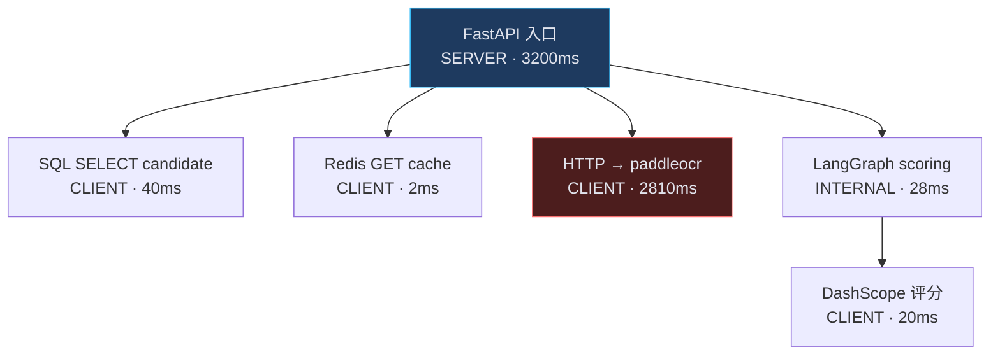
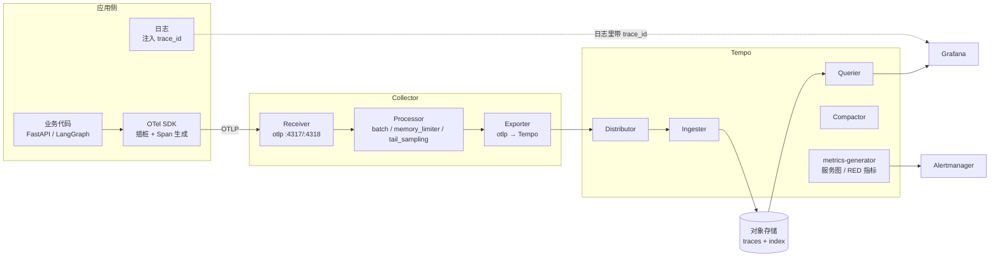

# OpenTelemetry + Tempo 零基础入门教程

> 适用项目：**simplejob**（FastAPI + gunicorn 单 worker + LangGraph + PostgreSQL + Redis + 邮件机器人 + OCR/AI 外部调用）
>
> 配套文档：[总览篇](./00-监控告警健康检查-总览.md)（监控全景）、[指标篇](./01-Prometheus-指标监控.md)（指标篇）、[日志篇](./02-Loki与Promtail-日志.md)（日志篇）
>
> 前置知识：看得懂 Python，知道「一次 HTTP 请求」是什么。**不需要**运维背景，不需要用过任何 APM。
>
> 阅读方式：第 0～3 章建立概念并跑起来，**第 5～6 章是埋点核心**，第 7～9 章是链路本身（OTLP / Collector / Tempo），第 10～12 章是查询与联动。只想要结论直接跳 [15. 一页纸速查](#15-一页纸速查)。

---

## 目录

- [0. 链路追踪是什么](#0-链路追踪是什么)
- [1. 七个核心概念](#1-七个核心概念)
- [2. OpenTelemetry 是什么](#2-opentelemetry-是什么)
- [3. 架构全景](#3-架构全景)
- [4. 五分钟跑起来](#4-五分钟跑起来)
- [5. 埋点 自动插桩与手动-span](#5-埋点-自动插桩与手动-span)
- [6. 上下文传播 跨服务怎么串起来](#6-上下文传播-跨服务怎么串起来)
- [7. OTLP 协议与导出](#7-otlp-协议与导出)
- [8. Collector 流水线](#8-collector-流水线)
- [9. Tempo 存储架构](#9-tempo-存储架构)
- [10. TraceQL 查询](#10-traceql-查询)
- [11. 三件套联动](#11-三件套联动)
- [12. 采样 成本与完整性](#12-采样-成本与完整性)
- [13. 排障](#13-排障)
- [14. 最佳实践清单](#14-最佳实践清单)
- [15. 一页纸速查](#15-一页纸速查)

---

## 0. 链路追踪是什么

先看一个真实问题。

某天早上，Grafana 上 `/candidate/list` 的 P95 从 200ms 涨到了 3 秒。

- **指标告诉你**：慢了。
- **日志告诉你**：各个步骤的耗时数字，但散落在几十行、甚至几个文件里，要人工拼。
- **链路追踪告诉你**：这一次请求**卡在哪一环**，一眼看到。

```text
trace 0af76516ab34...  （一次 POST /candidate/list，总耗时 3.2s）
├─ FastAPI 入口 ........................ 3200 ms
│  ├─ SQL: SELECT candidate ... ......... 40 ms
│  ├─ Redis GET cache ................... 2 ms
│  ├─ HTTP → paddleocr /parse ......... 2810 ms   ← 瓶颈在这
│  └─ LangGraph: scoring 节点 ............ 28 ms
```

**这就是链路追踪的价值：把「一次请求」经过的所有环节，自动串成一棵树。**

### 0.1 和指标、日志的分工

| | 指标 | 日志 | 链路 |
|---|---|---|---|
| 粒度 | 聚合 | 单条事件 | **单次请求的全路径** |
| 回答 | 「整体慢不慢」 | 「具体发生了什么」 | 「这一次卡在哪一环」 |
| 成本 | 低 | 中 | **高**（要记录每次调用） |
| 数据量 | 很小 | 大 | **最大** |

> **一句话**：指标发现**问题**，日志解释**原因**，链路定位**位置**。三者互补，不是替代。

### 0.2 一个重要事实 链路数据很贵

一次请求会产生几十上百个 span，每个 span 带十几个属性。**全量采集的成本可能是日志的数倍**。

所以链路系统有两个必修课：

1. **采样**（[第 12 章](#12-采样-成本与完整性)）：不是所有请求都要。
2. **按需下钻**：平时看指标，出问题了才拿 trace_id 去查。

---

## 1. 七个核心概念

### 1.1 概念表

| 概念 | 一句话 | 例子 |
|---|---|---|
| **Trace** | 一次完整请求的调用链 | 一次 `POST /candidate/list` |
| **Span** | 一个操作单元 | 一次 SQL 查询、一次 HTTP 调用 |
| **Trace ID** | 整条链路的唯一标识 | `0af76516ab34...`（32 位十六进制） |
| **Span ID** | 单个 span 的标识 | `9f2c...`（16 位十六进制） |
| **Parent Span ID** | 父 span，用来组成树 | 根 span 为空 |
| **Attribute** | span 上的键值对 | `http.route="/candidate/list"` |
| **Span Kind** | span 的角色 | `SERVER` / `CLIENT` / `INTERNAL` |

### 1.2 一棵 span 树



读法：

- 每个节点是一个 span，方括号里是它的**耗时**和**类型**。
- **父子关系**由 `parent_span_id` 决定，构成一棵树。
- 红色那个就是瓶颈——**一眼定位**。

### 1.3 Span 里到底存了什么

```yaml
trace_id: 0af76516ab34cd7890123456789abcdef
span_id: 9f2c1b3d4e5f6071
parent_span_id: 1a2b3c4d5e6f7081      # 根 span 没有这个字段
name: "SELECT candidate"
kind: CLIENT
start_time: 1731550000.123
end_time:   1731550000.163
attributes:
  db.system: postgresql
  db.statement: "SELECT * FROM candidate WHERE ..."
  http.route: /candidate/list
status: OK
events:                                # 时间点事件（如异常）
  - name: exception
    attributes: { exception.message: "..." }
resource:                             # 产生它的实体
  service.name: simplejob
  service.version: 0.1.0
  host.name: app-1
```

### 1.4 Span Kind 四种

| Kind | 含义 | 例子 |
|---|---|---|
| `SERVER` | 服务端处理一个请求 | FastAPI 入口 |
| `CLIENT` | 发起一次外部调用 | SQL 查询、Redis、HTTP 请求 |
| `INTERNAL` | 进程内部操作 | 函数调用、LangGraph 节点 |
| `PRODUCER` / `CONSUMER` | 消息的生产/消费 | Kafka、RabbitMQ |

> **记忆法**：`SERVER` = 我接待，`CLIENT` = 我出门，`INTERNAL` = 我手头的活。

### 1.5 Status 三种

| 状态 | 含义 |
|---|---|
| `UNSET` | 没设置（默认） |
| `OK` | 成功 |
| `ERROR` | 失败 |

> **实战要点**：只有 `ERROR` 状态的 span 才值得告警。但要让状态**真的被设置**——自动插桩通常做得不错，手动 span 容易忘。

### 1.6 Resource 资源属性

Resource 描述「**谁在产生这条数据**」，而不是「做了什么」：

```yaml
service.name: simplejob          # 最重要，服务图就靠它
service.version: 0.1.0
service.namespace: hr
deployment.environment: prod
host.name: app-1
```

> **核心原则**：**身份信息放 Resource，操作信息放 Attribute。**
> 弄反了会导致存储爆炸（每个不同 URL 都变成一个 service）。

---

## 2. OpenTelemetry 是什么

### 2.1 一句话

> **OpenTelemetry（简称 OTel）是一套「怎么采集和传输可观测性数据」的开放标准 + 工具集。**

它不是存储，也不是界面。它只负责**生产数据、加工数据、传输数据**。

### 2.2 三大信号

| 信号 | 说明 | 存储 |
|---|---|---|
| **Traces** | 调用链 | Tempo / Jaeger |
| **Metrics** | 指标 | Prometheus / Mimir |
| **Logs** | 日志 | Loki / ES |

OTel 对三者都提供 SDK 和传输协议，但**本项目只使用 Traces**。

### 2.3 三个组成部分

```text
┌─────────────────────────────────────────────────────────┐
│ 1. SDK / API     应用里埋点，产生 span                    │
│ 2. OTLP          传输协议（gRPC :4317 / HTTP :4318）      │
│ 3. Collector     接收 → 处理 → 导出（可选但推荐）         │
└─────────────────────────────────────────────────────────┘
```

### 2.4 为什么要用 OTel 而不是直接接 Jaeger / Zipkin

| | 直接接厂商 | 用 OTel |
|---|---|---|
| 绑定 | 强（换 APM 要改代码） | **松**（只改 exporter 配置） |
| 标准 | 各家私有 | **CNCF 标准** |
| 三类信号 | 各搞一套 | **统一 SDK** |
| 未来 | 被动 | 主动 |

> **一句话**：OTel 是「USB 接口」，Tempo 是「U 盘」。接口标准化了，换存储设备不用改应用代码。

---

## 3. 架构全景



### 3.1 组件职责

| 组件 | 职责 | 本项目 |
|---|---|---|
| **OTel SDK** | 生成 span，导出到 Collector | ✅ Python SDK |
| **Collector** | 接收、批处理、采样、转发 | ✅ `otelcol-contrib` |
| **Tempo** | 存储与查询 trace | ✅ 2.6.0 |
| **Grafana** | 查询界面 + 跳转 | ✅ |
| **metrics-generator** | 从 trace 生成服务图/RED 指标（可选） | 可选 |

### 3.2 为什么中间要加 Collector

理论上应用可以直接发给 Tempo，但生产环境几乎都加 Collector：

| 作用 | 说明 |
|---|---|
| **解耦** | 应用不用知道 Tempo 地址，换存储只改 Collector |
| **批处理** | `batch` processor 减少请求数 |
| **缓冲** | Tempo 挂了先攒着，避免应用阻塞 |
| **采样** | 尤其 **tail-based sampling**（要看完整条 trace 才能决定） |
| **统一出口** | 三类信号走同一个管道 |

> **注意**：加 Collector 会**多一跳**。小规模部署可以直接把 span 发给 Tempo 的 OTLP 端口，省一个组件。

---

## 4. 五分钟跑起来

### 4.1 依赖

```bash
uv add opentelemetry-api opentelemetry-sdk \
       opentelemetry-exporter-otlp \
       opentelemetry-instrumentation-fastapi \
       opentelemetry-instrumentation-sqlalchemy \
       opentelemetry-instrumentation-redis \
       opentelemetry-instrumentation-httpx
```

### 4.2 最小初始化

```python
# app/core/tracing.py
from opentelemetry import trace
from opentelemetry.exporter.otlp.proto.grpc.trace_exporter import OTLPSpanExporter
from opentelemetry.sdk.resources import Resource
from opentelemetry.sdk.trace import TracerProvider
from opentelemetry.sdk.trace.export import BatchSpanProcessor

from app.core.config import get_settings


def setup_tracing(app) -> None:
    settings = get_settings()

    # 开发环境且非 debug 时关掉，避免本地噪音
    if settings.environment == "development" and not settings.debug:
        return

    resource = Resource.create(
        {
            "service.name": settings.app_name,
            "service.version": settings.version,
            "deployment.environment": settings.environment,
        }
    )
    provider = TracerProvider(resource=resource)
    provider.add_span_processor(
        BatchSpanProcessor(OTLPSpanExporter(endpoint="http://otel-collector:4317"))
    )
    trace.set_tracer_provider(provider)

    # 自动插桩（业务代码零改动）
    from opentelemetry.instrumentation.fastapi import FastAPIInstrumentor
    from opentelemetry.instrumentation.sqlalchemy import SQLAlchemyInstrumentor
    from opentelemetry.instrumentation.redis import RedisInstrumentor
    from opentelemetry.instrumentation.httpx import HTTPXClientInstrumentor

    FastAPIInstrumentor.instrument_app(app)
    SQLAlchemyInstrumentor().instrument(engine=engine)
    RedisInstrumentor().instrument()
    HTTPXClientInstrumentor().instrument()


def get_tracer():
    return trace.get_tracer("simplejob")
```

### 4.3 接入 `app/main.py`

```python
from app.core.tracing import setup_tracing


def create_app() -> FastAPI:
    app = FastAPI(...)
    setup_middlewares(app)
    setup_exception_handlers(app)
    setup_routers(app)
    setup_tracing(app)      # ← 新增
    return app
```

### 4.4 验证

```bash
# 起服务后发一个请求
curl -i http://127.0.0.1:8000/healthz

# 去 Grafana Explore 选 Tempo 数据源，搜：
#   { resource.service.name = "simplejob" }
# 或直接按 trace id 搜
```

看到 FastAPI 入口的 span，链路就通了。

---

## 5. 埋点 自动插桩与手动-span

### 5.1 两种埋点方式

| | 自动插桩 | 手动 span |
|---|---|---|
| 怎么写 | 加一行 `instrument()` | 自己 `with start_as_current_span(...)` |
| 覆盖 | HTTP / DB / Redis / HTTP 客户端 | **业务语义**（节点、阶段） |
| 成本 | 极低 | 要改代码 |
| 价值 | 通用调用链 | **真正有业务含义的那一层** |

> **经验**：先开自动插桩拿到「骨架」，再对**关键业务节点**手动加 span 补充「灵魂」。

### 5.2 本项目的自动插桩点

| 插桩对象 | 得到的 span |
|---|---|
| `FastAPIInstrumentor` | 每个请求一个 `SERVER` span |
| `SQLAlchemyInstrumentor` | 每条 SQL 一个 `CLIENT` span |
| `RedisInstrumentor` | 每次 Redis 操作一个 `CLIENT` span |
| `HTTPXClientInstrumentor` | 每次外部 HTTP 调用一个 `CLIENT` span（OCR/AI/钉钉/邮件） |

### 5.3 手动 span 本项目重点

LangGraph 的节点是**业务语义**，自动插桩看不到，必须手动包：

```python
from opentelemetry import trace

tracer = trace.get_tracer("simplejob")


async def scoring_node(state):
    with tracer.start_as_current_span("node:scoring") as span:
        # 给这个节点加业务属性
        span.set_attribute("candidate.id", state["candidate"].id)
        span.set_attribute("stage", "scoring")

        try:
            score = await ai_client.score(state["resume_text"])
            span.set_attribute("score", score)
            return {"score": score}
        except ExternalServiceError as e:
            # 显式标记失败，否则状态是 UNSET
            span.record_exception(e)
            span.set_status(Status(StatusCode.ERROR, str(e)))
            raise
```

**三个必须注意的点**：

1. **`start_as_current_span`**（不是 `start_span`）—— 只有前者会自动设为「当前 span」，子 span 才能挂上来。
2. **异常要 `record_exception` + `set_status`** —— 否则 span 状态是 `UNSET`，在 Tempo 里看不出失败。
3. **属性值别用高基数** —— `candidate.id` 这种按需用，`request_id` / `email` 绝对不要。

### 5.4 属性命名规范

OTel 有**语义约定（Semantic Conventions）**，遵循它 Grafana 才能自动识别：

| 属性 | 含义 |
|---|---|
| `http.method` / `http.route` / `http.status_code` | HTTP 信息 |
| `db.system` / `db.statement` | 数据库 |
| `url.full` | 外部请求 URL |
| `service.name` / `service.version` | 服务身份 |

自定义属性用点分命名：`simplejob.stage`、`simplejob.node`。

---

## 6. 上下文传播 跨服务怎么串起来

**这是链路追踪最核心、也最容易出错的部分。**

问题：请求从 A 服务到 B 服务，怎么让 B 知道「我还是同一条 trace」？

答案：**在 HTTP header 里塞一个 `traceparent`。**

### 6.1 traceparent 长什么样

```http
traceparent: 00-0af76516ab34cd7890123456789abcdef-9f2c1b3d4e5f6071-01
           │  │                                │                └─ 采样标志
           │  │                                └─ 当前 span id
           │  └─ trace id（整条链路共享）
           └─ 版本（目前都是 00）
```

传递流程：

```text
服务 A                         服务 B
─────                          ─────
生成 traceparent ──HTTP header──► 读到 traceparent
                                 提取 trace_id（沿用）
                                 生成新的 span_id（自己）
                                 把 parent 指向 A 的 span_id
```

**结果**：A 和 B 的 span 共享同一个 `trace_id`，串成一条链。

### 6.2 传播方式

| 场景 | 怎么传 |
|---|---|
| HTTP 同步调用 | `traceparent` header（OTel 自动注入） |
| 消息队列 | 写进消息 header / 属性 |
| 进程内异步 | **contextvars**（Python `contextvars` / context 对象） |
| 线程切换 | 显式传 context |

> **本项目的坑**：Web 层是异步的，`contextvars` 会随任务切换丢失。
> OTel Python SDK 用 `contextvars` 存当前 span，所以 **`asyncio` 任务要正确传递 context**，否则子任务里的 span 会断链。

### 6.3 断链的常见原因

| 现象 | 原因 |
|---|---|
| trace 分成几段 | 跨进程没传 `traceparent` |
| 异步任务里的 span 丢了 parent | context 没传递 |
| 消息队列消费端是全新 trace | 消息里没带 trace 信息 |
| 外部服务不支持 OTel | 只能看到「调出去」那一段（正常） |

### 6.4 Baggage 顺带传业务上下文

`baggage` header 用来传**业务维度**（如 `user.role=admin`），会随链路自动传播：

```python
from opentelemetry import baggage

ctx = baggage.set_baggage("candidate.id", "12345")
```

> ⚠️ **baggage 会广播给所有下游**，别放敏感信息，也别放高基数值（影响性能）。

---

## 7. OTLP 协议与导出

### 7.1 两种传输方式

| 协议 | 端口 | 说明 |
|---|---|---|
| **OTLP/gRPC** | `4317` | 性能好，推荐 |
| **OTLP/HTTP** | `4318` | 路径 `/v1/traces`，穿防火墙方便 |

### 7.2 导出器选择

```bash
# gRPC（默认）
uv add opentelemetry-exporter-otlp

# 或 HTTP
uv add opentelemetry-exporter-otlp-proto-http
```

```python
# gRPC
from opentelemetry.exporter.otlp.proto.grpc.trace_exporter import OTLPSpanExporter
exporter = OTLPSpanExporter(endpoint="http://otel-collector:4317")

# HTTP
from opentelemetry.exporter.otlp.proto.http.trace_exporter import OTLPSpanExporter
exporter = OTLPSpanExporter(endpoint="http://otel-collector:4318/v1/traces")
```

### 7.3 处理器 批处理是必须的

| 处理器 | 行为 | 适用 |
|---|---|---|
| `BatchSpanProcessor` | 攒一批再发 | **生产必用** |
| `SimpleSpanProcessor` | 每个 span 立刻发 | 仅调试 |

```python
from opentelemetry.sdk.trace.export import BatchSpanProcessor

provider.add_span_processor(BatchSpanProcessor(exporter))
```

> **为什么必须批处理**：一个请求几十个 span，同步逐个发送会把延迟打爆，也会把 Collector 淹没。

### 7.4 环境变量配置

不改代码也能配（容器部署常用）：

```bash
OTEL_SERVICE_NAME=simplejob
OTEL_EXPORTER_OTLP_ENDPOINT=http://otel-collector:4317
OTEL_EXPORTER_OTLP_PROTOCOL=grpc
OTEL_TRACES_SAMPLER=parentbased_traceidratio
OTEL_TRACES_SAMPLER_ARG=0.1        # 10% 采样
OTEL_RESOURCE_ATTRIBUTES=service.version=0.1.0,deployment.environment=prod
```

> **建议**：用环境变量管**部署相关**配置（地址、采样率），用代码管**语义**配置（服务名、资源属性）。

---

## 8. Collector 流水线

Collector 的结构是固定的三段：**接收 → 处理 → 导出**。

```yaml
# deploy/otel/otel-collector-config.yml
receivers:
  otlp:
    protocols:
      grpc:
        endpoint: 0.0.0.0:4317
      http:
        endpoint: 0.0.0.0:4318

processors:
  memory_limiter:              # 必须放第一个：防 OOM
    check_interval: 1s
    limit_mib: 512
  batch:
    timeout: 1s
    send_batch_size: 1024
  # tail_sampling:             # 需要看完整 trace 的采样（见第 12 章）
  #   decision_wait: 10s
  #   policies:
  #     - name: errors
  #       type: status_code
  #       status_code: { status_codes: [ERROR] }

exporters:
  otlp:
    endpoint: tempo:4317
    tls:
      insecure: true

service:
  pipelines:
    traces:
      receivers: [otlp]
      processors: [memory_limiter, batch]
      exporters: [otlp]
```

### 8.1 常用 processor

| processor | 作用 |
|---|---|
| `memory_limiter` | 限制内存，**必须放第一个** |
| `batch` | 合并请求，减少压力 |
| `tail_sampling` | 看完整个 trace 再决定采不采 |
| `attributes` | 增删改 span 属性（如脱敏） |
| `resource` | 修改 Resource（如加环境标签） |
| `filter` | 按条件丢弃 span |
| `transform` | 用 OTTL 语言做复杂转换 |
| `probabilistic_sampler` | 按比例采样 |

### 8.2 部署模式

| 模式 | 说明 | 适用 |
|---|---|---|
| **Agent** | 和应用同机部署（sidecar/daemonset） | 生产推荐 |
| **Gateway** | 集中式，多应用共用 | 大规模 |
| **直连** | 应用直接发 Tempo | 小规模（省一个组件） |

---

## 9. Tempo 存储架构

### 9.1 组件

| 组件 | 职责 |
|---|---|
| **Distributor** | 接收 OTLP，校验后分发给 Ingester |
| **Ingester** | 把 trace 写成 block，热数据 |
| **Querier** | 查询热数据 + 冷数据 |
| **Query Frontend** | 大查询拆分（可选） |
| **Compactor** | 压缩 block、清理过期数据 |
| **metrics-generator** | 从 trace 生成服务图 / RED 指标（可选） |

### 9.2 存储特点

```text
Tempo 不索引 span 内容，只索引：
  - trace id
  - 少量属性（service.name、http.route、status 等）
  → 所以存储成本远低于 Loki/ES
```

数据分两层：

- **热数据**：Ingester 内存 + 本地盘
- **冷数据**：对象存储（S3/OSS/GCS/本地文件系统）

### 9.3 最简配置

```yaml
# deploy/tempo/tempo-config.yml
server:
  http_listen_port: 3200

distributor:
  receivers:
    otlp:
      protocols:
        grpc:
        http:

ingester:
  trace_idle_period: 10s
  max_block_duration: 5m

compactor:
  compaction:
    block_retention: 24h

storage:
  trace:
    backend: local
    local:
      path: /tmp/tempo/traces
    wal:
      path: /tmp/tempo/wal

multitenancy_enabled: false
```

> **生产环境**把 `backend` 换成 `s3` / `gcs`，并配好 `compactor.block_retention` 控制保留期。

---

## 10. TraceQL 查询

TraceQL 是 Tempo 的查询语言。**它查的是 span 属性，不是日志正文。**

### 10.1 基本结构

```traceql
{ <条件> }
{ <条件> } | <聚合或管道>
```

### 10.2 内建字段

| 字段 | 含义 |
|---|---|
| `duration` | span 耗时（纳秒） |
| `status` | `ok` / `error` / `unset` |
| `kind` | `server` / `client` / `internal` |
| `name` | span 名称 |
| `traceDuration` | 整条 trace 的耗时 |
| `rootServiceName` | 根服务名 |
| `rootSpanName` | 根 span 名 |

### 10.3 属性访问

```traceql
# span 属性用点号
{ .http.route = "/candidate/list" }

# resource 属性用 resource. 前缀
{ resource.service.name = "simplejob" }

# 字符串比较
{ .http.method = "POST" }

# 数值比较
{ duration > 1s }

# 正则
{ .http.route =~ "/candidate/.*" }

# 逻辑
{ duration > 1s } && { status = error }
{ .http.status_code >= 500 } || { status = error }
```

### 10.4 实用查询模板

```traceql
# 本项目最近的慢请求
{ resource.service.name = "simplejob" } | duration > 2s

# 出错的 trace
{ resource.service.name = "simplejob" } && { status = error }

# 某个路由的错误
{ .http.route = "/user/token" } && { .http.status_code >= 500 }

# 外部调用慢的（OCR/AI）
{ .url.full =~ ".*(paddleocr|dashscope).*" } && { duration > 5s }

# 按服务聚合 trace 数量
{} | count() by (resource.service.name)

# 按路由看平均耗时
{ resource.service.name = "simplejob" } | avg(duration) by (.http.route)

# P95 近似：按服务统计
{ resource.service.name = "simplejob" } | quantile(duration, 0.95) by (.http.route)
```

### 10.5 按 trace id 直接查

在 Grafana 里直接贴 trace id，或用：

```traceql
{ trace:id = "0af76516ab34cd7890123456789abcdef" }
```

### 10.6 TraceQL vs LogQL vs PromQL

| | PromQL | LogQL | TraceQL |
|---|---|---|---|
| 查什么 | 指标序列 | 日志行 | **span** |
| 语法味道 | 数学运算 | 管道过滤 | **属性过滤** |
| 聚合 | `sum/avg/histogram_quantile` | `count_over_time` | `count()/avg()/quantile()` |
| 时间范围 | 查询参数 | 查询参数 | 查询参数 |

---

## 11. 三件套联动

这是投入产出比最高的一节：**让指标、日志、链路互相跳转。**

### 11.1 日志注入 trace_id

在日志格式里加 `trace_id`，就能从日志一键跳到链路：

```python
# app/core/logging_config.py（片段）
from opentelemetry import trace


class TraceIdFilter(logging.Filter):
    def filter(self, record: logging.LogRecord) -> bool:
        ctx = trace.get_current_span().get_span_context()
        record.trace_id = format(ctx.trace_id, "032x") if ctx.is_valid else "-"
        return True


# LOG_FORMAT 末尾追加 trace 字段
LOG_FORMAT = (
    "%(asctime)s | %(levelname)-8s | %(name)s:%(funcName)s:%(lineno)d | "
    "%(threadName)s | req=%(request_id)s | trace=%(trace_id)s | %(message)s"
)

# _build_handlers() 里给每个 handler 增加：
#   handler.addFilter(TraceIdFilter())
```

日志效果：

```text
2026-11-14 10:23:01 | ERROR | app.workflow.error_handler:wrapped:68 | req=a3f9... | trace=0af76516... | [error_wrap] scoring_node
```

### 11.2 Grafana 配置 Derived Fields

在 Loki 数据源里加派生字段，点一下 trace_id 直接跳 Tempo：

```yaml
datasources:
  - name: Loki
    type: loki
    uid: loki
    jsonData:
      derivedFields:
        - name: TraceID
          matcherRegex: 'trace=([0-9a-f]+)'
          datasourceUid: tempo
```

### 11.3 Exemplars 指标里带 trace

Prometheus 支持 exemplar：指标数据点附带一个 trace_id，Grafana 点击直接跳。

```python
from opentelemetry.exporter.prometheus import PrometheusExporter  # 示意
# 实际上通常通过 OTel Collector 的 prometheusremotewrite + exemplars 实现
```

> **价值**：看到错误率涨了 → **点一下那个点** → 直接看到当时的 trace。不用猜时间范围去搜。

### 11.4 完整排障闭环


### 11.5 服务图（Service Graph）

Tempo 的 `metrics-generator` 从 trace 自动生成「谁调用谁」的图：

```yaml
metrics_generator:
  processor:
    service_graphs:
      enabled: true
```

Grafana 里就能看到 simplejob → PostgreSQL / Redis / OCR 的调用关系和错误率。

> **这是最直观的「系统拓扑图」**，而且不用手动维护。

---

## 12. 采样 成本与完整性

**全量采集 = 成本爆炸。** 采样是链路系统的必修课。

### 12.1 两种采样位置

| | Head-based（头部采样） | Tail-based（尾部采样） |
|---|---|---|
| 决定时机 | 请求**开始时** | 请求**结束后** |
| 依据 | 随机/比例 | **完整 trace 的信息** |
| 能保留 | 按比例碰运气 | **所有出错的 trace** |
| 实现 | SDK 里 | Collector 里 |
| 成本 | 低 | 高（要缓存整条 trace） |

### 12.2 Head-based 配置

```python
from opentelemetry.sdk.trace.sampling import ParentBased, TraceIdRatioBased

# 10% 采样，且「上游采了我就采」
sampler = ParentBased(TraceIdRatioBased(0.1))
provider = TracerProvider(sampler=sampler, resource=resource)
```

| 采样器 | 说明 |
|---|---|
| `ALWAYS_ON` | 全采（仅开发） |
| `ALWAYS_OFF` | 全不采 |
| `TraceIdRatioBased(0.1)` | 按 trace_id 比例采 |
| `ParentBased(...)` | **跟随上游决定**（推荐） |

> **`ParentBased` 很关键**：跨服务调用时，如果上游采样了，下游也必须采，否则链路会断成半截。

### 12.3 Tail-based 配置（推荐生产使用）

```yaml
processors:
  tail_sampling:
    decision_wait: 10s              # 等 10 秒收齐整条 trace
    num_traces: 100000              # 缓存上限
    expected_new_traces_per_sec: 100
    policies:
      - name: keep-errors           # 策略 1：出错的全留
        type: status_code
        status_code: { status_codes: [ERROR] }
      - name: keep-slow             # 策略 2：慢的全留
        type: latency
        latency: { threshold_ms: 2000 }
      - name: sample-normal        # 策略 3：正常请求 1%
        type: probabilistic
        probabilistic: { sampling_percentage: 1 }
```

**这才是实用的方案**：正常请求只留 1%，但**所有出错和慢的都留**。

### 12.4 采样率怎么定

| 场景 | 建议 |
|---|---|
| 开发环境 | 100% |
| 低流量服务（<100 req/s） | 10% |
| 中等流量 | 1%～5% |
| 高流量 | 0.1%～1% + tail_sampling 保错误 |
| 金融/支付关键链路 | 100%（单独标记） |

> **经验法则**：**先按「错误全留、正常抽样」设计**，比拍一个固定比例科学得多。

---

## 13. 排障

### 13.1 span 没上报

| 现象 | 排查 |
|---|---|
| Tempo 里什么都没有 | ① `setup_tracing` 被环境判断跳过了 ② endpoint 配错 |
| 端口不通 | 容器里 `curl http://otel-collector:4317`；检查 4317/4318 是否暴露 |
| 协议不对 | gRPC 发到了 4318（HTTP 端口），反之亦然 |
| Collector 报错 | 看 Collector 日志，常见是 `connection refused` / `tls` |

### 13.2 trace 断链

| 现象 | 原因 | 处置 |
|---|---|---|
| 两个独立 trace | 跨服务没传 `traceparent` | 用支持 OTel 的客户端（httpx 已插桩） |
| 异步任务 span 没有 parent | context 没传递 | 用 `contextvars` / 显式传 context |
| 消息队列两端不串 | 消息没带 trace | 手动注入/提取 baggage |
| 外部服务只有 CLIENT span | 对方不支持 OTel | 正常，无法改变 |

### 13.3 Tempo 查不到

```text
1. 保留期到了吗？        → compactor.block_retention
2. Ingester 还没 flush？  → trace_idle_period / max_block_duration
3. 查询时间范围对吗？
4. 采样把它丢了？          → 查采样率配置
```

### 13.4 属性值太大 / 太多

| 问题 | 后果 | 处置 |
|---|---|---|
| 把 SQL 全文放属性 | 存储爆炸、可能泄密 | 只放摘要，或不放 |
| 把 URL 带 query 放属性 | 高基数 | 用路由模板 |
| 放 request_id / email | 高基数 | 移到日志 |

### 13.5 成本失控

```text
1. 采样率是不是 100%？      → 降到 1% + tail_sampling
2. span 数量是不是太多？    → 关掉不必要的插桩
3. 属性是不是太多？         → 精简 attributes
4. 有没有采样器生效？       → 确认 ParentBased
```

---

## 14. 最佳实践清单

**设计**

- [ ] `service.name` 用服务名，**不要**把 URL / 版本塞进去
- [ ] 身份放 Resource，操作放 Attribute
- [ ] 遵循 OTel 语义约定（`http.route`、`db.system`）
- [ ] 属性值避免高基数（SQL 全文、URL query、ID）

**埋点**

- [ ] 自动插桩先开（FastAPI / SQLAlchemy / Redis / httpx）
- [ ] 关键业务节点手动加 span（LangGraph 节点）
- [ ] 异常必须 `record_exception` + `set_status(ERROR)`
- [ ] 用 `start_as_current_span` 而不是 `start_span`

**传输**

- [ ] 用 `BatchSpanProcessor`
- [ ] 用 `ParentBased` 采样器
- [ ] 生产用 tail_sampling：错误全留、正常抽样
- [ ] 地址/采样率走环境变量

**联动**

- [ ] 日志注入 `trace_id`
- [ ] Grafana 配 derived fields 互跳
- [ ] 关键指标开 exemplars
- [ ] 开 metrics-generator 看服务图

---

## 15. 一页纸速查

### 15.1 核心概念

```text
Trace   = 一次请求的完整调用链（共享 trace_id）
Span    = 一个操作单元（name + 时间 + 属性 + 状态）
Kind    = SERVER（我接待）/ CLIENT（我出门）/ INTERNAL（手头的活）
Status  = OK / ERROR / UNSET
Resource = 谁在产生（service.name）
Attribute = 做了什么（http.route）
```

### 15.2 数据流

```text
SDK 生成 span ──OTLP──► Collector ──OTLP──► Tempo ──► Grafana
              (4317 gRPC / 4318 HTTP)      (对象存储)
```

### 15.3 采样怎么选

```text
开发     → ALWAYS_ON
生产     → ParentBased(TraceIdRatioBased(0.01))
最好     → tail_sampling：错误全留 + 慢请求全留 + 正常 1%
```

### 15.4 TraceQL 模板

| 需求 | 写法 |
|---|---|
| 慢请求 | `{ resource.service.name = "simplejob" } \| duration > 2s` |
| 出错 | `{ resource.service.name = "simplejob" } && { status = error }` |
| 某路由 5xx | `{ .http.route = "/user/token" } && { .http.status_code >= 500 }` |
| 外部调用慢 | `{ .url.full =~ ".*paddleocr.*" } && { duration > 5s }` |
| 按路由聚合 | `{} \| avg(duration) by (.http.route)` |
| 按服务计数 | `{} \| count() by (resource.service.name)` |
| 按 trace id | `{ trace:id = "0af76516..." }` |

### 15.5 常用环境变量

```bash
OTEL_SERVICE_NAME=simplejob
OTEL_EXPORTER_OTLP_ENDPOINT=http://otel-collector:4317
OTEL_EXPORTER_OTLP_PROTOCOL=grpc
OTEL_TRACES_SAMPLER=parentbased_traceidratio
OTEL_TRACES_SAMPLER_ARG=0.1
OTEL_RESOURCE_ATTRIBUTES=service.version=0.1.0,deployment.environment=prod
```

### 15.6 五个易错点

```text
① 用 start_span 而不是 start_as_current_span  → 子 span 断链
② 异常没 record_exception / set_status        → 看不出失败
③ 采样器没用 ParentBased                      → 跨服务链路断成半截
④ 用 BatchSpanProcessor 之外的同步导出         → 延迟被打爆
⑤ 把 SQL 全文 / request_id 放属性             → 存储爆炸
```

### 15.7 相关文档

- [总览篇](./00-监控告警健康检查-总览.md) —— 监控 / 告警 / 健康检查全景
- [指标篇](./01-Prometheus-指标监控.md) —— 指标篇（exemplars 与链路联动）
- [日志篇](./02-Loki与Promtail-日志.md) —— 日志篇（trace_id 注入日志）
- [monitoring-alerting-healthcheck.md](../monitoring-alerting-healthcheck.md) —— 完整 `tracing.py` / `otel-collector-config.yml` / `tempo-config.yml`
