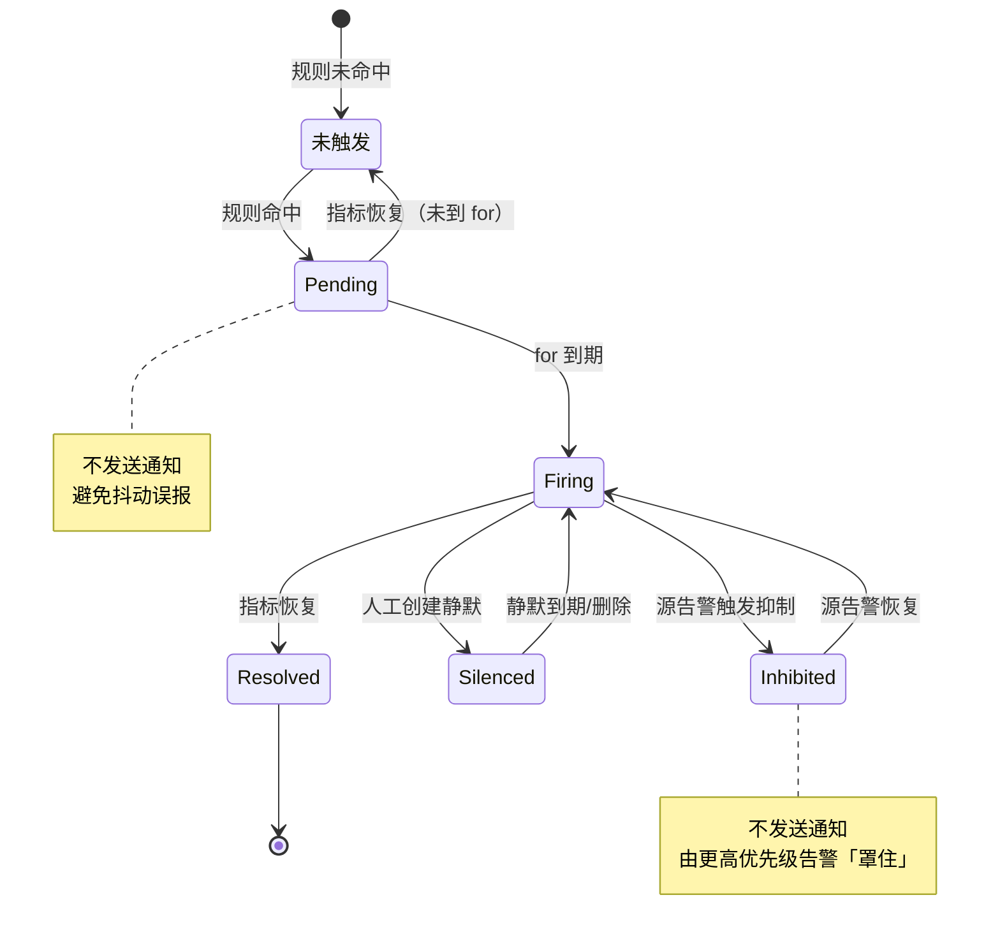
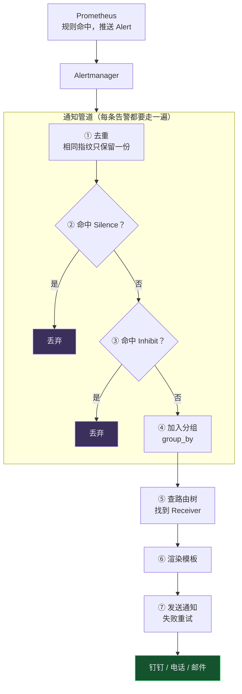
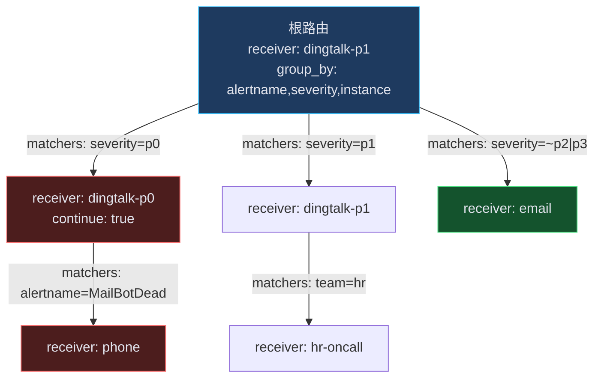

# Alertmanager 零基础入门教程

> 适用项目：**simplejob**（FastAPI + gunicorn 单 worker + PostgreSQL + Redis + 邮件机器人 + OCR/AI 外部调用）
>
> 配套文档：[总览篇](./00-监控告警健康检查-总览.md)（监控全景与告警分级）、[指标篇](./01-Prometheus-指标监控.md)（指标与告警规则）、[日志篇](./02-Loki与Promtail-日志.md)（日志告警）
>
> 前置知识：看得懂 YAML 和 JSON。**不需要**运维背景。
>
> 阅读方式：第 0～3 章建立概念，第 4～5 章跑起来看配置，**第 6～9 章是核心（路由 / 分组 / 抑制 / 静默）**，第 10～11 章是通知渠道与模板，第 12 章往后是落地与排障。只想要结论直接跳 [17. 一页纸速查](#17-一页纸速查)。

---

## 目录

- [0. Alertmanager 是什么](#0-alertmanager-是什么)
- [1. 六个核心概念](#1-六个核心概念)
- [2. 告警的生命周期](#2-告警的生命周期)
- [3. 架构与通知管道](#3-架构与通知管道)
- [4. 五分钟跑起来](#4-五分钟跑起来)
- [5. 配置逐段讲](#5-配置逐段讲)
- [6. 路由 Route](#6-路由-route)
- [7. 分组 Group](#7-分组-group)
- [8. 抑制 Inhibit](#8-抑制-inhibit)
- [9. 静默 Silence](#9-静默-silence)
- [10. 接收器 Receiver](#10-接收器-receiver)
- [11. 通知模板](#11-通知模板)
- [12. 与 Prometheus 对接](#12-与-prometheus-对接)
- [13. 分级与值班](#13-分级与值班)
- [14. 告警质量](#14-告警质量)
- [15. 排障](#15-排障)
- [16. 最佳实践清单](#16-最佳实践清单)
- [17. 一页纸速查](#17-一页纸速查)

---

## 0. Alertmanager 是什么

一句话：

> **Prometheus 负责「判断该不该报警」，Alertmanager 负责「怎么把这条报警送到对的人手里」。**

分工如下：

```text
Prometheus
  ├─ 周期性执行告警规则（PromQL）
  ├─ 命中 → 产生一条 Alert
  └─ 推给 Alertmanager（只是「通知我一声」）

Alertmanager
  ├─ 接收 Alert
  ├─ 分组（把同时爆发的合并成一条）
  ├─ 抑制（压掉根因的「症状」）
  ├─ 静默（计划内维护别打扰）
  ├─ 路由（按级别发给不同渠道）
  └─ 通知（钉钉 / 电话 / 邮件 / PagerDuty）
```

### 0.1 它**不**做什么

| 常见误解 | 实际 |
|---|---|
| 「Alertmanager 能判断告警是否该发」 | ❌ 判断在 Prometheus，AM 只负责投递 |
| 「Alertmanager 存历史告警」 | ❌ 它只维护「当前活跃的告警」，历史要去 Prometheus 查 |
| 「Alertmanager 是日志系统」 | ❌ 日志是 Loki |
| 「配一次就完事」 | ❌ 告警体系要持续治理（见 [第 14 章](#14-告警质量)） |
| 「Alertmanager 只有一个实例」 | ❌ 生产通常多副本组成集群（Gossip 协议） |

### 0.2 为什么必须要有它

如果直接把 Prometheus 的告警 webhook 发到钉钉，会立刻遇到三个问题：

| 问题 | 没有 AM | 有 AM |
|---|---|---|
| **告警风暴** | 一次故障 10 条告警 → 10 条通知 | 合并成 1 条 |
| **依赖故障放大** | PG 挂了 → 5 条相关告警全响 | 只发根因那条 |
| **重复提醒** | 一直发，没有节奏 | 按 `repeat_interval` 收敛 |

> **一句话**：Alertmanager 的价值不在「发通知」，而在**「降噪」**。

---

## 1. 六个核心概念

| 概念 | 一句话 | 例子 |
|---|---|---|
| **Alert** | 一条具体的告警实例 | `SimpleJobDown{firing, instance="app:8000"}` |
| **Route** | 告警该去哪（树形） | `severity=p0 → 钉钉 + 电话` |
| **Receiver** | 通知渠道的具体配置 | `dingtalk-p0` 指向某个 webhook |
| **Group** | 什么算「同一条通知」 | 按 `alertname + severity + instance` |
| **Silence** | 人工设定的「别打扰」 | 维护窗口 02:00–03:00 |
| **Inhibit** | 系统自动的「别打扰」 | PG 挂了 → 抑制依赖它的应用告警 |

### 1.1 一个 Alert 长什么样

```json
{
  "status": "firing",
  "labels": {
    "alertname": "SimpleJobDown",
    "instance": "app:8000",
    "job": "simplejob",
    "severity": "p0",
    "team": "hr"
  },
  "annotations": {
    "summary": "SimpleJob 服务不可达",
    "description": "实例 app:8000 已 1 分钟无指标",
    "runbook": "https://git.example.com/simplejob/docs/runbook.md#simplejobdown"
  },
  "startsAt": "2026-11-14T10:23:00+08:00",
  "endsAt": "0001-01-01T00:00:00Z",
  "generatorURL": "http://prometheus:9090/graph?g0.expr=up%7Bjob%3D%22simplejob%22%7D+%3D%3D+0",
  "fingerprint": "a1b2c3d4e5f6"
}
```

三个字段各司其职：

| 字段 | 用途 |
|---|---|
| `labels` | **给机器用**：路由、抑制、静默都按 labels 匹配 |
| `annotations` | **给人用**：通知正文、Runbook 链接 |
| `status` | `firing` / `resolved` |

> **核心原则**：**判断逻辑只放 labels，说明文字放 annotations。**
> 把说明写进 labels 会导致路由失效，也会让分组爆炸。

---

## 2. 告警的生命周期

一条告警从产生到消失，要经过几个阶段：



### 2.1 三个阶段

| 阶段 | 通知 | 含义 |
|---|---|---|
| **Pending** | ❌ | 条件满足但 `for` 未到（防抖期） |
| **Firing** | ✅ | 已确认异常，按组发送 |
| **Resolved** | ✅（若开启） | 指标恢复，发恢复通知 |

### 2.2 两个「不发通知」的状态

| | 谁决定 | 用途 |
|---|---|---|
| **Silenced** | **人工** | 计划内维护、已知问题、值班交接 |
| **Inhibited** | **系统** | 自动压掉根因的症状 |

> **判断标准**：
> 「我知道，正在处理，别烦我」→ **Silence**
> 「这条告警是因为另一条才产生的，不该单独打扰人」→ **Inhibit**

### 2.3 恢复通知为什么重要

`send_resolved: true` 之后，恢复时也会发一条。它的价值：

1. 告诉值班人「可以收工了」
2. 在群里留下完整时间线（什么时候坏、什么时候好）
3. 复盘时能算出故障时长

> **实践**：**P0/P1 一定要开 `send_resolved`**；P2/P3 可以不开，避免打扰。

---

## 3. 架构与通知管道



### 3.1 七个步骤

| 步骤 | 说明 | 相关配置 |
|---|---|---|
| ① 去重 | 同一指纹的重复推送只留一份 | 自动 |
| ② 静默 | 匹配到 Silence 就丢弃 | `silences` |
| ③ 抑制 | 匹配到 Inhibit 就丢弃 | `inhibit_rules` |
| ④ 分组 | 同组告警攒在一起 | `group_by` / `group_wait` |
| ⑤ 路由 | 从路由树找到接收者 | `route` |
| ⑥ 渲染 | 套用模板生成消息 | `templates` |
| ⑦ 发送 | 失败会重试（至少一次投递） | `receiver.*_configs` |

### 3.2 三个时间参数（必须搞懂）

```yaml
route:
  group_wait: 30s        # 新组第一条通知延迟 30 秒
  group_interval: 5m     # 同组内新增告警的最小间隔
  repeat_interval: 4h    # 同一条告警的重复提醒间隔
```

时间线示意：

```text
10:00:00  告警 A 触发 ─┐
10:00:15  告警 B 触发 ─┤ group_wait 30s（攒批）
10:00:30  告警 C 触发 ─┘
10:01:00  发出第 1 条通知（含 A、B、C）      ← group_wait 到期

10:03:00  告警 D 触发
10:06:00  发出第 2 条通知（含 D）            ← 距上次 ≥ group_interval 5m

10:07:00  告警 E 触发
10:12:00  发出第 3 条通知（含 E）            ← 又过了 group_interval

... 告警仍未恢复 ...
14:06:00  再次提醒                            ← repeat_interval 4h
```

**记忆法**：

| 参数 | 决定什么 |
|---|---|
| `group_wait` | 第一条通知**多快**发（太短 → 风暴，太长 → 延迟） |
| `group_interval` | 组内**新告警**多快发一次（防止同组刷屏） |
| `repeat_interval` | 没恢复的告警**多久提醒一次** |

> **经验值**：`group_wait: 30s`、`group_interval: 5m`、`repeat_interval: 4h`。
> P0 可以 `repeat_interval: 30m`，P2 可以 `24h`。

---

## 4. 五分钟跑起来

### 4.1 最简配置

```yaml
# alertmanager-minimal.yml
global:
  resolve_timeout: 5m

route:
  receiver: default
  group_by: ['alertname']
  group_wait: 30s
  group_interval: 5m
  repeat_interval: 4h

receivers:
  - name: default
    webhook_configs:
      - url: 'http://127.0.0.1:5001/'     # 用一个 webhook 测试工具接收
        send_resolved: true
```

```bash
docker run -d --name am \
  -p 9093:9093 \
  -v "$(pwd)/alertmanager-minimal.yml:/etc/alertmanager/alertmanager.yml:ro" \
  prom/alertmanager:v0.27.0
```

### 4.2 手动触发一条测试告警

```bash
curl -XPOST http://localhost:9093/api/v2/alerts -H 'Content-Type: application/json' -d '[{
  "labels": {
    "alertname": "TestAlert",
    "severity": "p1",
    "instance": "test-01"
  },
  "annotations": {
    "summary": "这是一条测试告警",
    "description": "用来验证 Alertmanager 配置是否正确"
  }
}]'
```

去 `http://localhost:9093` 看 Silences / Alerts，并确认 webhook 收到了。

> **这个接口建议做成日常自检**：每天发一条测试告警，确保通知渠道没坏（见 [14.3](#143-告警系统自己坏了怎么办)）。

### 4.3 三个必看的界面 / 接口

| 用途 | 地址 |
|---|---|
| UI 总览 | `http://am:9093` |
| 当前活跃告警 | `/api/v2/alerts` |
| 当前静默 | `/api/v2/silences` |
| 自身状态（配置、集群） | `/api/v2/status` |

---

## 5. 配置逐段讲

```yaml
global:
  resolve_timeout: 5m                      # 告警多久没更新就自动 resolved
  smtp_smarthost: 'smtp.163.com:465'
  smtp_from: 'alert@example.com'
  smtp_auth_username: 'alert@example.com'
  smtp_auth_password: '${SMTP_PASSWORD}'   # 用环境变量，不要硬编码
  smtp_require_tls: false

templates:
  - '/etc/alertmanager/templates/*.tmpl'   # 通知模板

route:                                     # 路由树（详见第 6 章）
  receiver: dingtalk-p1
  group_by: ['alertname', 'severity', 'instance']
  group_wait: 30s
  group_interval: 5m
  repeat_interval: 4h
  routes:
    - matchers: [ severity = p0 ]
      receiver: dingtalk-p0
      continue: true
    - matchers: [ severity = p1 ]
      receiver: dingtalk-p1
    - matchers: [ severity =~ "p2|p3" ]
      receiver: email

receivers:
  - name: dingtalk-p0
    webhook_configs:
      - url: 'http://alertmanager-dingtalk:8060/dingtalk/p0/send'
        send_resolved: true

  - name: dingtalk-p1
    webhook_configs:
      - url: 'http://alertmanager-dingtalk:8060/dingtalk/p1/send'
        send_resolved: true

  - name: email
    email_configs:
      - to: 'ops@example.com'
        send_resolved: true

inhibit_rules:
  - source_matchers: [ alertname = PostgresDown ]
    target_matchers: [ alertname =~ "SimpleJobReadyFailing|HighErrorRate5xx|SlowQueries" ]
    equal: [ instance ]

  - source_matchers: [ alertname = SimpleJobDown ]
    target_matchers: [ alertname =~ ".*" ]
    equal: [ instance ]
```

### 5.1 关键字段

| 字段 | 默认 | 说明 |
|---|---|---|
| `global.resolve_timeout` | 5m | 超过这个时间没收到更新，就认为已恢复 |
| `templates` | – | 自定义模板路径 |
| `route.receiver` | 必填 | 默认接收者 |
| `route.group_by` | – | 分组维度，**不要放高基数标签** |
| `route.routes` | – | 子路由（树形） |
| `receivers[].name` | 必填 | 与 `route.receiver` 对应 |
| `inhibit_rules` | – | 抑制规则 |

> ⚠️ **`resolve_timeout` 的坑**：设太短（如 1m），网络抖动一下就会发一条假的「已恢复」；设太长（如 1h），故障恢复后还一直显示 Firing。
> **5 分钟是常用值**，但对 `for: 5m` 的告警，建议 `resolve_timeout` 至少 ≥ `for`。

---

## 6. 路由 Route

### 6.1 路由是一棵树



**匹配流程**：

1. 从根路由开始，告警看自己匹配哪个子路由。
2. 命中就进入该子路由，用它的 `receiver` 和参数。
3. 默认**不再继续匹配兄弟路由**；`continue: true` 才继续。

### 6.2 matcher 语法

```yaml
# 精确
matchers: [ severity = "p0" ]

# 正则（多个值）
matchers: [ severity =~ "p2|p3" ]

# 排除
matchers: [ team != "hr" ]

# 正则排除
matchers: [ alertname !~ "Watchdog|InfoInhibitor" ]

# 多个条件（AND）
matchers: [ severity = "p0", team = "hr" ]
```

> **旧写法**（0.22 之前）是 `match: {severity: p0}` 和 `match_reject`，现在推荐 `matchers`。

### 6.3 三个易错点

**① 正则要引号**

```yaml
matchers: [ severity = p0 ]        # ✅
matchers: [ severity = "p0" ]      # ✅ 更清晰
matchers: [ severity =~ p0|p1 ]    # ❌ 竖线要写在引号里
matchers: [ severity =~ "p0|p1" ]  # ✅
```

**② 子路由不继承父路由的 receiver**

每个子路由必须自己写 `receiver`（除非还想用父的）。

**③ `continue: true` 的语义**

```yaml
routes:
  - matchers: [ severity = "p0" ]
    receiver: dingtalk-p0
    continue: true          # ✅ 匹配完这个，继续匹配后面的兄弟路由
  - matchers: [ severity = "p0" ]
    receiver: phone         # 所以 P0 也会走到这里
```

没有 `continue: true` 时，P0 只发到 `dingtalk-p0`。

> **本项目的 P0 就是这么设计的**：`continue: true` 让 P0 同时进「P0 专用通道」和默认组，确保升级机制生效。

---

## 7. 分组 Group

### 7.1 group_by 决定「什么算同一条通知」

```yaml
route:
  group_by: ['alertname', 'severity', 'instance']
```

**含义**：`alertname + severity + instance` 三者都相同的告警，合并成一条通知。

| group_by | 效果 |
|---|---|
| `['alertname']` | 同名告警全合并（最狠，但会丢掉实例信息） |
| `['alertname', 'instance']` | 每个实例一条 |
| `['alertname', 'severity', 'instance']` | **常用**，粒度合适 |
| `['instance']` | 每个实例的所有告警合并 |
| `[]`（空） | 所有告警合并成一条（别这么干） |

> **核心原则**：`group_by` 里**只放低基数标签**。
> 放 `candidate_id` 会导致每条告警都单独成组，失去合并能力。

### 7.2 分组的实际效果

一次 PG 故障，Prometheus 同时产生 5 条告警：

```text
PostgresDown              (instance=pg-1)
SimpleJobReadyFailing     (instance=app-1)
HighErrorRate5xx          (instance=app-1)
SlowQueries               (instance=app-1)
CandidateStuck            (instance=app-1)
```

`group_by: ['alertname', 'severity', 'instance']` 下：

```text
通知 1：PostgresDown（p0, pg-1）
通知 2：SimpleJobReadyFailing + HighErrorRate5xx + SlowQueries（p0/p1, app-1）
通知 3：CandidateStuck（p2, app-1）
```

从 5 条降到 3 条。再配合抑制规则 → **只剩 1 条**（PostgresDown）。

### 7.3 三个时间参数的取舍

| 参数 | 太短 | 太长 |
|---|---|---|
| `group_wait` | 容易风暴（一个告警触发就发） | 告警延迟明显 |
| `group_interval` | 同组刷屏 | 新告警通知慢 |
| `repeat_interval` | 反复轰炸 | 值班人忘记跟进 |

**推荐值**：

| 级别 | group_wait | group_interval | repeat_interval |
|---|---|---|---|
| P0 | 10s | 1m | 30m |
| P1 | 30s | 5m | 4h |
| P2 | 30s | 5m | 24h |

---

## 8. 抑制 Inhibit

**抑制 = 系统自动执行的「别发这条，因为根因已经有人知道了」。**

### 8.1 规则结构

```yaml
inhibit_rules:
  - source_matchers: [ alertname = PostgresDown ]        # 「谁」触发抑制
    target_matchers: [ alertname =~ "SimpleJobReadyFailing|HighErrorRate5xx|SlowQueries" ]  # 抑制「谁」
    equal: [ instance ]                                  # 必须在这些标签上相等
```

读法：

> 当 `PostgresDown` 处于 Firing 时，**同一 instance** 上的
> `SimpleJobReadyFailing` / `HighErrorRate5xx` / `SlowQueries` 就不发了。

### 8.2 本项目为什么需要抑制

```text
PostgreSQL 挂了
  ├─ PostgresDown          (根因)
  ├─ SimpleJobReadyFailing ← 症状
  ├─ HighErrorRate5xx      ← 症状
  ├─ SlowQueries           ← 症状
  └─ CandidateStuck        ← 症状
```

值班人只需要处理 `PostgresDown`。其余四条被抑制，**注意力不被分散**。

### 8.3 三条经典规则

```yaml
inhibit_rules:
  # 1) PG 挂了 → 抑制依赖它的应用告警
  - source_matchers: [ alertname = PostgresDown ]
    target_matchers: [ alertname =~ "SimpleJobReadyFailing|HighErrorRate5xx|SlowQueries" ]
    equal: [ instance ]

  # 2) 服务整体不可达 → 抑制该实例的所有其他告警
  - source_matchers: [ alertname = SimpleJobDown ]
    target_matchers: [ alertname =~ ".*" ]
    equal: [ instance ]

  # 3) 主机挂了 → 抑制该主机上所有服务的告警
  - source_matchers: [ alertname = HostDown ]
    target_matchers: [ alertname =~ ".*" ]
    equal: [ instance ]
```

### 8.4 `equal` 的坑

**`equal` 是「必须相等的标签」。** 少写会导致抑制失效：

```yaml
# ❌ 少了 equal：pg-1 挂了会抑制 app-2 的告警（张冠李戴）
inhibit_rules:
  - source_matchers: [ alertname = PostgresDown ]
    target_matchers: [ alertname = HighErrorRate5xx ]

# ✅ 加上 equal，只在同一实例上抑制
inhibit_rules:
  - source_matchers: [ alertname = PostgresDown ]
    target_matchers: [ alertname = HighErrorRate5xx ]
    equal: [ instance ]
```

> **经验**：`equal` 至少放 `instance`（或 `node` / `host` 这类拓扑标识）。

### 8.5 抑制 vs 静默

| | Inhibit | Silence |
|---|---|---|
| 谁决定 | **系统**（规则） | **人**（手动创建） |
| 触发条件 | 源告警 Firing | 时间窗 / 匹配器 |
| 用途 | 自动收敛症状 | 计划内维护、已知问题 |
| 配置位置 | `inhibit_rules` | API / UI |
| 持续时间 | 随源告警 | 自定义 |

---

## 9. 静默 Silence

### 9.1 什么时候用

| 场景 | 用 Silence |
|---|---|
| 计划内维护（重启、升级、迁移） | ✅ |
| 已知问题，正在处理 | ✅ |
| 测试环境告警太多 | ✅ |
| 「这条告警老误报，先静音」 | ⚠️ 谨慎——应该修规则，不是静音 |
| 「不想看到这条告警」 | ❌ 这是逃避，不是治理 |

> **一句话**：Silence 是「我知道，别烦我」，不是「我没看见」。

### 9.2 三种创建方式

**UI**：`http://am:9093` → Silences → New Silence

**API**：

```bash
curl -XPOST http://localhost:9093/api/v2/silences -H 'Content-Type: application/json' -d '{
  "matchers": [
    { "name": "alertname", "value": "CandidateStuck", "isRegex": false, "isEqual": true }
  ],
  "startsAt": "2026-11-14T02:00:00+08:00",
  "endsAt":   "2026-11-14T03:00:00+08:00",
  "createdBy": "ops-zhang",
  "comment": "例行维护，暂停该告警"
}'
```

**定时静默（`time_intervals`，0.24+）**：

```yaml
time_intervals:
  - name: maintenance-window
    time_intervals:
      - times:
          - start_time: '02:00'
            end_time: '03:00'
        weekdays: ['wednesday']

route:
  routes:
    - matchers: [severity =~ "p2|p3"]
      receiver: email
      mute_time_intervals: [maintenance-window]   # 维护时段不响
```

### 9.3 Silence 的坑

| 坑 | 说明 |
|---|---|
| 静默到期自动删除，但**没人记得** | 定期清理过期 Silence |
| 静默范围写太宽 | 把真故障也静音了 → 酿成事故 |
| 静音代替修规则 | 告警质量永远好不了 |
| 忘记 `send_resolved` | 静音结束后才收到一堆恢复通知 |

---

## 10. 接收器 Receiver

### 10.1 常见渠道

| 渠道 | 配置段 | 说明 |
|---|---|---|
| **Webhook** | `webhook_configs` | 通用，钉钉/企微/飞书都靠它 |
| **邮件** | `email_configs` | 需要 SMTP |
| **钉钉** | webhook → 适配服务 | 官方不直接支持，需 `alertmanager-dingtalk` |
| **Slack** | `slack_configs` | 原生支持 |
| **企业微信** | `wechat_configs` | 原生支持 |
| **PagerDuty** | `pagerduty_configs` | 电话/升级 |
| **Telegram** | `telegram_configs` | 原生支持 |
| **飞书** | webhook → 适配服务 | 类似钉钉 |

### 10.2 webhook 配置（本项目用法）

```yaml
receivers:
  - name: dingtalk-p0
    webhook_configs:
      - url: 'http://alertmanager-dingtalk:8060/dingtalk/p0/send'
        send_resolved: true          # 恢复时也要通知
        max_alerts: 0                # 0 = 不限制
```

**webhook 收到的 JSON**（v2）：

```json
{
  "version": "4",
  "groupKey": "{}:{alertname=\"SimpleJobDown\"}",
  "status": "firing",
  "receiver": "dingtalk-p0",
  "groupLabels": { "alertname": "SimpleJobDown" },
  "commonLabels": { "alertname": "SimpleJobDown", "severity": "p0" },
  "commonAnnotations": { "summary": "SimpleJob 服务不可达" },
  "externalURL": "http://am:9093",
  "alerts": [
    {
      "status": "firing",
      "labels": { "alertname": "SimpleJobDown", "instance": "app:8000" },
      "annotations": { "summary": "...", "description": "..." },
      "startsAt": "2026-11-14T10:23:00+08:00",
      "endsAt": "0001-01-01T00:00:00Z",
      "generatorURL": "http://prometheus:9090/graph?...",
      "fingerprint": "a1b2c3d4"
    }
  ]
}
```

> **调试技巧**：把 `url` 指到 [webhook.site](https://webhook.site) 或本地 `nc -l 5001`，先看清楚 Alertmanager 到底发了什么，再写适配服务。

### 10.3 邮件配置

```yaml
global:
  smtp_smarthost: 'smtp.163.com:465'
  smtp_from: 'alert@example.com'
  smtp_auth_username: 'alert@example.com'
  smtp_auth_password: '${SMTP_PASSWORD}'
  smtp_require_tls: false

receivers:
  - name: email
    email_configs:
      - to: 'ops@example.com'
        send_resolved: true
        headers:
          Subject: '[告警] {{ .CommonLabels.alertname }}'
```

> ⚠️ **密码不要硬编码**，用 `${VAR}` 由 Docker 注入。

### 10.4 电话 / 短信怎么办

Alertmanager **本身不支持电话**。常见做法：

| 方案 | 说明 |
|---|---|
| **PagerDuty / OpsGenie** | 原生支持，能升级、能电话 |
| **阿里云语音 / 腾讯云短信** | 自己写 webhook 适配 |
| **钉钉机器人 + 电话机器人** | 本项目走钉钉 + 第三方语音 |

> **本项目的约定**：**P0 必须电话 + 钉钉双通道**，因为邮件系统本身故障时不能只靠邮件告警。

---

## 11. 通知模板

### 11.1 默认模板 vs 自定义模板

Alertmanager 自带一套默认模板（能看，但不适合团队用）。生产建议自定义：

```yaml
templates:
  - '/etc/alertmanager/templates/*.tmpl'
```

### 11.2 钉钉 Markdown 模板

```gotemplate
{{ define "dingtalk.simplejob.text" }}
{{ range .Alerts }}
【{{ .Labels.severity | toUpper }}】{{ .Annotations.summary }}
实例：{{ .Labels.instance }}
详情：{{ .Annotations.description }}
时间：{{ .StartsAt.Format "2006-01-02 15:04:05" }}
Runbook：{{ .Annotations.runbook }}
{{ end }}
{{ end }}
```

### 11.3 常用变量与函数

| 变量 / 函数 | 含义 |
|---|---|
| `.Alerts` | 本组所有告警 |
| `.Alerts.Firing` | 只看 Firing 的 |
| `.Alerts.Resolved` | 只看 Resolved 的 |
| `.CommonLabels` | 组内共有的标签 |
| `.CommonAnnotations` | 组内共有的注解 |
| `.Status` | `firing` / `resolved` |
| `toUpper` / `toLower` | 大小写转换 |
| `humanize` | 数字人性化（1.5K） |
| `humanizeDuration` | 时长人性化 |
| `since` | 距现在多久 |
| `formatTime` / `date` | 时间格式化 |
| `reReplaceAll` | 正则替换 |

### 11.4 一个更完整的模板示例

```gotemplate
{{ define "simplejob.dingtalk" }}
{{- if eq .Status "firing" -}}
🚨 **{{ .CommonLabels.alertname }}** {{ .Status | toUpper }}
{{- else -}}
✅ **{{ .CommonLabels.alertname }}** 已恢复
{{- end }}
{{ range .Alerts }}
**级别**：{{ .Labels.severity | toUpper }}
**实例**：{{ .Labels.instance }}
**摘要**：{{ .Annotations.summary }}
**详情**：{{ .Annotations.description }}
**开始**：{{ .StartsAt.Format "2006-01-02 15:04:05" }}
{{- if .Annotations.runbook }}
**手册**：{{ .Annotations.runbook }}
{{- end }}
------------------
{{ end }}
{{- end }}
```

### 11.5 模板的三个坑

| 坑 | 说明 |
|---|---|
| 模板里放高基数值 | 通知内容爆炸 |
| `{{ $labels.x }}` 写错变量名 | 渲染失败 → 通知发不出去 |
| 忘了 `send_resolved` | 恢复时套用不到模板 |

---

## 12. 与 Prometheus 对接

### 12.1 Prometheus 侧配置

```yaml
# prometheus.yml
alerting:
  alertmanagers:
    - static_configs:
        - targets: ["alertmanager:9093"]
      # 可选：关闭 AM 自身的抑制（一般不关）
      # inhibit_rules: []
```

> **多实例 AM**：targets 里写多个地址即可，Prometheus 会向所有实例推送（AM 集群内部去重）。

### 12.2 Loki Ruler 也可以直连

```yaml
# loki-config.yml
ruler:
  alertmanager_url: http://alertmanager:9093
  enable_alertmanager_v2: true
```

**日志告警和指标告警走同一个 Alertmanager**，这样分级、路由、静默、抑制全部统一。

### 12.3 完整链路

```text
Prometheus 规则命中 ─┐
                     ├─► Alertmanager ─► 分组/抑制/静默/路由 ─► 钉钉/电话/邮件
Loki Ruler 规则命中 ─┘
```

---

## 13. 分级与值班

### 13.1 级别怎么定

| 级别 | 判定 | 通道 | 响应 |
|---|---|---|---|
| **P0** | 服务不可用、依赖宕机、核心链路中断 | 电话 + 钉钉 | 5 分钟响应，15 分钟未确认升级 |
| **P1** | 错误率/延迟劣化、后台任务死亡、疑似攻击 | 钉钉 + 邮件 | 30 分钟响应 |
| **P2** | 资源水位、证书、备份、业务积压 | 邮件 + 钉钉（静默时段） | 工作日处理 |
| **P3** | 业务量异常、趋势类 | 日报 / 看板 | 无需即时响应 |

> **判断标准**：**「用户是否已经受损」**，不是「问题是否有趣」。
> CPU 高了但用户没感觉 → 不该是 P0；错误率涨 1% 用户立刻能感觉 → 必须 P0。

### 13.2 升级机制

```yaml
route:
  routes:
    - matchers: [ severity = "p0" ]
      receiver: dingtalk-p0
      continue: true              # 同时进 P0 通道和默认组
    - matchers: [ severity = "p0" ]
      receiver: phone             # P0 也走电话
```

配合 Runbook 里的升级规则：

```text
5 分钟未恢复  → 二级值班
15 分钟未恢复 → 服务负责人
30 分钟未恢复 → 部门负责人
```

### 13.3 Runbook 每条告警都要有

```markdown
# Runbook: {{ alertname }}

## 现象
- 告警表达式：`{{ expr }}`
- 当前值 / 阈值：
- Grafana：<面板链接>

## 快速定位
1. 看总览：QPS / 错误率 / P95 是否同时异常？
2. 看依赖：PG / Redis / 邮件 / OCR 是否同时告警？
3. 看日志（Loki）：`{job="simplejob"} |= "{{ 关键字 }}"`
4. 看链路（Tempo）：按 trace_id 下钻。

## 处置
- 单点：`docker compose restart app`
- 依赖：切备用 / 降级（关闭 `GRAPH_OPEN` / `MAIL_BOT_ENABLED`）
- 回滚：`git revert` + 重新构建镜像

## 升级
- 5 分钟未恢复 → 二级值班；15 分钟 → 负责人

## 复盘
- 时间线 / 根因 / 改进项（落到 backlog）
```

**本项目必须覆盖的关键字**（写进 Runbook）：

```text
[timeout_sweep] 推进失败、node_error、简历文件不存在、
Redis 未初始化、Token expired、登录失败、resume.download
```

---

## 14. 告警质量

### 14.1 告警疲劳是真问题

如果一个人一天收到 50 条告警，他的实际行为就是**全部忽略**。这时告警系统等于不存在。

**治理方向**：少而准。

| 指标 | 健康值 |
|---|---|
| 每人每天告警数 | < 10 条 |
| P0 误报率 | < 5% |
| 告警从触发到响应 | 按级别达标 |
| 无 Runbook 的告警 | 0 条 |

### 14.2 降噪三件套

```text
① for          → 防抖（规则层）
② group_*      → 合并（AM 层）
③ inhibit      → 压症状（AM 层）
```

**实践顺序**：先加 `for` → 再看是否该分组 → 最后考虑抑制。

### 14.3 告警系统自己坏了怎么办

三个措施：

1. **Dead man's switch（活人开关）**
   合成监控每 5 分钟推一次心跳指标；**10 分钟没数据就触发 `MonitoringItselfDown`**。
   逻辑是反的：**该来的没来就报警**。

2. **通知渠道连通性**
   每天发一条测试告警。如果钉钉机器人被删了、邮件密码过期了，你要在**真出事之前**知道。

3. **月度演练**
   手动停 Redis、杀日志监听进程、停邮件机器人，**验证告警真的能到、内容真的对**。

> **没有演练过的告警系统 ≈ 没有告警系统。**

### 14.4 告警质量自检

- [ ] 每条告警都能一句话说清「该做什么」
- [ ] 没有「信息类」告警（如「CPU 高了点」）
- [ ] P0 有电话通道
- [ ] 抑制规则有明确依据
- [ ] 静默有到期时间和负责人
- [ ] 每条告警都有 Runbook

---

## 15. 排障

### 15.1 告警没到 Alertmanager

```text
1. Prometheus 里规则是 Firing 吗？     → /alerts
2. Prometheus 的 alerting 配置对吗？   → prometheus.yml
3. 网络通吗？                          → 容器里 curl http://alertmanager:9093
4. Prometheus 日志有报错吗？           → 搜 "alertmanager"
```

```bash
# 查看 Prometheus 当前的告警状态
curl -s http://prometheus:9090/api/v1/alerts | python -m json.tool
```

### 15.2 Alertmanager 收到了但没发

```text
1. 路由匹配吗？        → 对照 matchers 和 labels
2. 被静默了吗？        → /api/v2/silences
3. 被抑制了吗？        → 看有没有 source 告警在 Firing
4. 还在 group_wait？   → 等一等
5. 到 repeat_interval 了吗？
6. 通知失败吗？        → 看 AM 日志
```

```bash
# 当前活跃告警
curl -s http://localhost:9093/api/v2/alerts | python -m json.tool

# 当前静默
curl -s http://localhost:9093/api/v2/silences | python -m json.tool

# AM 状态（配置、集群）
curl -s http://localhost:9093/api/v2/status | python -m json.tool
```

### 15.3 通知失败

| 现象 | 原因 |
|---|---|
| 钉钉收不到 | 机器人被删、webhook 地址错、适配器挂了 |
| 邮件收不到 | SMTP 配置错、密码过期、被当垃圾邮件 |
| 全部失败 | AM 到通知渠道的网络不通 |

**看 AM 日志**，关键报错：

```text
notify_inhibit" err="dial tcp: connection refused"
notify_retry"   err="context deadline exceeded"
```

### 15.4 误报 resolved

```text
现象：告警刚触发就显示已恢复
原因：resolve_timeout 太短
处置：调大 resolve_timeout（≥ 规则的 for）
```

### 15.5 告警风暴

```text
1. group_by 是不是太细？      → 加维度合并
2. group_wait / group_interval 是不是太短？
3. 有没有该抑制而没抑制的？
4. 阈值是不是太敏感？
5. 有没有循环告警（A 触发 B，B 触发 A）？
```

---

## 16. 最佳实践清单

**路由**

- [ ] 根路由有默认 receiver
- [ ] 子路由都显式写 receiver
- [ ] P0 走电话 + 钉钉双通道
- [ ] 用 `continue: true` 实现升级

**分组**

- [ ] `group_by` 只放低基数标签
- [ ] `group_wait` / `group_interval` / `repeat_interval` 按级别区分

**抑制**

- [ ] 「主机/依赖挂了 → 抑制该范围其他告警」
- [ ] `equal` 至少包含 `instance`
- [ ] 抑制规则有明确依据，不瞎写

**静默**

- [ ] 只用于计划内维护
- [ ] 设到期时间和创建人
- [ ] 定期清理过期 Silence

**通知**

- [ ] 模板含 summary / description / runbook
- [ ] P0/P1 开启 `send_resolved`
- [ ] 密码走环境变量

**质量**

- [ ] 每条告警有 Runbook
- [ ] 每天发测试告警验证渠道
- [ ] 每月演练
- [ ] 告警数量纳入看板

---

## 17. 一页纸速查

### 17.1 通知管道

```text
Alert 到达
  → 去重 → Silence？ → Inhibit？ → 分组 → 路由 → 模板 → 通知
                          ↓ 是          ↓ 是
                         丢弃         丢弃
```

### 17.2 三个时间参数

| 参数 | 作用 | 常用值 |
|---|---|---|
| `group_wait` | 新组第一条通知延迟 | 30s |
| `group_interval` | 同组新增告警最小间隔 | 5m |
| `repeat_interval` | 未恢复告警的重复提醒 | 4h |

### 17.3 抑制规则骨架

```yaml
inhibit_rules:
  - source_matchers: [ alertname = 根因告警 ]
    target_matchers: [ alertname =~ "症状1|症状2" ]
    equal: [ instance ]
```

### 17.4 路由骨架

```yaml
route:
  receiver: default
  group_by: ['alertname', 'severity', 'instance']
  routes:
    - matchers: [ severity = "p0" ]
      receiver: phone-and-dingtalk
      continue: true
    - matchers: [ severity = "p1" ]
      receiver: dingtalk
    - matchers: [ severity =~ "p2|p3" ]
      receiver: email
```

### 17.5 常用 API

```bash
# 活跃告警
curl -s http://am:9093/api/v2/alerts

# 静默列表
curl -s http://am:9093/api/v2/silences

# 手动创建告警（测试用）
curl -XPOST http://am:9093/api/v2/alerts -H 'Content-Type: application/json' \
  -d '[{"labels":{"alertname":"Test","severity":"p1"},"annotations":{"summary":"test"}}]'

# 创建静默
curl -XPOST http://am:9093/api/v2/silences -H 'Content-Type: application/json' \
  -d '{"matchers":[{"name":"alertname","value":"Test","isRegex":false}],"startsAt":"...","endsAt":"...","createdBy":"ops","comment":"test"}'
```

### 17.6 五个易错点

```text
① 说明文字写进 labels     → 路由失效、分组爆炸
② group_by 放高基数标签    → 合并失效
③ 抑制规则漏了 equal       → 张冠李戴
④ resolve_timeout 太短     → 误报恢复
⑤ 只用 webhook 不做演练     → 真出事才发现通道是坏的
```

### 17.7 相关文档

- [总览篇](./00-监控告警健康检查-总览.md) —— 监控全景与告警分级（第 6 章）
- [指标篇](./01-Prometheus-指标监控.md) —— 告警规则怎么写、怎么测
- [日志篇](./02-Loki与Promtail-日志.md) —— 日志告警（Loki Ruler → Alertmanager）
- [链路篇](./03-OpenTelemetry与Tempo-链路追踪.md) —— 链路篇（从 trace 定位根因）
- [monitoring-alerting-healthcheck.md](../monitoring-alerting-healthcheck.md) —— 完整 `alertmanager.yml` / 钉钉模板 / 抑制规则
