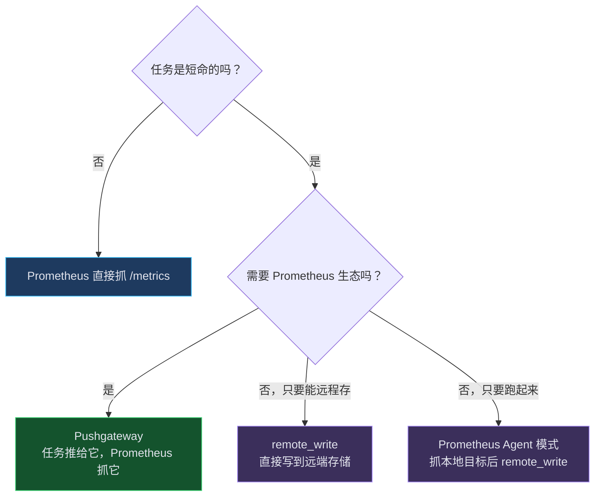
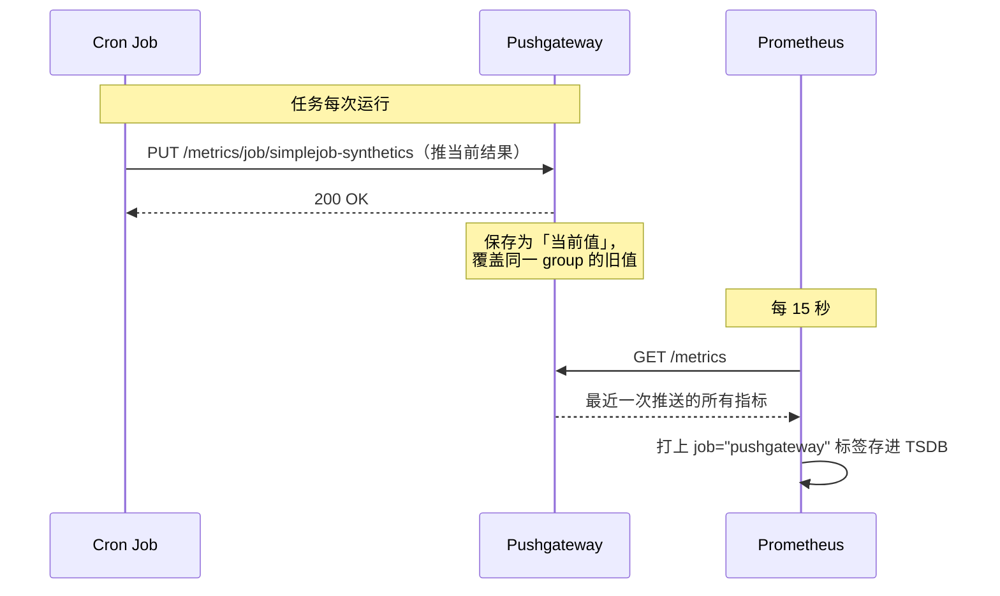

# Cron + Pushgateway 零基础入门教程

> 适用项目：**simplejob**（FastAPI + gunicorn 单 worker + PostgreSQL + Redis + 邮件机器人）
>
> 配套文档：[总览篇](./00-监控告警健康检查-总览.md)（总入口）、[指标篇](./01-Prometheus-指标监控.md)（拉取模型与抓取配置）、[告警触达篇](./04-Alertmanager-告警触达.md)（告警路由）、[看板篇](./05-Grafana-可视化看板.md)（看板）
>
> 前置知识：看得懂 shell，知道「定时任务」是什么。**不需要**运维背景。
>
> 阅读方式：第 0 章先讲清楚「为什么需要它」，第 1 章补 Cron 基础，第 2～6 章是 Pushgateway 核心，**第 7 章是合成监控实战**，第 8～9 章是替代方案，第 10 章是坑。只想要结论直接跳 [13. 一页纸速查](#13-一页纸速查)。

---

## 目录

- [0. 先讲清楚问题 为什么拉取模型会失效](#0-先讲清楚问题-为什么拉取模型会失效)
- [1. Cron 零基础](#1-cron-零基础)
- [2. Pushgateway 是什么](#2-pushgateway-是什么)
- [3. Pushgateway 数据流](#3-pushgateway-数据流)
- [4. 五分钟跑起来](#4-五分钟跑起来)
- [5. 推送 API 与语义](#5-推送-api-与语义)
- [6. Prometheus 侧怎么抓](#6-prometheus-侧怎么抓)
- [7. 合成监控实战](#7-合成监控实战)
- [8. Kubernetes CronJob](#8-kubernetes-cronjob)
- [9. 替代方案](#9-替代方案)
- [10. 六个坑](#10-六个坑)
- [11. 排障](#11-排障)
- [12. 最佳实践清单](#12-最佳实践清单)
- [13. 一页纸速查](#13-一页纸速查)

---

## 0. 先讲清楚问题 为什么拉取模型会失效

Prometheus 的核心模型是**拉取（Pull）**：它按 `scrape_interval` 去访问目标的 `/metrics`。

这对**常驻服务**完美，但对**短命任务**完全失效：

```text
Cron Job（每 5 分钟跑一次，每次 10 秒）
     │
     ├─ 00:00:00  启动，干活
     ├─ 00:00:10  结束，退出  ← 进程没了
     │
     └─ Prometheus 在 00:01:00 来抓 → 连接被拒绝 → up=0
```

**问题**：Prometheus 根本没机会在任务**活着的时候**抓到指标。

### 0.1 哪些场景属于「短命任务」

| 场景 | 例子 |
|---|---|
| **批处理 Job** | 数据清洗、报表生成、备份 |
| **定时脚本** | 证书检查、日志归档、健康巡检 |
| **合成监控** | 定时拨测自己的接口（本项目） |
| **CI 任务** | 构建、测试 |

> **判断标准**：**任务跑完就退出** → 拉取模型不适用 → 需要推送。

### 0.2 三种解法



**本项目的选择**：合成监控走 **Cron + Pushgateway**。

---

## 1. Cron 零基础

### 1.1 crontab 格式

```text
分  时  日  月  周    命令
*   *   *   *   *     command
```

| 字段 | 范围 | 特殊字符 |
|---|---|---|
| 分 | 0–59 | `*` `,` `-` `/` |
| 时 | 0–23 | 同上 |
| 日 | 1–31 | 同上 + `?` |
| 月 | 1–12 | 同上 + 英文缩写 `JAN` |
| 周 | 0–7（0 和 7 都是周日） | 同上 + 英文缩写 `SUN` |

**常用写法**：

```cron
# 每 5 分钟
*/5 * * * * /opt/simplejob/scripts/synthetics.py

# 每天凌晨 2 点
0 2 * * *   /opt/simplejob/scripts/backup.sh

# 每小时整点
0 * * * *   /opt/simplejob/scripts/cleanup.sh

# 每周三凌晨 2:00-3:00 之间的维护窗口
0 2 * * 3   /opt/simplejob/scripts/maintenance.sh

# 每月 1 号
0 3 1 * *   /opt/simplejob/scripts/monthly-report.sh

# 工作日每 10 分钟
*/10 * * * 1-5 /opt/simplejob/scripts/workday-check.sh
```

**特殊字符串**（部分 cron 实现支持）：

| 写法 | 等价 |
|---|---|
| `@reboot` | 启动时 |
| `@yearly` / `@annually` | `0 0 1 1 *` |
| `@monthly` | `0 0 1 * *` |
| `@weekly` | `0 0 * * 0` |
| `@daily` / `@midnight` | `0 0 * * *` |
| `@hourly` | `0 * * * *` |

### 1.2 编辑 crontab

```bash
crontab -e              # 编辑当前用户的
crontab -l              # 查看
crontab -r              # 删除（小心）
sudo crontab -u deploy -e   # 编辑指定用户的
```

### 1.3 生产环境的五个注意点

**① 一定要重定向输出**

```cron
# ❌ 错误：命令的 stdout/stderr 会被 cron 发到本地邮件，可能堆积
*/5 * * * * /opt/simplejob/scripts/synthetics.py

# ✅ 正确
*/5 * * * * cd /opt/simplejob && .venv/bin/python scripts/ci/synthetics.py >> logs/synthetics.log 2>&1
```

**② 环境变量不完整**

cron 的环境非常干净，`PATH` 通常只有 `/usr/bin:/bin`。

```cron
# ❌ 可能找不到 python
*/5 * * * * python scripts/ci/synthetics.py

# ✅ 用绝对路径
*/5 * * * * /opt/simplejob/.venv/bin/python /opt/simplejob/scripts/ci/synthetics.py
```

**③ 用 flock 防止任务重叠**

如果任务可能跑超过一个周期，重叠会出问题：

```cron
*/5 * * * * flock -n /tmp/synthetics.lock -c '/opt/simplejob/.venv/bin/python /opt/simplejob/scripts/ci/synthetics.py' >> logs/synthetics.log 2>&1
```

`flock -n` 表示拿不到锁就**直接退出**（不排队）。

**④ cron 不会补跑**

如果机器在计划时间关着，cron **不会**在开机后补跑（那是 `anacron` 的活）。
对合成监控来说：**开机后第一次跑尤其重要**，否则会有一段监控盲区。

**⑤ 时区**

cron 用**系统时区**。容器里要注意 `TZ`：

```dockerfile
ENV TZ=Asia/Shanghai
```

### 1.4 systemd timer 替代方案

比 cron 更现代，有日志、有依赖、能补跑：

```ini
# /etc/systemd/system/simplejob-synthetics.service
[Unit]
Description=SimpleJob 合成监控

[Service]
Type=oneshot
WorkingDirectory=/opt/simplejob
ExecStart=/opt/simplejob/.venv/bin/python scripts/ci/synthetics.py
```

```ini
# /etc/systemd/system/simplejob-synthetics.timer
[Unit]
Description=每 5 分钟跑一次合成监控

[Timer]
OnBootSec=2min          # 开机 2 分钟后先跑一次
OnUnitActiveSec=5min    # 之后每 5 分钟
AccuracySec=1min
Unit=simplejob-synthetics.service

[Install]
WantedBy=timers.target
```

```bash
systemctl enable --now simplejob-synthetics.timer
systemctl list-timers --all
journalctl -u simplejob-synthetics.service
```

> **对比**：cron 简单通用；systemd timer 有日志、有依赖、能补跑。本项目用 cron（简单），但**建议加上「监控 cron 本身」**。

---

## 2. Pushgateway 是什么

### 2.1 一句话

> **Pushgateway 是一个「指标中转站」：短命任务把指标推给它，Prometheus 从它那里拉。**

```text
短命任务 ──push──► Pushgateway ──pull──► Prometheus
 (Job)              (中转缓存)         (抓取)
```

它解决的问题：**让拉取模型也能覆盖短命任务**。

### 2.2 它**不**是什么（重要）

| 误解 | 实际 |
|---|---|
| 「它是个聚合器」 | ❌ 不做聚合，只是缓存。聚合用 recording rules / `sum()` |
| 「它支持高可用」 | ❌ **单实例**，挂了所有推送型指标就没了 |
| 「它自带认证」 | ❌ **没有任何认证**，谁都能推 |
| 「它能替代 Prometheus」 | ❌ 它不存储历史，只是当前值的缓存 |
| 「数据会永久保存」 | ⚠️ 会一直留着，直到你删（见 [第 10 章](#10-六个坑)） |
| 「适合所有场景」 | ⚠️ 官方明确说「**仅在特定场景使用**」 |

> **官方原话的中文意思**：Pushgateway 不是银弹，能用别的方式就别用它。

### 2.3 什么时候用

| 场景 | 用 Pushgateway？ |
|---|---|
| 短命批处理 Job | ✅ |
| 合成监控 / 拨测 | ✅（本项目） |
| 防火墙后面、拉不到的目标 | ✅ |
| 常驻服务 | ❌ 直接暴露 `/metrics` |
| 需要精确计数 | ❌ 用 remote_write |
| 高可用要求 | ❌ 单实例 |
| 需要多实例聚合 | ❌ 用 recording rules |

---

## 3. Pushgateway 数据流



### 3.1 三个关键语义

| 语义 | 说明 |
|---|---|
| **Group** | URL 里 `/job/<job>/<label>/<value>...` 定义的分组，是唯一单位 |
| **覆盖** | `PUT` 会**替换**整个 group；`POST` 是**合并** |
| **持久** | 值一直保留，直到被覆盖或删除 |

### 3.2 标签会发生什么

推送时：

- URL 里的 `job` → 成为标签 `job`
- 如果你在指标文本里也写了 `job="xxx"` → 会被重命名为 `exported_job`

```text
PUT /metrics/job/simplejob-synthetics
内容: simplejob_synthetic_probe_success{check="healthz"} 1

最终 Prometheus 看到:
  simplejob_synthetic_probe_success{job="simplejob-synthetics", check="healthz"} 1
```

> **`honor_labels: true`** 控制冲突时保留谁的标签，见 [第 6 章](#6-prometheus-侧怎么抓)。

---

## 4. 五分钟跑起来

### 4.1 启动 Pushgateway

```bash
docker run -d --name pushgateway \
  -p 9091:9091 \
  --restart unless-stopped \
  prom/pushgateway:v1.9.0
```

生产建议加持久化，否则重启后指标全丢：

```bash
docker run -d --name pushgateway \
  -p 9091:9091 \
  --restart unless-stopped \
  -v pg_data:/data \
  prom/pushgateway:v1.9.0 \
  --persistence.file=/data/pushgateway.metrics \
  --persistence.interval=5m
```

### 4.2 Prometheus 配置

```yaml
scrape_configs:
  - job_name: pushgateway
    honor_labels: true
    static_configs:
      - targets: ["pushgateway:9091"]
```

### 4.3 推一条测试指标

```bash
echo 'simplejob_test_metric{env="dev"} 42' | \
  curl --data-binary @- http://localhost:9091/metrics/job/test-job
```

然后去 Prometheus 查：

```promql
simplejob_test_metric
```

能看到 `job="test-job"` 和 `env="dev"`，链路就通了。

### 4.4 验证清单

```bash
# Pushgateway 自身的指标
curl -s http://localhost:9091/metrics | grep pushgateway

# 当前存了哪些指标
curl -s http://localhost:9091/api/v1/metrics | python -m json.tool
```

---

## 5. 推送 API 与语义

### 5.1 URL 格式

```text
/metrics/job/<JOB>[/<LABEL_NAME>/<LABEL_VALUE>/...]
```

例：

```text
/metrics/job/simplejob-synthetics
/metrics/job/simplejob-synthetics/env/prod
/metrics/job/backup/host/db-1/result/ok
```

### 5.2 三种操作

| 方法 | 语义 | 用在哪 |
|---|---|---|
| **`PUT`** | **替换**整个 group | 任务每次运行推最新值（**常用**） |
| **`POST`** | **合并**到 group（同名指标覆盖） | 追加指标，不清理旧的 |
| **`DELETE`** | 删除 group | 任务结束清理、或避免陈旧 |

```bash
# PUT：替换（最常用）
curl -XPUT --data-binary @metrics.txt \
  http://pushgateway:9091/metrics/job/simplejob-synthetics

# POST：追加
curl -XPOST --data-binary @metrics.txt \
  http://pushgateway:9091/metrics/job/simplejob-synthetics

# DELETE：删除整个 group
curl -XDELETE http://pushgateway:9091/metrics/job/simplejob-synthetics

# DELETE：删除 group 下的某个指标
curl -XDELETE \
  http://pushgateway:9091/metrics/job/simplejob-synthetics/check/healthz
```

### 5.3 Python 客户端

```python
from prometheus_client import CollectorRegistry, Gauge, push_to_gateway

registry = CollectorRegistry()
_success = Gauge(
    "simplejob_synthetic_probe_success",
    "合成探测成功(1)/失败(0)",
    ["check"],
    registry=registry,
)

_success.labels(check="healthz").set(1.0)
_success.labels(check="readyz").set(0.0)

# push_to_gateway 用 PUT（替换），pushadd_to_gateway 用 POST（追加）
push_to_gateway("pushgateway:9091", job="simplejob-synthetics", registry=registry)
```

| 函数 | HTTP 方法 | 语义 |
|---|---|---|
| `push_to_gateway(...)` | PUT | 替换整个 group |
| `pushadd_to_gateway(...)` | POST | 追加到 group |
| `delete_from_gateway(...)` | DELETE | 删除 group |

> **实战建议**：任务每次运行都用 `push_to_gateway`（PUT）。
> 因为它是**替换**，不会残留上次的指标——这是避免「陈旧指标」的关键。

---

## 6. Prometheus 侧怎么抓

### 6.1 `honor_labels` 的作用

Prometheus 抓取时会自动加 `job` 和 `instance` 标签。如果目标**已经有同名标签**，就冲突了：

```yaml
# honor_labels: false（默认）
# 目标自带的 job="xxx" 会被改名成 exported_job="xxx"
# Prometheus 的 job="pushgateway" 生效

# honor_labels: true
# 保留目标自带的 job="xxx"
# Prometheus 不再覆盖
```

**Pushgateway 必须配 `honor_labels: true`**，因为 group 的 `job` 标签是通过 URL 传进来的，要保留下来。

### 6.2 完整配置

```yaml
scrape_configs:
  - job_name: pushgateway
    honor_labels: true
    static_configs:
      - targets: ["pushgateway:9091"]
    # 可选：只抓特定的指标，减少压力
    # metric_relabel_configs:
    #   - source_labels: [__name__]
    #     regex: 'simplejob_.*'
    #     action: keep
```

### 6.3 抓取时间戳的坑

Pushgateway 里的指标**默认不带时间戳**，所以 Prometheus 用**抓取时刻**当样本时间。

含义：

- 任务 5 分钟前推的值，现在被抓到 → 时间戳是「现在」
- 所以**值不会变，但时间一直在走**
- 这会让「最后推送时间」变得不可见 → 需要**活人开关**（见 [7.4](#74-dead-mans-switch-让沉默可见)）

---

## 7. 合成监控实战

### 7.1 为什么用合成监控

前面所有监控都是**从服务器内部**看的。但有些故障只有外部视角能发现：

- 服务正常，但**证书过期了**
- 应用没问题，但**防火墙把 443 封了**
- 内网全通，但**公网用户连不进来**
- 域名解析挂了

**合成监控 = 从外部定时模拟真实用户访问核心链路。**

### 7.2 复用现成的 smoke.py

项目已有 `scripts/ci/smoke.py`（CI 冒烟测试），它已经在做「登录 → 拿 token → 访问受保护接口」这条链路。只要把**结果推给 Pushgateway**，就变成合成监控。

### 7.3 完整脚本

```python
#!/usr/bin/env python3
"""合成监控：从外部视角拨测核心链路，指标推 Pushgateway。"""
from __future__ import annotations

import os
import time

import httpx
from prometheus_client import CollectorRegistry, Gauge, push_to_gateway

BASE = os.environ.get("SMOKE_BASE_URL", "https://hr.example.com")
EMAIL = os.environ.get("SMOKE_SEED_EMAIL", "boss@qq.com")
PASSWORD = os.environ.get("SMOKE_SEED_PASSWORD", "111111")
GATEWAY = os.environ.get("PUSHGATEWAY_URL", "http://pushgateway:9091")

registry = CollectorRegistry()
_success = Gauge(
    "simplejob_synthetic_probe_success",
    "合成探测成功(1)/失败(0)",
    ["check"],
    registry=registry,
)
_duration = Gauge(
    "simplejob_synthetic_probe_duration_seconds",
    "合成探测耗时",
    ["check"],
    registry=registry,
)

_failed: list[str] = []


def run(check: str, fn) -> None:
    """跑一个检查项，记录成功/失败和耗时。"""
    start = time.perf_counter()
    ok = 0.0
    try:
        r = fn()
        if r.status_code < 500:
            ok = 1.0
    except Exception:  # noqa: BLE001 - 探测要兜住任何异常
        ok = 0.0
    _success.labels(check).set(ok)
    _duration.labels(check).set(time.perf_counter() - start)
    if ok == 0.0:
        _failed.append(check)


def main() -> int:
    with httpx.Client(base_url=BASE, timeout=10.0) as c:
        run("healthz", lambda: c.get("/healthz"))
        run("readyz", lambda: c.get("/readyz"))

        def login():
            r = c.post("/user/token", json={"email": EMAIL, "password": PASSWORD})
            token = r.json().get("access_token")
            c.headers["Authorization"] = f"Bearer {token}"
            return r

        run("login", login)
        run("candidate_list", lambda: c.get("/candidate/list", params={"page": 1, "size": 10}))
        run("dashboard_distribution", lambda: c.get("/candidate/candidate/distribution"))

    # PUT：替换整个 group，避免残留上一次的指标
    push_to_gateway(GATEWAY, job="simplejob-synthetics", registry=registry)

    if _failed:
        print(f"合成探测失败：{_failed}")
        return 1
    print("合成探测全部通过")
    return 0


if __name__ == "__main__":
    raise SystemExit(main())
```

### 7.4 Dead man's switch 让沉默可见

**最大的坑**：如果 Cron 没跑、机器挂了、Pushgateway 挂了，**指标就停在旧值上**——看起来「一切正常」，其实是监控哑了。

两种解法：

**方案 A：记录最后推送时间**

```python
from prometheus_client import Gauge

_last_push = Gauge("simplejob_synthetic_last_push_seconds", "最后一次推送的时间戳", registry=registry)
_last_push.set(time.time())
```

告警：

```yaml
- alert: SyntheticNeverRan
  expr: (time() - simplejob_synthetic_last_push_seconds) > 600
  for: 5m
  labels: { severity: p0 }
  annotations: { summary: "合成监控 10 分钟没推送，监控链路可能已失效" }
```

**方案 B：用 `absent()` 检测完全没数据**

```yaml
- alert: SyntheticProbeMissing
  expr: absent(simplejob_synthetic_probe_success)
  for: 10m
  labels: { severity: p0 }
  annotations: { summary: "完全没有合成探测数据" }
```

> **两个都要**：A 抓「推送变旧」，B 抓「彻底没数据」。

### 7.5 定时执行

```cron
# crontab：每 5 分钟
*/5 * * * * cd /opt/simplejob && .venv/bin/python scripts/ci/synthetics.py >> logs/synthetics.log 2>&1
```

对应告警：

```yaml
- alert: SyntheticProbeFailing
  expr: simplejob_synthetic_probe_success == 0
  for: 5m
  labels: { severity: p0 }
  annotations: { summary: "外部拨测失败：{{ $labels.check }}" }
```

### 7.6 合成监控该检查什么

| 检查项 | 价值 |
|---|---|
| `/healthz` | 进程活着 |
| `/readyz` | **依赖可用**（比 healthz 更有价值） |
| 登录 + 取 token | 鉴权链路 |
| 受保护接口 | 端到端业务链路 |
| 证书到期 | 用 `probe_ssl_earliest_cert_expiry`（Blackbox） |
| 关键页面可达 | 前端白屏检测 |

> **原则**：**检查「用户会用到什么」，不是「服务器上有什么」。**

---

## 8. Kubernetes CronJob

如果用 K8s，CronJob 比 crontab 更好：有日志、有历史、有重试策略。

```yaml
apiVersion: batch/v1
kind: CronJob
metadata:
  name: simplejob-synthetics
spec:
  schedule: "*/5 * * * *"
  concurrencyPolicy: Forbid        # 禁止重叠执行
  successfulJobsHistoryLimit: 3
  failedJobsHistoryLimit: 5
  jobTemplate:
    spec:
      backoffLimit: 1
      template:
        spec:
          restartPolicy: Never
          containers:
            - name: synthetics
              image: simplejob-app:latest
              command: ["python", "scripts/ci/synthetics.py"]
              env:
                - name: PUSHGATEWAY_URL
                  value: "http://pushgateway:9091"
                - name: SMOKE_BASE_URL
                  value: "https://hr.example.com"
```

**关键参数**：

| 参数 | 说明 |
|---|---|
| `concurrencyPolicy: Forbid` | 上一次没跑完就跳过（防重叠） |
| `startingDeadlineSeconds` | 超过这个时间就认为调度失败 |
| `restartPolicy: Never` | 失败不自动重启容器 |
| `backoffLimit` | Job 级重试次数 |

**查看执行历史**：

```bash
kubectl get cronjob simplejob-synthetics
kubectl get jobs --selector=job-name=simplejob-synthetics-xxxx
kubectl logs job/simplejob-synthetics-xxxx
```

---

## 9. 替代方案

| 方案 | 说明 | 什么时候更好 |
|---|---|---|
| **remote_write** | 任务直接写到远端存储（Thanos Receive / Mimir / VictoriaMetrics） | 高频、要精确计数 |
| **Prometheus Agent 模式** | Agent 抓本地目标后 remote_write | 不想改抓取逻辑 |
| **Grafana Alloy** | 现代 agent，支持 traces/metrics/logs | 新项目，想统一 agent |
| **VictoriaMetrics `vmagent`** | 支持 push 模式 | 大规模、高基数 |
| **Blackbox Exporter** | 专门做外部拨测（HTTP/DNS/TCP/ICMP/证书） | 只需拨测，不要业务指标 |

> **本项目选择 Pushgateway 的原因**：简单、官方组件、和现有 `prometheus_client` 无缝集成。
> 如果只是做外部拨测，**Blackbox Exporter 更专业**（还能查证书到期）。

---

## 10. 六个坑

### 坑 1 陈旧指标

任务失败后不再推送，旧值一直留在 Pushgateway 里，看起来「一切正常」。

**处置**：

- 每次用 `PUT`（替换），别用 `POST`（追加）
- 记录「最后推送时间」并告警
- 任务结束时 `DELETE` 不适用于合成监控（会丢掉现场），所以用时间戳方案

### 坑 2 无认证

Pushgateway **没有任何认证**。如果能从外网访问，任何人都能推指标（污染监控）。

**处置**：

- 只在内网 / 容器网络暴露
- 前面加反向代理做 Basic Auth 或 mTLS
- 用 NetworkPolicy 限制来源

### 坑 3 单点故障

Pushgateway 挂了 → 所有推送型指标消失。

**处置**：

- 开持久化（`--persistence.file`）
- 对「最后推送时间」做告警（坑 1 的方案）
- 重要场景改用 remote_write

### 坑 4 把 Pushgateway 当聚合器用

「多个实例都推同一个 job，Pushgateway 会不会自动加总？」

**不会。** 后推的覆盖先推的（同一个 group）。

**正确做法**：聚合交给 Prometheus 的 `sum()` 或 recording rules。

### 坑 5 `instance` 标签丢失

推送时 URL 里没写 `instance`，Prometheus 抓到的 `instance` 是 Pushgateway 的地址（`pushgateway:9091`），**不是任务的真实来源**。

**处置**：推送时在 URL 里带上 `instance`：

```text
/metrics/job/simplejob-synthetics/instance/app-1
```

### 坑 6 时间戳不可信

Prometheus 用抓取时刻当样本时间，所以「值最后一次变化的时间」是丢失的。

**处置**：额外推一个「最后推送时间戳」指标（见 [7.4](#74-dead-mans-switch-让沉默可见)）。

---

## 11. 排障

### 11.1 推了但 Prometheus 看不到

```text
1. Pushgateway 里有吗？          → curl -s http://pg:9091/metrics | grep 指标名
2. Prometheus 抓 pushgateway 吗？ → /targets 看 job="pushgateway" 是否 UP
3. honor_labels 配了吗？          → 没配的话 job 标签会被改名成 exported_job
4. 指标名/标签写对了吗？
5. metric_relabel_configs 把它过滤掉了？
```

### 11.2 值不更新

| 现象 | 原因 |
|---|---|
| 值一直不变 | 任务没在跑 / Cron 没配 |
| 值是旧的 | 任务失败后没再推 → 加「最后推送时间」告警 |
| 有两个不同的值 | 用了 `POST` 追加，残留了旧指标 |

### 11.3 合成监控本身没跑

```bash
# 看 cron 有没有执行
grep CRON /var/log/syslog
grep synthetics /var/log/cron

# 手动跑一次，看报什么错
cd /opt/simplejob && .venv/bin/python scripts/ci/synthetics.py

# 看日志
tail -100 logs/synthetics.log
```

### 11.4 常见报错

| 报错 | 原因 |
|---|---|
| `connection refused` | Pushgateway 没起 / 地址错 |
| `400 Bad Request` | 指标文本格式错误（检查 HELP/TYPE 行） |
| `could not finalize metrics` | 指标名或标签不合法 |
| 推送成功但 Prometheus 没有 | `honor_labels` / relabel 过滤 / 抓取间隔 |

---

## 12. 最佳实践清单

**Cron**

- [ ] 输出重定向到日志文件
- [ ] 用绝对路径（cron 的 PATH 很干净）
- [ ] 用 `flock -n` 防重叠
- [ ] 明确时区
- [ ] **监控 cron 本身**（最后推送时间）

**Pushgateway**

- [ ] 用 `PUT` 而非 `POST`（避免陈旧）
- [ ] URL 里带 `instance`
- [ ] Prometheus 配 `honor_labels: true`
- [ ] 只在内网暴露，加访问控制
- [ ] 开持久化

**告警**

- [ ] 有「值变旧」告警（死开关）
- [ ] 有「完全没数据」告警（`absent()`）
- [ ] 合成监控检查 `/readyz` 而不只是 `/healthz`

**设计**

- [ ] 只给短命任务用 Pushgateway
- [ ] 聚合交给 Prometheus，别指望 Pushgateway
- [ ] 常驻服务直接暴露 `/metrics`

---

## 13. 一页纸速查

### 13.1 什么时候用 Pushgateway

```text
短命任务（跑完就退出）  →  ✅ 用
常驻服务               →  ❌ 直接 /metrics
需要多实例聚合         →  ❌ 用 Prometheus sum()
需要高可用             →  ❌ 用 remote_write
```

### 13.2 crontab 速查

```cron
*/5 * * * *   每 5 分钟
0 2 * * *     每天 02:00
0 * * * *     每小时
0 3 1 * *     每月 1 号 03:00
*/10 * * * 1-5 工作日每 10 分钟
@daily        每天
```

### 13.3 推送 API

```bash
# 替换（推荐）
curl -XPUT --data-binary @m.txt http://pg:9091/metrics/job/JOB[/label/value...]

# 追加
curl -XPOST --data-binary @m.txt http://pg:9091/metrics/job/JOB

# 删除
curl -XDELETE http://pg:9091/metrics/job/JOB
```

### 13.4 Prometheus 配置

```yaml
- job_name: pushgateway
  honor_labels: true
  static_configs:
    - targets: ["pushgateway:9091"]
```

### 13.5 死开关（必配）

```python
_last_push = Gauge("simplejob_synthetic_last_push_seconds", "最后推送时间", registry=registry)
_last_push.set(time.time())
```

```yaml
- alert: SyntheticNeverRan
  expr: (time() - simplejob_synthetic_last_push_seconds) > 600
  for: 5m
  labels: { severity: p0 }
```

### 13.6 五个易错点

```text
① 用 POST 而不是 PUT        → 陈旧指标残留
② 没配 honor_labels         → job 标签被改名
③ 没监控「最后推送时间」     → 监控哑了没人知道
④ Pushgateway 暴露到公网     → 任何人都能污染指标
⑤ 拿 Pushgateway 当聚合器    → 后推的覆盖先推的
```

### 13.7 相关文档

- [总览篇](./00-监控告警健康检查-总览.md) —— 监控 / 告警 / 健康检查全景（含合成监控章节）
- [指标篇](./01-Prometheus-指标监控.md) —— 拉取模型、`honor_labels`、抓取配置
- [告警触达篇](./04-Alertmanager-告警触达.md) —— 合成探测告警怎么路由
- [看板篇](./05-Grafana-可视化看板.md) —— 合成探测指标面板
- [monitoring-alerting-healthcheck.md](../monitoring-alerting-healthcheck.md) —— 完整 `synthetics.py` / compose / 告警规则
